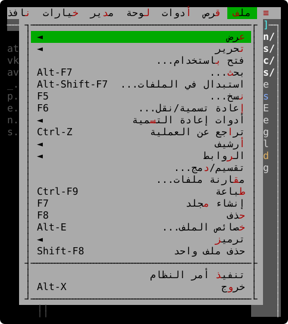

# مساعدة Navigator

Navigator إعادة بناء لمدير الملفات ذي اللوحتين DOS Navigator للطرفيات الحديثة. هذه الصفحات دليله، وهي نفسها
الملفات التي يعرضها `F1` داخل Navigator.

## البدء

في أعلى الشاشة شريط القوائم، وتحته [لوحتان](panels.md) للملفات، ثم [سطر الأوامر](console.md)، وفي السطر الأخير
شريط المفاتيح الذي يذكر عمل كل مفتاح وظيفي. وفي الطرفية التي تبلّغ عن ذلك، يُظهر الضغط المستمر على `Alt` أو
`Ctrl` أو `Shift` عمل المفاتيح مع ذلك المفتاح.

| المفتاح | ما يفعله |
|---|---|
| `Tab` | التبديل بين اللوحتين |
| `Enter` | الدخول إلى مجلد أو فتح ملف |
| `F3`, `F4` | [عرض](viewer.md) الملف أو [تحريره](editor.md) |
| `F5`, `F6` | [النسخ، أو إعادة التسمية والنقل](file-operations.md#النسخ-والنقل) |
| `F7` | إنشاء مجلد |
| `F8` | الحذف |
| `F10` | فتح القائمة |
| `Ctrl+O` | إظهار [وحدة التحكم](console.md) خلف النوافذ |
| `Alt+X` | الخروج |
| `F1` | المساعدة فيما تفعله الآن؛ انظر [حول المساعدة](help.md) |

كل أمر موجود في القوائم، ومفتاحه بجانبه. ويعثر `Alt+Shift+P` على أمر بكتابة جزء من اسمه.

## المحتويات

الملفات والمجلدات:

- [اللوحات](panels.md): التنقل، وأنماط العرض، والفرز، والتعليم، ولوحة المعلومات، والأعمدة، والمرشّح، والبحث عن
  الملفات وعن المكررات، وملفات القوائم
- [عمليات الملفات](file-operations.md): النسخ والنقل، وإعادة التسمية، والحذف، والتراجع، والسمات، والروابط، والتقسيم
  والدمج، وترميز UU، والمجاميع الاختبارية، والتشفير، وتحويل النصوص، والفتح بتطبيق آخر، والطباعة
- [الأرشيفات](archives.md): الصيغ، والفتح، والاختبار، وإنشاء أرشيف والاستخراج منه
- [المقارنة](compare.md): المجلدات، ونافذة المزامنة، وملفان
- [أشجار المجلدات](trees.md): الشجرة بجانب اللوحة، وتغيير المجلد، ونافذة الشجرة، وأحجام المجلدات
- [أماكن غير القرص](drives.md): الأرشيفات، والخوادم، والحاويات، والأقراص، وصور الأقراص، وسلة المهملات
- [العمل بصلاحيات root](as-root.md): تنفيذ ما لا تملك صلاحيته، وصلاحيات الجذر
- [الاتصالات](connections.md): مدير الروابط، وكلمات المرور، ومفاتيح المضيف، وتمرير المنافذ، والاتصالات المحفوظة
- [الإشارات المرجعية](bookmarks.md): القائمة ومفاتيحها

عرض الملفات وتغييرها:

- [العارض](viewer.md): مفاتيحه، وفتح ملف، والصفحات، وملفات PDF والصور، والبحث، وترشيح الأسطر، وشجرة البيانات،
  والجداول
- [المحرر](editor.md): مفاتيحه، وفتح ملف، والكتل، والبحث والاستبدال، والانتقال إلى سطر، والهوامش، وتلوين الصياغة
- [وحدات الماكرو](macros.md): المفاتيح المسجلة، ووحدات ماكرو المحرر

العمل مع Navigator:

- [سطر الأوامر ووحدة التحكم](console.md): تشغيل الأوامر، ونوافذ الأوامر، والسجلات
- [تشغيل Navigator](command-line.md): خيارات الأمر `nav`
- [النوافذ](windows.md): التنقل بين النوافذ، وعرضان لنص واحد، والعمليات في الخلفية، وحفظ سطح المكتب، وقائمة
  النوافذ، ولوحة الأوامر
- [مربعات الحوار](dialogs.md): مفاتيحها، واختيار ملف
- [النسخ واللصق](clipboard.md): المفاتيح، وأدوات الحافظة، وما تفعله كل طرفية بها
- [الإعدادات](settings.md): كل صفحة من خيارات > الإعدادات
- [المفاتيح والألوان](customizing.md): ربط المفاتيح، وألوان السمة
- [قائمة المستخدم وارتباطات الملفات](user-menu.md)

الأدوات:

- [الآلة الحاسبة](calculator.md): واجهاتها الأربع، والتعابير والمفاتيح
- [الأدوات](utilities.md): قائمة العمليات، والخدمات، ومراقب النظام، والبيئة، ومعلومات النظام، والتقويم، وجدول
  الأحرف، وSmartPad، وقائمة النظام
- [اللعبة](game.md): مفاتيحها، وقائمة أفضل عشرة، وإعدادها

- [حول المساعدة](help.md): المساعدة حيث أنت، ومفاتيح هذه النافذة
