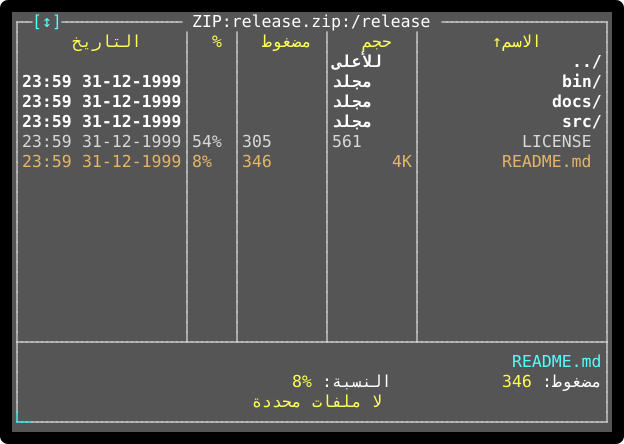
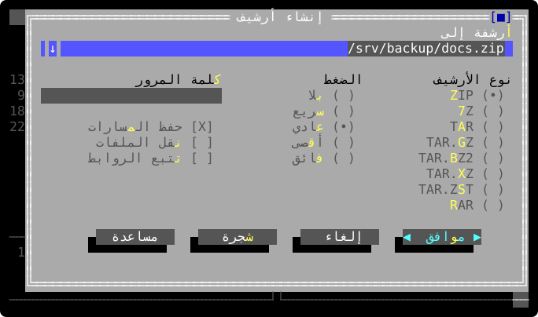
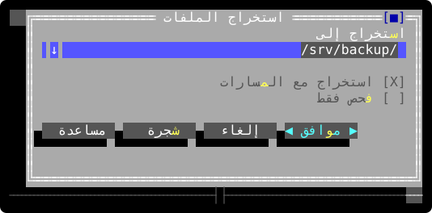

# الأرشيفات

يعرض Navigator الأرشيف كأنه مجلد: يدخل `Enter` على ملف zip أو tar إلى داخله، ويمكن عرض الملفات التي فيه ونسخها
إلى الخارج كأي ملفات أخرى. هذه الصفحة عن فتح الأرشيفات وإنشائها وفك حزمها.

## فتح أرشيف

يدخل `Enter` أو `Ctrl+PgDn` على أرشيف إلى داخله؛ ويخرج `..` في أعلاه منه. يتعرف `Enter` على الأرشيف من اسمه:
`.zip` و`.tar.gz` و`.7z` و`.deb` وما شابهها. ويفتح *ملف > أرشيف > فتح أرشيف*، أو `Ctrl+PgDn`، الملف الذي تحت
المؤشر بوصفه أرشيفا أيا كان اسمه، وبهذا تنظر داخل مكتبة ثابتة (`.a`)، أو داخل AppImage كان `Enter` سيشغّله. وإذا
أُلغي تحديد *ENTER يفتح الأرشيف* في صفحة [لوحات الملفات](settings.md#لوحات-الملفات) من الإعدادات، فلا يفعل ذلك إلا
`Ctrl+PgDn`.

في الداخل، ينسخ `F5` الملفات إلى الخارج. وحيث يمكن تغيير الصيغة، يحذف `F8` الملفات ويمكن نسخ الملفات إلى الداخل
أيضا. ويُظهر العرض المفصل حجم كل ملف المضغوط ومقدار ضغطه.

| الصيغة | ما تحتاجه | قابلة للتغيير |
|---|---|---|
| ZIP وTAR، وTAR مضغوطا بـ gzip أو bzip2 أو xz | لا شيء | نعم |
| ملف واحد مضغوط بـ gzip أو bzip2 أو xz أو lzma | لا شيء | ذلك الملف وحده فقط |
| TAR أو ملف واحد مضغوط بـ zstd | البرنامج `zstd`، قبل Python 3.14 | نعم؛ وللملف الواحد، ذلك الملف فقط |
| 7Z | 7-Zip (`7z` أو `7zz` أو `7za`) | نعم |
| RAR | `unrar`، أو `7z` أو `7zz` من 7-Zip | فقط مع `rar` من RARLAB |
| حزم Debian وRPM، وCPIO، والمكتبات الثابتة (`.a`) | لا شيء | لا |
| صور SquashFS وملفات AppImage | `unsquashfs`، من squashfs-tools | لا |

حين يكون برنامج مفقودا، يذكر `Enter` أي برنامج يجب تثبيته بدلا من تشغيل الملف. والأرشيف المحمي بكلمة مرور يطلبها.

## فحص أرشيف

يقرأ *ملف > أرشيف > فحص الأرشيف*، داخل أرشيف، الملفات المحددة كاملة ويفحص كلا منها، أو الأرشيف كله حين يكون
المؤشر على `..` ولا شيء معلّما. ويُذكر اسم الملف الذي يفشل فحصه. ويفعل *فحص فقط* في مربع
[الاستخراج](#استخراج-الملفات) الشيء نفسه من الخارج.

## إنشاء أرشيف

يحزم `Shift+F1`، أو *ملف > أرشيف > إنشاء أرشيف*، التحديد في أرشيف جديد.

- *أرشفة إلى* هو اسم الأرشيف. يُفتح السطر على مجلد اللوحة الأخرى؛ والاسم الذي بلا مجلد ينشئ الأرشيف في المجلد
  الحالي. ويختار *شجرة* المجلد من شجرة. وإن كان الأرشيف موجودا، تُسأل أتضيف إليه أم تستبدله.
- يختار *نوع الأرشيف* الصيغة. تتبع نهاية الاسم النوع، وكتابة نهاية تختار النوع. والنوع الذي يحتاج برنامجا غير
  مثبت عندك يكون رماديا، ويذكر السطر الذي فوق الأزرار أي برنامج.
- يقايض *الضغط* الوقت بالحجم، من *بلا* إلى *فائق*. والمستويات التي لا تملكها الصيغة رمادية؛ وTAR العادي لا مستويات له.
- تشفّر *كلمة المرور* الأرشيف. وهي متاحة لـ ZIP و7Z حين يكون 7-Zip مثبتا، ولـ RAR. وتُطلب منك كتابتها مرة ثانية.

الخيارات:

- يحفظ *حفظ المسارات* مجلدات كل ملف داخل الأرشيف، لا اسمه وحده.
- يحذف *نقل الملفات* الملفات بعد أن تصبح في الأرشيف.
- يحزم *تتبع الروابط* ما يشير إليه الرابط، لا الرابط نفسه.

## استخراج الملفات

يفك `Shift+F2` على أرشيف، أو *ملف > أرشيف > استخراج أرشيف*، حزمه في المجلد الذي تسميه. وداخل أرشيف، يفك
*استخراج إلى* حزم التحديد.

- ينشئ *استخراج مع المسارات* مجلدات الأرشيف. ومن دونه يذهب كل ملف مباشرة إلى المجلد الهدف.
- يفحص *فحص فقط* الأرشيف بحثا عن أخطاء ولا يكتب شيئا.

ويختار *شجرة* المجلد الهدف من شجرة.
