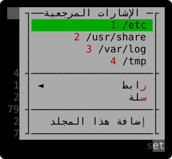

# الإشارات المرجعية

الإشارات المرجعية مجلدات تذهب إليها كثيرا. يفتح `Alt+F1` القائمة للوحة اليسرى، و`Alt+F2` لليمنى، و`Alt+C` للوحة
النشطة؛ وهي أيضا *الإشارات يسارا* و*الإشارات يمينا* في القائمة *مدير*.

## القائمة

لكل إشارة مرجعية مفتاح، من `1` إلى `9`، ثم `0`، ثم الحروف: اضغطه، أو انتقل إلى الإشارة واضغط `Enter`، فتنتقل
اللوحة إلى هناك. الإشارة التي ليس مجلدها موجودا الآن تظهر باهتة.

| المفتاح | ما يفعله |
|---|---|
| `Enter`، أو مفتاح الإشارة | الذهاب إلى المجلد |
| `F2` | إعطاء الإشارة تسمية تُعرض بدلا من مسارها. التسمية الفارغة تزيلها |
| `Ctrl+Up`، `Ctrl+Down` | تحريك الإشارة إلى أعلى القائمة أو أسفلها |
| `Del` | حذف الإشارة |
| `Esc` | إغلاق القائمة |

آخر مدخل هو *إضافة هذا المجلد*، الذي يضيف مجلد اللوحة إلى الإشارات، أو *إزالة هذا المجلد* حين يكون مضافا من قبل.

تحت خط فاصل تأتي الأقراص الموصولة الآن وليست إشارات مرجعية، مثل ذاكرة USB. هي أماكن للذهاب إليها، ولا تُحفظ.
وفي القائمة أيضا قسم *اتصالات* فيه [اتصالاتك المحفوظة](connections.md).

يسأل الحذف أولا. يوقف السؤالَ *عدم السؤال مجددا* في السؤال نفسه، أو *حذف الإشارة المرجعية* في صفحة
[التأكيدات](settings.md#التأكيدات).

## دون القائمة

ترسل `Alt+1` إلى `Alt+9` اللوحة النشطة مباشرة إلى الإشارات التسع الأولى. وتضيف `Alt+Shift+1` إلى `Alt+Shift+9`
مجلد اللوحة إشارةً في ذلك الموضع.

## الإشارات الأولى

في أول تشغيل يضيف Navigator إلى الإشارات مجلدك المنزلي، ومجلدات سطح المكتب الموجودة مثل المستندات والتنزيلات،
والمجلدات التي توصل فيها الأقراص. بعد ذلك تصبح القائمة لك: الإشارات التي تحذفها لا تعود.
