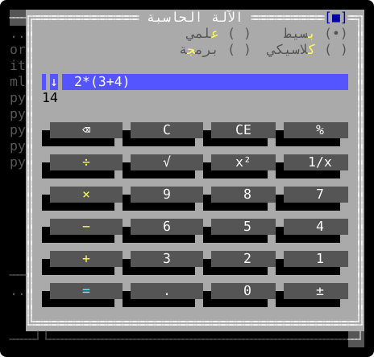
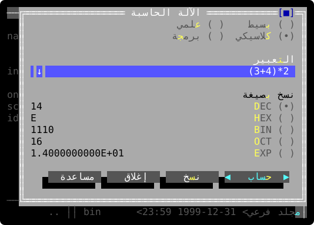
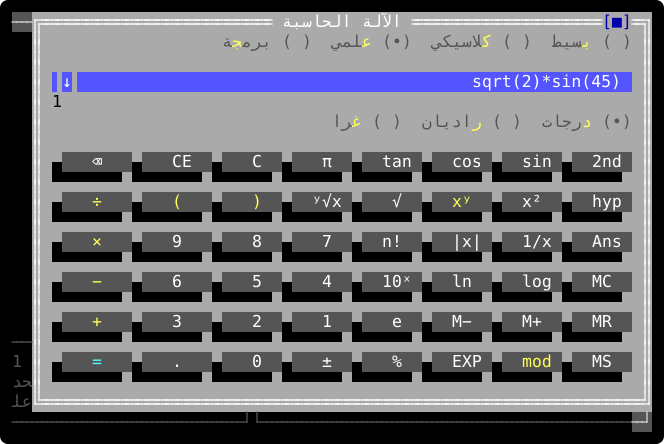
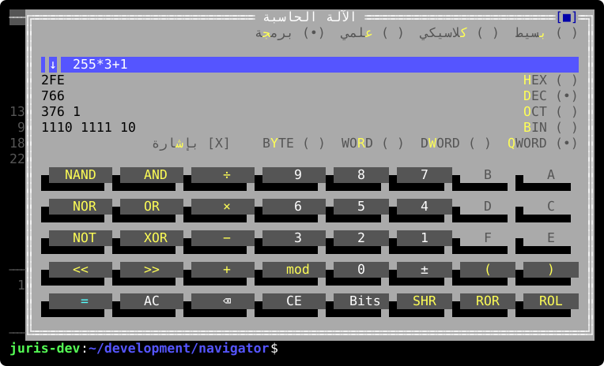

# الآلة الحاسبة

يفتح `Ctrl+F6`، أو *أدوات > الحاسبة*، الآلة الحاسبة. تكتب تعبيرا في السطر، وتُحسب قيمته أثناء الكتابة. ويحسبه
`Enter`: يذهب التعبير إلى سجل السطر وتبقى القيمة محددة، فيبدأ الرقم حسابا جديدا ويتابع العامل من القيمة.

## الواجهات الأربع

للآلة الحاسبة أربع واجهات، تُختار من الشريط الذي على طول أعلاها، أو من قائمة *الحاسبة*، أو بالضغط على
`Ctrl+F6` ثانية للانتقال إلى التالية. وهي تتذكر آخر واجهة استعملتها.

- *بسيط* آلة حاسبة جيب: أرقام والعمليات الأربع.
- *كلاسيكي* يُظهر القيمة بخمس صيغ معا: عشرية، وست عشرية، وثنائية، وثمانية، وبالترميز العلمي.
- *علمي* يضيف دوالا، واختيارا لوحدة الزاوية، وذاكرة، وآخر جواب.
- *برمجة* يعمل بأعداد صحيحة بحجم مختار، في أربعة أنظمة عددية.

في *بسيط* و*علمي* و*برمجة* تكتب لوحة مفاتيح تحت السطر فيه، كما تفعل لوحة المفاتيح. ويحيط مفتاح الدالة بالعدد الذي
قبل المؤشر: `9` ثم `√` يعطي `SQRT(9)`.

## التعابير

| ما تكتبه | ما هو |
|---|---|
| `12`, `1.5`, `.5`, `1E+3` | أعداد |
| `$FF`, `0FFh`, `0x1F` | أعداد ست عشرية |
| `101b`, `0b101` | أعداد ثنائية |
| `17o` | عدد ثماني |
| `+`, `-`, `*`, `/` | العمليات الأربع |
| `^` | أس: `2^10` |
| `%` | باقي قسمة عددين صحيحين |
| `&`, `\|`, `\`, `~` | العمليات البتية AND وOR وXOR وNOT |
| `<<`, `>>` | الإزاحات |
| `=`, `<>`, `<`, `>`, `<=`, `>=` | المقارنات، وتعطي 1 أو 0 |
| `&&`, `\|\|` | AND وOR لقيمتين منطقيتين |
| `(`, `)` | الأقواس |
| `PI` | العدد π |

الأحرف الكبيرة والصغيرة سواء. يأتي الضرب والقسمة قبل الجمع والطرح، والأس قبلها جميعا.

الدوال هي `SIN` و`COS` و`TAN` و`CTAN` و`ARCTAN` و`SQR` (المربع) و`SQRT` (الجذر التربيعي) و`LN` و`LG` (اللوغاريتم
للأساس عشرة) و`EXP` و`SIGN`، و`IF(condition, a, b)`، وقيمتها `a` حين يكون الشرط صحيحا و`b` في غير ذلك.

## الكلاسيكي

تُظهر الأسطر الخمسة القيمة بكل صيغة؛ والعدد غير الصحيح يُظهر جزءه الصحيح بالست عشرية والثنائية والثمانية.

- يحسب *حساب* التعبير، كما يفعل `Enter`.
- يختار *نسخ بصيغة* الصيغة، ويضع *نسخ* القيمة في الحافظة بتلك الصيغة.
- يغلق *إغلاق* الآلة الحاسبة.

## العلمي

- تختار *درجات* و*راديان* و*غراد* الوحدة التي تأخذها الدوال المثلثية وتعطيها.
- دوال أخرى: `ASIN` و`ACOS` و`ATAN` و`SINH` و`COSH` و`TANH` و`ABS` و`CBRT` و`ROOT(x, n)` و`LOG` و`LOG2`
  و`FACT`، و`!` بعد عدد لمضروبه. و`E` هو العدد e.
- `ANS`، أو المفتاح *Ans*، آخر قيمة حُسبت.
- مفاتيح الذاكرة: *MS* يخزن القيمة، و*MR* يستدعيها، و*M+* و*M−* يضيفان إليها ويطرحان منها، و*MC* يمسحها.
- يغيّر *2nd* و*hyp* ما تكتبه مفاتيح الدوال: الدوال العكسية، والدوال الزائدية.

## البرمجة

- تختار *HEX* و*DEC* و*OCT* و*BIN* النظام الذي تكتب به الأعداد. وتُعرض القيمة في الأربعة كلها.
- تختار *QWORD* و*DWORD* و*WORD* و*BYTE* حجم العدد: 64 أو 32 أو 16 أو 8 بتات. والنتيجة التي لا تتسع تُقص إلى ذلك
  الحجم.
- يقرأ *بإشارة* العدد على أنه ذو إشارة. وإن أُلغي تحديده، لا يكون سالبا أبدا.
- القسمة تعطي عددا صحيحا.
- يمكن أيضا كتابة العمليات كلمات: `AND` و`OR` و`XOR` و`NAND` و`NOR` و`NOT` و`MOD` و`SHL` و`SHR` و`SAR` و`ROL`
  و`ROR`.
- يُظهر *لوحة البتات*، في قائمة *الحاسبة*، البتات الأربعة والستين مكان المفاتيح. والنقر أو `Space` يقلب بتا.

## المفاتيح

| المفتاح | ما يفعله |
|---|---|
| `Enter` | الحساب |
| `Ctrl+F6` | الواجهة التالية |
| `Ctrl+1` إلى `Ctrl+4` | بسيط، كلاسيكي، علمي، برمجة، حيث ترسل الطرفية هذه المفاتيح |
| `Down` في السطر | سجل التعابير |
| `Esc` | إغلاق الآلة الحاسبة |
