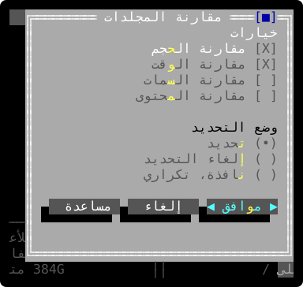
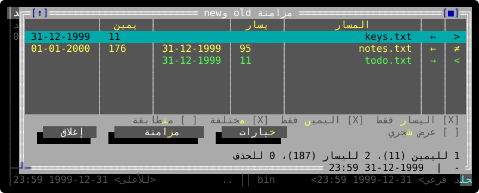
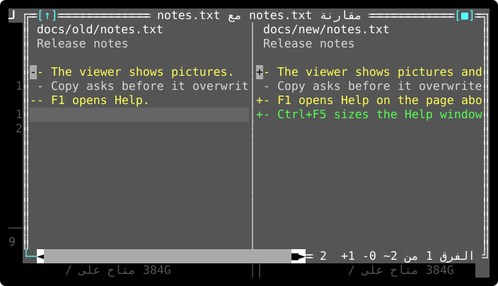

# المقارنة

## مقارنة المجلدات

يقارن *لوحة > مقارنة المجلدات* ملفات اللوحتين بأسمائها.

- تحدد *مقارنة الحجم* و*مقارنة الوقت* و*مقارنة السمات* و*مقارنة المحتوى* ما يجعل ملفين بالاسم نفسه يُعدّان
  متطابقين. ولا يقرأ الملفات إلا *مقارنة المحتوى*، وهو أبطأ.
- يعلّم *تحديد*، في كل لوحة، الملفات التي ليس لها نظير في الأخرى. ونسخ الملفات المعلّمة إلى الجهة الأخرى يجعل
  المجلد الآخر محدّثا.
- يزيل *إلغاء التحديد* العلامات عن تلك الملفات بدلا من ذلك.
- يقارن *نافذة، تكراري* المجلدين مع كل ما فيهما، ويفتح نافذة المزامنة.

## المزامنة

تسرد نافذة المزامنة كل ملف موجود في جهة واحدة فقط أو مختلف، ومجلد اللوحة اليسرى على اليسار. لكل صف إجراء: النسخ
إلى اليمين، أو النسخ إلى اليسار، أو الحذف، أو التخطي. تقترح النافذة إجراء، وتغيّره قائمة *مزامنة* للصف الذي تحت
المؤشر أو لكل الصفوف دفعة واحدة.

- *مزامنة*، `F5`، ينفذ الإجراءات بعد السؤال.
- *مقارنة الملفات*، `Enter` أو `F3`، يعرض ملفي الصف جنبا إلى جنب.
- *مقارنة مجددا*، `Ctrl+R`، يقرأ المجلدين من جديد.
- تحدد *إظهار اليسار فقط* و*إظهار اليمين فقط* و*إظهار المختلفة* و*إظهار المتطابقة* الصفوف المسرودة.
- *عرض شجري*، `Ctrl+T`، يسرد الصفوف على شكل شجرة مجلدات.
- يضبط *خيارات* طريقة مقارنة الملفات، و[قناع ملفات](panels.md#أقنعة-الملفات) لما يُنظر فيه من ملفات.

### الخيارات

يضبط *خيارات* في نافذة المزامنة ما يُقارن وكيف. ويقارن *موافق* المجلدين من جديد.

- يختار *قناع الملفات* الملفات التي يُنظر فيها؛ والقناع الفارغ يقارن كل شيء. تُفصل الأنماط بـ `;`. والعلامة `-`
  قبل نمط تستبعد ملفاته، والعلامة `/` بعده تعني المجلدات: `*.py;-.git/`.
- يحدد *تُعد الأوقات متطابقة* مدى التقارب المطلوب بين وقتين: *بالضبط، حتى الثانية*، أو *في حدود 2 ثانية (FAT)*،
  أو *في حدود دقيقة (FTP)*.
- يعدّ *أو بفارق ساعة تماما* أيضا الوقتين اللذين بينهما ساعة واحدة متطابقين، وهذا ما يفعله تغيير التوقيت الصيفي
  بقرص FAT.
- يقترح *غير متماثل: يصبح اليمين نسخة من اليسار* حذف ما لا يوجد إلا في الجهة اليمنى، ونسخ كل ملف مختلف إلى
  اليمين، أيا كان الأحدث.

## مقارنة الملفات

يعرض *ملف > مقارنة الملفات* ملفين جنبا إلى جنب مع تمييز الفروق بينهما. يأخذ الملفين المعلّمين في اللوحة النشطة.
وإن لم يُعلَّم شيء أخذ الملف الذي تحت المؤشر والملف ذا الاسم نفسه في اللوحة الأخرى، أو، إن لم يوجد ملف بهذا الاسم،
الملف الذي تحت مؤشر اللوحة الأخرى.

