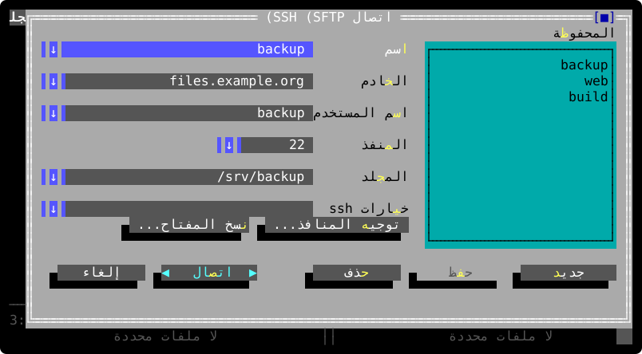
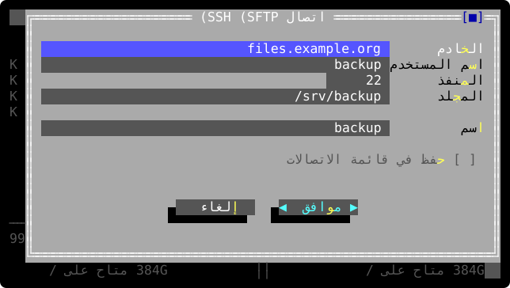
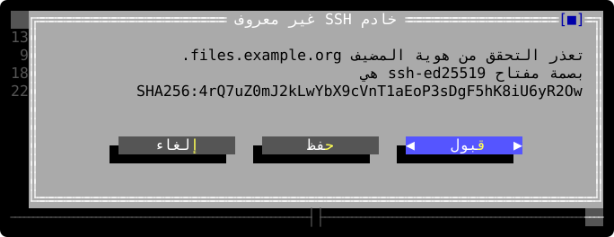
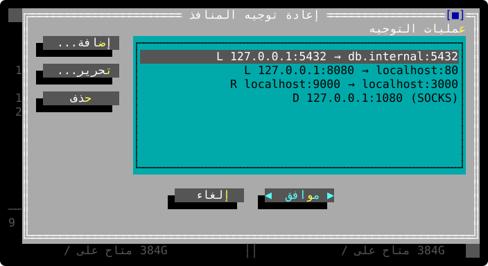
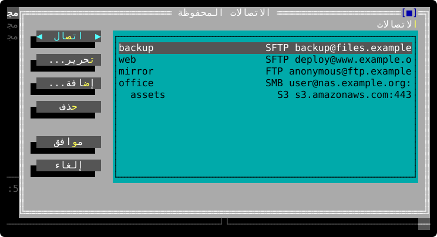

# الاتصالات

كيف توضع لوحة على خادم، وكيف تُحفظ الاتصالات التي تستعملها. أما ماهية كل نوع من الأماكن، والطرق الأخرى للوصول
إليه، ففي [أماكن غير القرص](drives.md).

## مدير الروابط

يفتح كل بند من *أدوات > اتصالات*، مثل *SSH (SFTP)* (`Alt+F11`)، الاتصالات المحفوظة لذلك البروتوكول على اليسار،
وأسطر اتصال واحد على اليمين.

- يُفتح المربع والأسطر فارغة. املأها واضغط *اتصال* لاتصال لا يُحفظ.
- اختر اتصالا تحت *المحفوظة* لتضعه في الأسطر. والنقر المزدوج يتصل به.
- ينشئ *جديد* اتصالا محفوظا، باسم يمكنك الكتابة فوقه. ويحفظ *حفظ* ما غيّرته؛ ويُعلَّم الاتصال المعدل بـ `*`، وتركه
  يسأل هل تحفظه. ويزيل *حذف* الاتصال.
- يرسل *اتصال* اللوحة النشطة إلى هناك. ومن *أدوات > صدفة بعيدة* يفتح بدلا من ذلك صدفة في نافذة.

الأسطر هي أسطر [الاتصال](#اتصال). ويتذكر كل منها ما كان فيه من قبل؛ ويفتح `Down` على سطر سجله.

ولمدير SSH ثلاثة أخرى:

- تُمرر *خيارات ssh* إلى `ssh` عند فتح صدفة بعيدة.
- يضبط *توجيه المنافذ* [عمليات توجيه المنافذ](#توجيه-المنافذ) للاتصال.
- يضع *نسخ المفتاح* أحد مفاتيحك العامة على الخادم، فلا تحتاج الاتصالات اللاحقة إلى كلمة مرور.

ويشغّل *تكوين* في مدير rclone الأمر `rclone config` لإعداد المستودعات البعيدة.

## اتصال

| السطر | ما هو |
|---|---|
| *الخادم* | اسم الخادم أو عنوانه. ولـ SSH يصلح اسم `Host` من `~/.ssh/config`، وما يقوله الملف يملأ اسم المستخدم والمنفذ إن تُركا فارغين |
| *اسم المستخدم* | المستخدم الذي يُتصل باسمه |
| *المنفذ* | المنفذ، حين لا يكون المنفذ المعتاد للبروتوكول |
| *المجلد* | حيث تبدأ اللوحة على الخادم |
| *اسم* | الاسم الذي يُحفظ الاتصال تحته |

تختلف الأسطر قليلا بين البروتوكولات: لاتصال FTP *تشفير بـ TLS*، الذي يجعله FTPS، وليس لمكان GVfs/KIO إلا *اسم*
و*عنوان URI*.

يحفظ *حفظ في قائمة الاتصالات* الاتصال تحت اسمه، لتتصل به ثانية بخطوة واحدة.

## كلمات المرور وعبارات المرور

تُطلب كلمة مرور الخادم، أو عبارة مرور المفتاح الخاص، حين يحتاجها الاتصال. ويتذكرها *حفظ في حلقة المفاتيح* في حلقة
مفاتيح سطح المكتب، فلا تُطلب ثانية. ولا يظهر إلا حيث توجد حلقة مفاتيح تحفظها.

## مفتاح مضيف غير معروف

في أول اتصال بخادم SSH، لا يكون مفتاح مضيفه في `~/.ssh/known_hosts`، فتُسأل هل تتابع، كما يسأل `ssh`.

- يثق *قبول* بالمفتاح لهذا الاتصال فقط.
- ويكتبه *حفظ* أيضا في `~/.ssh/known_hosts`، فلا تُسأل ثانية.
- ولا يتصل *إلغاء*.

قارن البصمة المعروضة ببصمة حصلت عليها من مدير الخادم قبل القبول.

## توجيه المنافذ

يسرد *توجيه المنافذ* في مدير SSH عمليات توجيه المنافذ لاتصال. وتغيّر *إضافة* و*تحرير* و*حذف* القائمة، التي تُحفظ
مع الاتصال حين تحفظه.

| النوع | ما يفعله |
|---|---|
| *محلي (-L)* | منفذ على هذا الجهاز يقود إلى الوجهة، التي يُوصل إليها من الخادم |
| *بعيد (-R)* | منفذ على الخادم يقود إلى الوجهة، التي يُوصل إليها من هذا الجهاز |
| *ديناميكي، SOCKS (-D)* | منفذ على هذا الجهاز هو وكيل SOCKS عبر الخادم |

*عنوان الاستماع* و*منفذ الاستماع* هما الطرف الذي ينتظر الاتصالات، و*خادم الوجهة* و*منفذ الوجهة* حيث تُرسل. وليس
للتوجيه الديناميكي وجهة.

## الاتصالات المحفوظة

يسرد *أدوات > الاتصالات المحفوظة* الاتصالات المحفوظة لكل البروتوكولات في مربع واحد. يفتح *اتصال* الاتصال الذي تحت
المؤشر، ويغيّره *تحرير*، وينشئ *إضافة* اتصالا جديدا، ويزيله *حذف*. وتُحفظ التغييرات حين تخرج بـ *موافق*.

ويغلق *أدوات > قطع الاتصال*، `Alt+H`، اتصالا؛ وتعود اللوحة التي كانت تعرضه إلى القرص.
