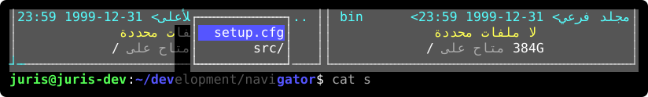
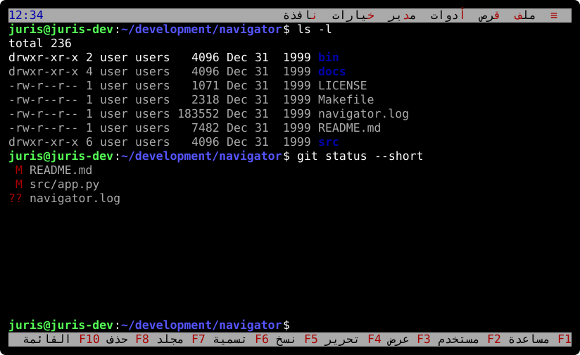
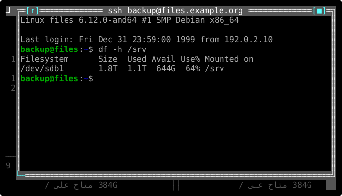
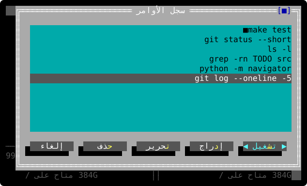

# سطر الأوامر ووحدة التحكم

تحت اللوحات سطر أوامر، وخلف النوافذ وحدة تحكم: طرفية تعمل فيها صدفتك.

## سطر الأوامر

كل ما تكتبه واللوحة تتلقى لوحة المفاتيح يذهب إلى سطر الأوامر. يشغّله `Enter` في الصدفة، في مجلد اللوحة النشطة،
ويظهر الخرج في وحدة التحكم.

| المفتاح | ما يفعله |
|---|---|
| `Enter` | تشغيل الأمر |
| `Ctrl+Enter` | وضع اسم الملف الذي تحت المؤشر في السطر |
| `Ctrl+E`, `Ctrl+X` | استدعاء الأمر السابق والتالي |
| `Tab` | إكمال الكلمة الجاري كتابتها، حين يكون في السطر نص |
| `Esc` | مسح السطر |

وما دام في السطر نص، تحرره `Left` و`Right` و`Home` و`End`. ويشغّل `Enter` على برنامج في لوحة ذلك البرنامج.

بعد أي أمر تعيد اللوحات قراءة مجلداتها، وتتبع اللوحة النشطة الصدفة إن غيّر الأمر المجلد.

## وحدة التحكم

يخفي `Ctrl+O` النوافذ ويُظهر وحدة التحكم؛ ويعيدها `Ctrl+O` ثانية. وما دامت النوافذ مخفية تذهب المفاتيح إلى الصدفة،
أو إلى البرنامج الذي يعمل فيها.

يمرر `Shift+PgUp` و`Shift+PgDn` إلى الوراء فيما عرضته وحدة التحكم، ويمرر `Shift+Up` و`Shift+Down` سطرا سطرا.

وأثناء عمل برنامج في وحدة التحكم يتلقى كل مفتاح، بما فيها `F1` و`F10`؛ فاخرج من البرنامج بطريقته أولا.

## أمر في نافذة

يمكن أن يعمل الأمر في نافذة خاصة به، بجانب اللوحات، بدلا من وحدة التحكم. ابدأ سطر الأوامر بـ `&`، أو اضغط
`Shift+Enter` بدلا من `Enter`.

يتلقى البرنامج في النافذة كل مفتاح إلا المفاتيح التي تحضر نافذة أخرى إلى الأمام. وحين ينتهي تحتفظ النافذة بخرجه
ويذكر عنوانها كيف انتهى؛ ويغلقها `Esc` أو `Enter`. وإغلاق النافذة والبرنامج يعمل ينهي البرنامج.

يفتح *أدوات > صدفة بعيدة* صدفة على خادم أو في حاوية أو على جهاز في نافذة كهذه.

## تنفيذ أمر

يطلب *ملف > تنفيذ أمر النظام* أمرا في سطر يتشارك سجل سطر الأوامر.

- يشغّله *في نافذة* في نافذة خاصة به، لا في وحدة التحكم.
- يفتح *مكبرة* تلك النافذة على سطح المكتب كله.
- يُبقي *مشروطة* لوحة المفاتيح في تلك النافذة إلى أن تُغلق.

## سجل الأوامر

يسرد `Alt+F8`، أو *أدوات > سجل الأوامر*، الأوامر التي كتبتها، والأحدث في الآخر.

- يشغّل *تشغيل*، أو `Enter`، الأمر الذي تحت المؤشر.
- يضعه *إدراج* في سطر الأوامر دون تشغيله.
- يغيّره *تحرير* في مربع؛ ويصبح الأمر المعدل هو الأحدث.
- يزيله *حذف*، أو `Del`، من السجل.

ويبحث *أدوات > بحث تقريبي في السجل*، `Alt+Shift+F8`، في الأوامر المكتوبة هنا وفي الصدفة باستعمال `fzf`.

## سجلات الملفات

يسرد `Alt+PgDn` الملفات المعروضة سابقا و`Alt+PgUp` الملفات المحررة سابقا؛ وهما *سجل عرض الملفات* و*سجل تحرير
الملفات* في قائمة *أدوات*. يفتح *فتح* الملف الذي تحت المؤشر من جديد، ويزيله *حذف السجل* من القائمة.
