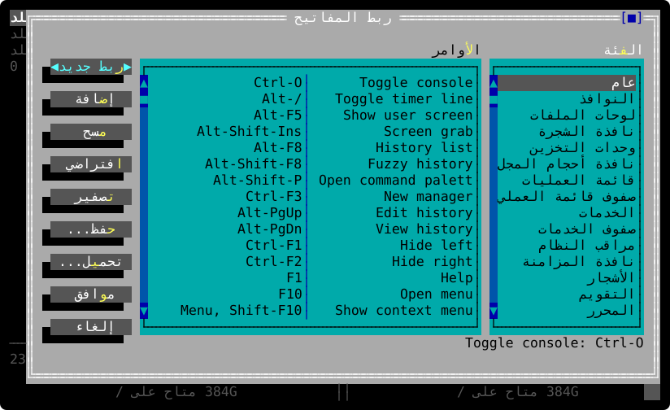
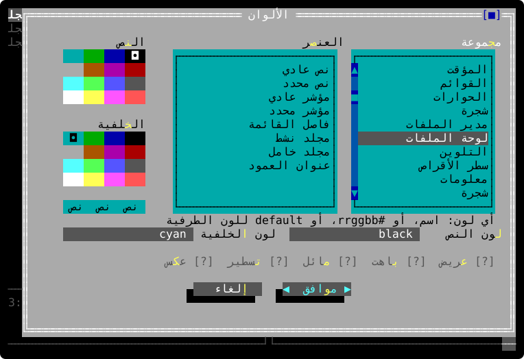

# المفاتيح والألوان

## ربط المفاتيح

يغيّر *خيارات > تهيئة > ربط المفاتيح* ما يفعله كل مفتاح. تُعرض المفاتيح في أقسام، قسم لكل مكان تعمل فيه: في كل
مكان، ومدير الملفات، والمحرر، والعارض، ومربعات الحوار وغيرها.

اختر أمرا واضغط المفتاح الذي تريده له.

يكتب *حفظ* المجموعة كلها في ملف، ويقرأ *تحميل* مجموعة من ملف. يأتي Navigator بأربع مجموعات: مجموعته الافتراضية،
ومجموعات على نمط WordStar وDOS Navigator 1.51 وEmacs.

تُحفظ الروابط في `keybindings.ini` في مجلد التهيئة. أما المفاتيح التي تحرّك المؤشر في القوائم وفي النص فثابتة.

## الألوان

يغيّر *خيارات > الألوان* ألوان السمة المستخدمة.

- يختار *مجموعة* و*العنصر* ما يُلوَّن.
- يختار *لون النص* و*لون الخلفية* من الألوان الستة عشر؛ ويقبل السطران بجانبهما أي لون، باسمه أو بالصيغة
  `#rrggbb`.
- تضبط المربعات الخمسة الخط العريض والباهت والمائل والتسطير والعكس. المربع الذي يعرض `?` يترك السمة كما يرثها
  العنصر.

تتبع الشاشة تغييراتك أولا بأول. يحفظ *موافق* التغييرات لهذه السمة؛ ويعيد *إلغاء* كل شيء كما كان.

يحفظ *خزن اللوحة* الألوان سمةً خاصة بك، يجدها بعد ذلك `--theme` و*جلب اللوحة*. ويأخذ *جلب اللوحة* ألوان سمة
أخرى.

لاستخدام سمة أخرى، شغّل Navigator بالخيار `--theme NAME`؛ ويسرد `--list-themes` أسماءها.
