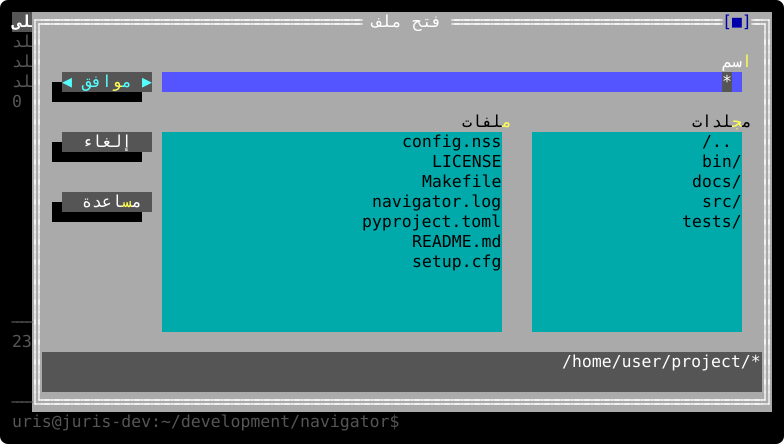

# مربعات الحوار

يستحوذ مربع الحوار على لوحة المفاتيح إلى أن تغلقه.

## المفاتيح في مربع الحوار

| المفتاح | ما يفعله |
|---|---|
| `Tab`، `Shift+Tab` | الانتقال إلى عنصر التحكم التالي أو السابق |
| `Alt` وحرف مميَّز | الانتقال إلى عنصر التحكم الذي يحمل ذلك الحرف |
| `Enter` | ضغط الزر الافتراضي، المعلَّم بالأسهم |
| `Esc` | إغلاق المربع دون فعل شيء |
| `Space` | تعليم مربع اختيار، أو اختيار زر راديو |
| `Down` على سطر بجانبه `↓` | فتح سجل السطر |
| `F1` | عرض التعليمات الخاصة بهذا المربع |

في قائمة السجل، يأخذ `Enter` مدخلا ويحذفه `Del` من السجل.

## اختيار ملف

تطلب عدة أوامر ملفا بالمربع نفسه: الاسم على سطر، وتحته ملفات المكان المعروض ومجلداته.

- *اسم* هو اسم الملف. يمكنك كتابة مسار كامل. الاسم الذي فيه `*` أو `?`، أو اسم مجلد، يسرد تلك الملفات بدلا من
  اختيار واحد منها.
- يسرد *ملفات* الملفات المطابقة. كتابة حروف هناك تجد اسما يبدأ بها.
- يسرد *مجلدات* المجلدات؛ و`Enter` على أحدها يدخل إليه.
- تعرض اللوحة السفلية المسار، وحجم الملف الذي تحت المؤشر وتاريخه.
- يختاره *موافق*، أو `Enter` على ملف.

ينقل `Left` و`Right` بين القائمتين والأزرار.
