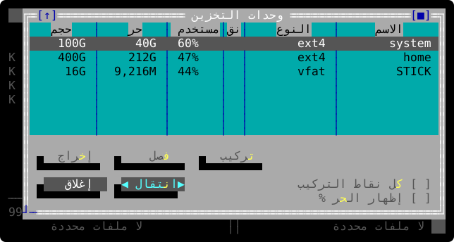
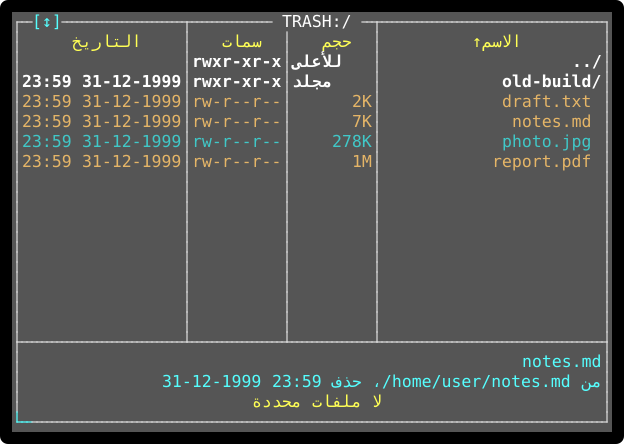

# أماكن غير القرص

يمكن للوحة أن تعرض أكثر من مجلدات قرصك. وأينما كانت، تُعرض الملفات وتُحرر وتُنسخ وتُحذف بالطريقة نفسها.

## الأرشيفات

يدخل `Enter` على أرشيف، كملف zip أو tar، إلى داخله كأنه مجلد. انسخ الملفات منه أو إليه بـ `F5`. ويشرح
[الأرشيفات](archives.md) الإنشاء والاستخراج.

## الخوادم والحاويات والأجهزة

يفتح *أدوات > اتصالات* لوحة على جهاز أو خدمة أخرى. يحتفظ كل بند بقائمة الاتصالات التي أجريتها، لتتصل بها ثانية؛
ويصف [الاتصالات](connections.md) مربعه.

| البند | ما يصل إليه |
|---|---|
| *SSH (SFTP)*, `Alt+F11` | خادم عبر SSH |
| *FTP* | خادم FTP أو FTPS |
| *SMB* | مشاركة Windows |
| *S3* | حاوية في S3 أو في خدمة متوافقة |
| *حاوية Docker*, *حاوية Podman* | الملفات داخل حاوية قيد التشغيل |
| *جهاز Android* | هاتف أو جهاز لوحي، عبر `adb` |
| *مستودع rclone* | أي مستودع بعيد مُعد في `rclone`، مثل Google Drive أو Dropbox |
| *رابط GVfs/KIO* | كل ما يستطيع سطح المكتب الوصول إليه، مثل هاتف عبر MTP أو خادم WebDAV |

يكون البند رماديا حين لا يكون البرنامج الذي يحتاجه مثبتا؛ ويذكر تلميحه اسم البرنامج.

ويمكنك أيضا كتابة عنوان حيث يُطلب مجلد، مثل `sftp://user@host/dir` أو `smb://host/share`.

يفتح *أدوات > صدفة بعيدة* صدفة على الخادم أو في الحاوية أو على الجهاز. ويغلق *أدوات > قطع الاتصال*، `Alt+H`،
اتصالا؛ وتعود اللوحة التي كانت تعرضه إلى القرص.

## وحدات التخزين

يسرد *قرص > وحدات التخزين* الأقراص والوسائط القابلة للإزالة، ويركّبها ويلغي تركيبها ويخرجها.

### صور الأقراص

يركّب `Enter` على صورة قرص، أي ملف `.iso` أو `.img`، أو *قرص > تركيب صورة* والمؤشر عليها، الصورةَ للقراءة فقط
ويفتحها في اللوحة. ويلغي *قرص > إلغاء تركيب الصورة*، داخل الصورة أو عليها، تركيبها ويعيد اللوحات التي كانت
داخلها إلى ملف الصورة. يحتاج هذا إلى udisks2، الذي تشغّله أغلب بيئات سطح المكتب؛ ويعطّل *ENTER يركّب صور الأقراص*
في صفحة [لوحات الملفات](settings.md#لوحات-الملفات) من الإعدادات دور `Enter` في ذلك.

## سلة المهملات

ينقل `F8` الملفات التي على القرص إلى سلة المهملات بدلا من حذفها حين يكون *F8 ينقل إلى المهملات* محددا في صفحة
[لوحات الملفات](settings.md#لوحات-الملفات) من الإعدادات. ويكون عندها *النقل إلى سلة المهملات* محددا في مربع
[الحذف](file-operations.md#المسح)؛ ألغِ تحديده لحذف الملفات نهائيا. ويستعيد [التراجع](file-operations.md#التراجع)، `Ctrl+Z`،
آخر نقل إلى سلة المهملات.

يعرض *قرص > سلة*، أو النقر المزدوج على أيقونة سلة المهملات، الملفات التي في السلة في اللوحة النشطة. ويذكر السطر
الذي تحت اللوحة من أين أتى الملف الذي تحت المؤشر ومتى حُذف.

- يعيد *ملف > استعادة من المهملات* الملفات المحددة إلى حيث أتت.
- يحذفها `F8` هناك نهائيا.
- ينسخها `F5` إلى الخارج، كما من أي مجلد.

يحذف *قرص > إفراغ المهملات* كل ما في سلة المهملات نهائيا، بعد السؤال.

## الإشارات المرجعية

يفتح `Alt+F1` و`Alt+F2` قائمة بالمجلدات المحفوظة في الإشارات المرجعية للوحة اليسرى واليمنى، و`Alt+C` للوحة
النشطة. ويحوي [الإشارات المرجعية](bookmarks.md) مفاتيح القائمة.
