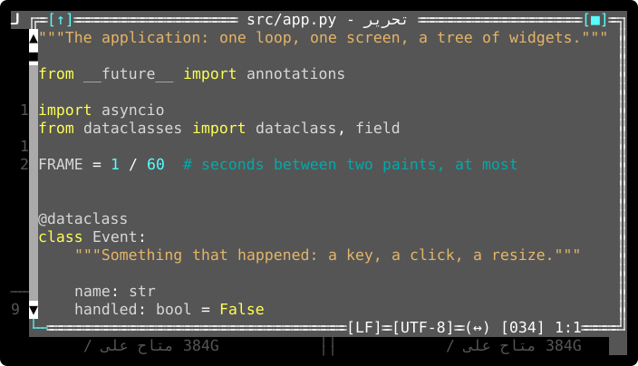
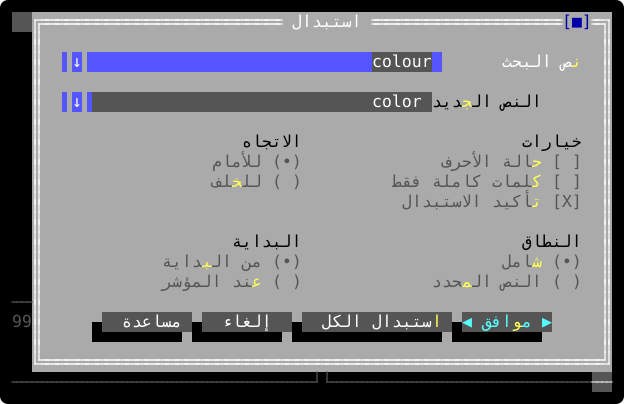
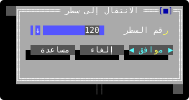
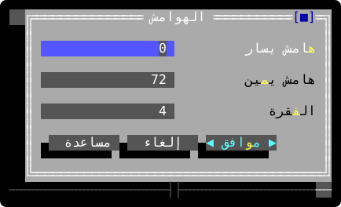

# المحرر

يفتح `F4` الملف الذي تحت المؤشر في المحرر. وكل أمر موجود أيضا في قائمة *المحرر*، التي تكون على شريط القوائم ما دام
محرر مفتوحا.



## المفاتيح

| المفتاح | ما يفعله |
|---|---|
| `F2` | الحفظ |
| `Shift+F2` | الحفظ باسم آخر |
| `Ctrl+F4` | إغلاق المحرر؛ ويسأل أولا إن كان النص قد تغيّر |
| `Alt+Backspace` | التراجع |
| `Alt+Shift+Backspace` | الإعادة |
| `Ctrl+Y` | حذف السطر |
| `Ctrl+Backspace` | حذف الكلمة التي على اليسار |
| `Ctrl+N` | إدراج سطر |
| `F7`, `Ctrl+F7` | [البحث والاستبدال](#البحث-والاستبدال) |
| `Alt+G` | [الانتقال إلى سطر](#الانتقال-إلى-سطر) |
| `Alt+PgUp` | سرد الملفات المحررة سابقا |

## فتح ملف

| المفتاح أو البند | ما يفتحه |
|---|---|
| `F4` | الملف الذي تحت المؤشر |
| `Alt+F4`, `Ctrl+K`, *ملف > تحرير > تحرير بديل* | الملف الذي تحت المؤشر في المحرر الآخر: انظر أدناه |
| `Shift+F4`, *ملف > تحرير > تحرير ملف جديد* | ملف تسميه في [مربع ملفات](dialogs.md#اختيار-ملف). والاسم غير الموجود بعد يُنشأ عند الحفظ |
| *ملف > تحرير > فتح...* | ملف تختاره في مربع ملفات، دون حاجة إلى مدير ملفات. والاسم غير الموجود بعد يُنشأ عند الحفظ |
| `Alt+PgUp` | ملف من قائمة الملفات المحررة سابقا |

يستعمل `F4` محرر Navigator، و*تحرير بديل* برنامجا آخر: البرنامج الذي يسميه `editors.ini` للملف
([ارتباطات الملفات](user-menu.md#ارتباطات-الملفات))، وإلا قائمة بالمحررات المثبتة في الطرفية، مثل `vim` أو `nano`،
ويعمل ما تختاره منها في نافذة خاصة به. وإذا أُلغي تحديد *محرر داخلي* في صفحة [النظام](settings.md#النظام) من
الإعدادات يتبادل المفتاحان مكانيهما: يشغّل `F4` برنامج `editors.ini`، وإلا `$EDITOR`، ويستعمل *تحرير بديل* محرر
Navigator. ويوجد `Ctrl+K` لأن كثيرا من مديري النوافذ يغلقون الطرفية عند `Alt+F4`.

يفتح `F4` على مجلد [سمات الملف](file-operations.md#سمات-الملفات) الخاصة به.

والملف الذي حُرر سابقا يُفتح حيث تركته.

## الكتل والحافظة

اضغط `Shift` مستمرا أثناء تحريك المؤشر، أو اسحب بالفأرة، لتعليم كتلة.

| المفتاح | ما يفعله |
|---|---|
| `Ctrl+Ins`, `Ctrl+C` | نسخ الكتلة |
| `Shift+Del`, `Ctrl+X` | قص الكتلة |
| `Shift+Ins`, `Ctrl+V` | اللصق |
| `Ctrl+Del` | حذف الكتلة |
| `Alt+Shift+I`, `Alt+Shift+O` | زيادة إزاحة الكتلة وإنقاصها |
| `Alt+Shift+U`, `Alt+Shift+L` | تحويل الكتلة إلى أحرف كبيرة، أو صغيرة |
| `Alt+T` | فرز أسطر الكتلة |
| `Alt+H` | إخفاء الكتلة أو إظهارها |

ويشرح [النسخ واللصق](clipboard.md) أي مفاتيح النسخ واللصق تعمل في أي طرفية.

تبدّل القائمة الفرعية *خيارات* سلوك هذه النافذة، مثل الإزاحة التلقائية وأرقام الأسطر وتلوين الصياغة. وما يبدأ به
المحرر الجديد يُضبط في صفحة [المحرر/العارض](settings.md#المحررالعارض) من الإعدادات.

## البحث والاستبدال

يبحث `F7` عن نص ويستبدله `Ctrl+F7`. ويكرر `Shift+F7` آخر بحث، بما فيه الاستبدال.

يُفتح المربع بتخمين لما تبحث عنه: النص المعلّم إن كان في سطر واحد، وإلا الكلمة التي تحت المؤشر.



- *نص البحث* هو النص المبحوث عنه. ويفتح `Down` على السطر سجل عمليات البحث السابقة.
- *النص الجديد*، عند الاستبدال، هو ما يوضع مكانه.

### الخيارات

- يميّز *حالة الأحرف* الأحرف الكبيرة من الصغيرة.
- يتخطى *كلمات كاملة فقط* التطابق الذي هو جزء من كلمة أطول.
- يسأل *تأكيد الاستبدال* قبل كل استبدال: *نعم*، أو *لا*، أو *الكل* لهذا ولكل ما بعده، أو *إلغاء*.

### أين يبحث

- *الاتجاه*: *للأمام* نحو نهاية النص، أو *للخلف* نحو بدايته.
- *النطاق*: *شامل* يبحث في النص كله، و*النص المحدد* في الكتلة المعلّمة فقط.
- *البداية*: *من البداية* يبدأ من أول النطاق، و*عند المؤشر* من المؤشر.

### الاستبدال

يستبدل *موافق* أول تطابق. ويستبدل *استبدال الكل* كل تطابق، ويذكر عدد ما استُبدل. ويمكن التراجع عن كل استبدال
على حدة.

### شريط البحث

يفتح `Ctrl+F` و`Ctrl+R` شريطا داخل نافذة المحرر بدلا من مربع. يبحث أثناء الكتابة، ويضيء كل تطابق على الشاشة،
ويمكنه البحث بتعبير نمطي.

## الانتقال إلى سطر



يطلب `Alt+G` رقم سطر ويضع المؤشر على ذلك السطر. تُعد الأسطر من 1. ويُفتح المربع بآخر رقم كتبته.

## الهوامش



يضبط *المحرر > فقرة > الهوامش* الأرقام الثلاثة التي يعمل تنسيق الفقرات بينها. وهي تسري على نافذة المحرر هذه
فقط؛ وتأتي القيم الأولى من إعداد المحرر.

- *هامش يسار* هو العمود الذي يبدأ منه كل سطر.
- *هامش يمين* هو آخر عمود قد يبلغه السطر.
- *الفقرة* هو العمود الذي يبدأ منه أول سطر في الفقرة.

لتنسيق فقرة، علّمها ككتلة واضغط `Alt+J` لضبطها من الجانبين، أو `Alt+L` لمحاذاتها إلى الهامش الأيسر، أو `Alt+R`
إلى الأيمن، أو `Alt+C` لتوسيطها. وتُعامل الكتلة كلها كفقرة واحدة.

## تلوين الصياغة

يلوّن المحرر والعارض نص البرنامج وصفحة الويب وملف الإعدادات وغيرها كثيرا حسب نوع كل جزء. ويُحدد تلوين الملف
باسمه، في `highlight.ini`، وللنص البرمجي الذي ليس له امتداد معروف بسطره الأول، مثل `#!/bin/sh`: ويفتح *خيارات >
تحرير ملف التلوين* ذلك الملف في المحرر.

```ini
[*.conf]
lexer = ini

[*.txt]
lexer = none
autowrap = on
right_margin = 72
```

- كل قسم [قناع ملفات](panels.md#أقنعة-الملفات). وأول قسم يطابق الملف ويسمي `lexer` يختار اللغة؛ والملف الذي لا
  يأخذه أي قسم يُترك لـ Pygments ليخمّن.
- يسمي `lexer` اللغة، كما يسميها Pygments (يسردها `python3 -m pygments -L lexers`). و`none` لا يلوّن شيئا؛ و`auto`
  يترك Pygments يخمّن من الاسم والمحتوى.
- ويمكن للقسم أيضا ضبط خيارات المحرر لتلك الملفات، بالأسماء التي لها في القسم `[editor]` من `navigator.ini`:
  `auto_indent` و`insert_tabs` و`line_numbers` و`soft_wrap` و`autowrap` و`right_margin` و`line_ending` وغيرها.
  ويأتي كل منها من أول قسم مطابق يضبطه. وتسردها تعليقات الملف نفسه كلها. والملف الذي حُرر سابقا يحتفظ بالخيارات
  التي تُرك عليها.

لنافذة واحدة، يختار *المحرر > نوع الملف* (`Ctrl+Shift+H`) لغة أخرى، ويعطّل *المحرر > خيارات > تلوين الصياغة*
التلوين ويفعّله. والألوان ألوان السمة.
