# عمليات الملفات

يعمل النسخ والنقل والربط والتقسيم والترميز على التحديد: الملفات المحددة في اللوحة النشطة، أو الملف الذي تحت المؤشر
حين لا يكون هناك تحديد. ويُفتح معظمها على مجلد اللوحة الأخرى بوصفه المكان الذي توضع فيه النتيجة.

## النسخ والنقل

ينسخ `F5` التحديد، ويعيد `F6` تسميته أو ينقله. وكلاهما يفتح المربع نفسه: سطر يقول إلى أين، وأوضاع النسخ، وأربعة
خيارات.

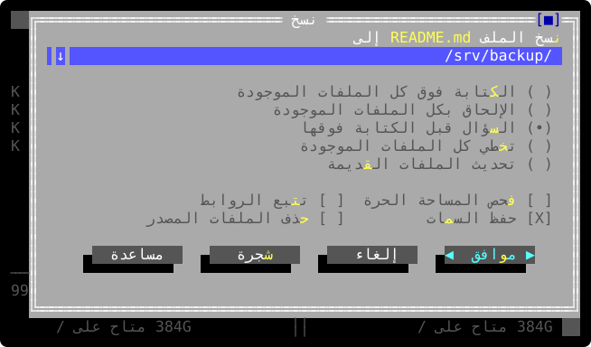

### إلى أين

ما تكتبه في السطر يقرر ما يحدث:

| ما تكتبه | ما يعنيه |
|---|---|
| مجلد موجود، أو اسم ينتهي بـ `/` | تذهب الملفات إلى ذلك المجلد |
| اسم فيه `*` أو `?` | يُعاد تسمية كل ملف بذلك القناع في المكان الذي يذهب إليه |
| أي اسم آخر، مع تحديد ملف واحد | الاسم الجديد للملف |
| أي اسم آخر، مع تحديد عدة ملفات | مجلد يُنشأ ويُنسخ إليه |

يُطبَّق القناع على الاسم وعلى اللاحقة كلٍّ على حدة: `*.bak` يعطي كل ملف اللاحقة `bak`. والقناع الذي ليس فيه نقطة
يشمل الاسم كله، فـ `*` يُبقي كل اسم كما هو.

يختار `F10`، أو الزر *شجرة*، المجلد من شجرة. ويفتح `Down` على السطر سجل الأماكن التي نسخت إليها من قبل.

### ما يُفعل بالملفات الموجودة هناك

| الوضع | ما يفعله |
|---|---|
| *الكتابة فوق كل الملفات الموجودة* | يستبدلها دون سؤال |
| *الإلحاق بكل الملفات الموجودة* | يضيف كل ملف إلى نهاية الملف الموجود |
| *السؤال قبل الكتابة فوقها* | يسأل عن كل واحد. ويمكن جعل الجواب ساريا على كل ما تبقى |
| *تخطي كل الملفات الموجودة* | يتركها كما هي وينسخ البقية |
| *تحديث الملفات القديمة* | لا يستبدل الملف إلا إذا كان المنسوخ أحدث منه |

وحين يسأل، يتيح لك *تسمية* أن تعطي النسخة اسما آخر بدلا من ذلك.

### الخيارات

- يتوقف *فحص المساحة الحرة* قبل النسخ حين لا يكون في الوجهة متسع كاف.
- يُبقي *حفظ السمات* الصلاحيات والمالك والأوقات على النسخ. ويُبلَّغ عما تعذر إبقاؤه؛ ومع ذلك ينجح النسخ نفسه.
- ينسخ *تتبع الروابط* ما يشير إليه الرابط، لا الرابط نفسه.
- يحذف *حذف الملفات المصدر* الأصول بعد نسخها، فيصبح النسخ نقلا.

يُحفظ الوضع والخيارات إلى أن تغادر Navigator.

### أثناء العمل

يعرض مربع التقدم السرعة والوقت المتبقي. يرسل *في الخلفية* النسخ بعيدا لتواصل العمل: تظهر نسبة مئوية على شريط القوائم،
والنقر عليها يعيد المربع. وإن كان لدى النسخ سؤال وهو في الخلفية، تعرض النسبة `?` وتنتظرك. ويسأل *أوقف* قبل التخلي
عن النسخ.

الملفات التي نُسخت يزول تحديدها؛ والملفات التي تُخطيت تبقى محددة.

يتراجع `Ctrl+Z` عن النسخ؛ انظر [التراجع](#التراجع).

## إنشاء مجلد

ينشئ `F7` مجلدا في اللوحة النشطة. اكتب مسارا مثل `a/b/c` لإنشاء كل مجلد في الطريق، أو عدة أسماء يفصل بينها `;`
لإنشاء عدة مجلدات.

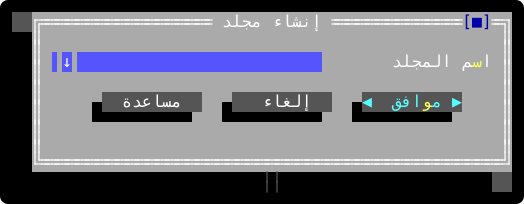

## إعادة التسمية السريعة

يطلب `Shift+F6`، أو *ملف > أدوات إعادة التسمية > إعادة تسمية سريعة*، الاسم الجديد للملف الذي تحت المؤشر في مربع
صغير. يعيد تسمية ملف واحد في مكانه؛ ولنقل ملف، أو لإعادة تسمية عدة ملفات بقناع، استخدم `F6`.

## إعادة التسمية الجماعية

يعيد `Alt+A`، أو *ملف > أدوات إعادة التسمية > إعادة تسمية جماعية*، تسمية الملفات المحددة بنمط واحد. تعرض القائمة في
النصف السفلي كل اسم جديد قبل فعل أي شيء، ويقول السطر الذي تحتها ما الخطأ حين يتعذر استخدام اسم: اسم فارغ، أو اسم
فيه `/`، أو ملفان أُعطيا اسما واحدا، أو اسم مأخوذ من قبل.

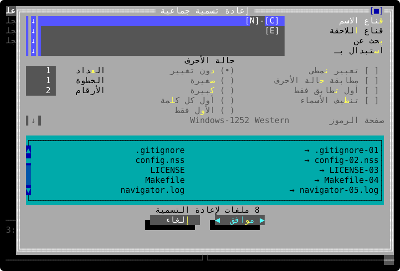

يُصنع الاسم الجديد في ثلاث خطوات.

**الأقنعة.** يبني *قناع الاسم* الاسم، و*قناع اللاحقة* اللاحقة. يؤخذ النص كما هو، ويُستبدل كل عنصر نائب بين قوسين
معقوفين:

| العنصر النائب | ما يمثله |
|---|---|
| `[N]` | الاسم القديم دون لاحقته |
| `[N3]` | حرفه الثالث |
| `[N2-5]` | حروفه من الثاني إلى الخامس |
| `[N2-]` | من الحرف الثاني فصاعدا |
| `[N2,4]` | أربعة حروف بدءا من الثاني |
| `[N-3-]` | الحروف الثلاثة الأخيرة |
| `[E]` | اللاحقة القديمة، تُقطع بالطرق نفسها |
| `[P]` | اسم المجلد الذي فيه الملف، يُقطع بالطرق نفسها |
| `[C]` | عداد، من *العداد* و*الخطوة* و*الأرقام* |
| `[C10+5:3]` | عداد يبدأ من 10، ويزيد بخطوة 5، وله ثلاثة أرقام: 010، 015، 020 |
| `[Y]` `[M]` `[D]` `[h]` `[m]` `[s]` | تاريخ تعديل الملف ووقته |
| `[[]` `[]]` | `[` و`]` |

قناع اللاحقة الفارغ يترك الاسم دون نقطة.

**البحث والاستبدال.** يعمل *بحث عن* و*استبدال بـ* على الاسم كله الذي صنعته الأقنعة.

- يعامل *تعبير نمطي* البحث بوصفه تعبيرا نمطيا؛ ويمكن للاستبدال حينئذ أن يستخدم `\1` لمجموعة.
- يميّز *مطابقة حالة الأحرف* الأحرف الكبيرة من الصغيرة.
- يستبدل *أول تطابق فقط* تطابقا واحدا في كل اسم، لا كل التطابقات.

**حالة الأحرف.** *دون تغيير*، أو *صغيرة*، أو *كبيرة*، أو *أول كل كلمة*، أو *الأول فقط*.

يصلح *تنظيف الأسماء* الأسماء قبل الخطوات الثلاث: البايتات التي ليست UTF-8 تُقرأ بـ *صفحة الرموز* التي تختارها،
وتصبح أحرف التحكم `_`، والأسماء في مجلد واحد التي لا تختلف إلا في حالة الأحرف تُرقَّم.

الملف الذي يخرج اسمه كما كان يُترك كما هو. والأسماء التي تتبادل بين الملفات، `a` إلى `b` و`b` إلى `a`، يُعاد
تسميتها بشكل صحيح.

### أسماء تحتاج إلى تنظيف

يحدد *ملف > أدوات إعادة التسمية > تحديد الأسماء الخاطئة* كل ملف في اللوحة سيغيّر *تنظيف الأسماء* اسمه: اسم ليس
UTF-8 صالحا، أو اسم مكتوب بصيغة Unicode مفككة، أو اسم فيه حرف تحكم، وأسماء لا تختلف عن غيرها إلا في الأحرف
الكبيرة. ثم يعيد `Alt+A` مع تعليم *تنظيف الأسماء* تسميتها.

## المسح

يمسح `F8`، أو `Del` مع سطر أوامر فارغ، التحديد بعد السؤال. ويمسح `Shift+F8` أو `Shift+Del` أو *ملف > حذف ملف واحد*
الملف الذي تحت المؤشر أيا كان المحدد.

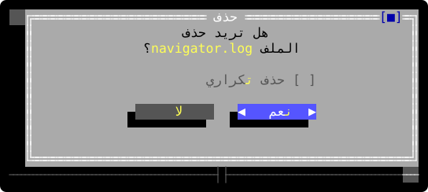

- يمسح *حذف تكراري* المجلدات بكل ما فيها دون السؤال عن كل واحد.
- يظهر *النقل إلى سلة المهملات* حين تكون [المهملات](drives.md#سلة-المهملات) مستخدمة. وإن أُلغي تعليمه، تُمسح الملفات
  نهائيا.

دون *حذف تكراري* تُسأل عن المجلد غير الفارغ، وعن الملفات التي لا تستطيع الكتابة فيها؛ ويمكن الإجابة عن كل سؤال لكل
ما تبقى. أما أي الأسئلة تُطرح أصلا فيُضبط في صفحة [التأكيدات](settings.md#التأكيدات) من الإعدادات.

يمكن إرسال المسح الطويل إلى الخلفية، كما يُرسل النسخ.

## التراجع

يتراجع `Ctrl+Z`، أو *ملف > تراجع عن العملية*، عن آخر عملية على الملفات، والضغط عليه مجددا عن التي قبلها، حتى
خمسين عملية. ويقول ما هو مقبل على فعله ويسأل أولا.

| العملية | ما يفعله التراجع |
|---|---|
| نسخ، بـ `F5` أو لصق | يزيل ما صنعه النسخ، لكن فقط الملفات التي لم يغيرها شيء منذ ذلك الحين: إلى المهملات على القرص، ونهائيا في غيره |
| نقل، بـ `F6` أو قص ولصق | يعيد الملفات إلى مكانها |
| إعادة تسمية، بـ `F6` أو `Alt+F6` أو `Shift+F6` أو `Alt+A` | يعيد الأسماء القديمة |
| المسح إلى [المهملات](drives.md#سلة-المهملات) | يستعيد الملفات من المهملات |
| المجلد الجديد من `F7` | يزيله، إن كان لا يزال فارغا |

الملف الذي استبدله نسخ أو نقل ذهب نهائيا، ويقول السؤال كم ملفا كان. ولا يمكن التراجع عن المسح النهائي ولا عن السمات
والروابط، ولا عن نسخ أو نقل إلى أرشيف أو منه. تبقى قائمة العمليات إلى أن يُنهى Navigator، وتتشاركها كل نوافذ مدير
الملفات. وما دام في سطر الأوامر نص، يُترك `Ctrl+Z` لسطر الأوامر.

## سمات الملفات

يغيّر `Alt+E` سمات التحديد. لا يُطبَّق إلا ما تغيّره، فتحتفظ الملفات التي تختلف في نواح أخرى باختلافاتها. ويطبّق
*تكراري* التغيير على كل ما داخل المجلدات أيضا.

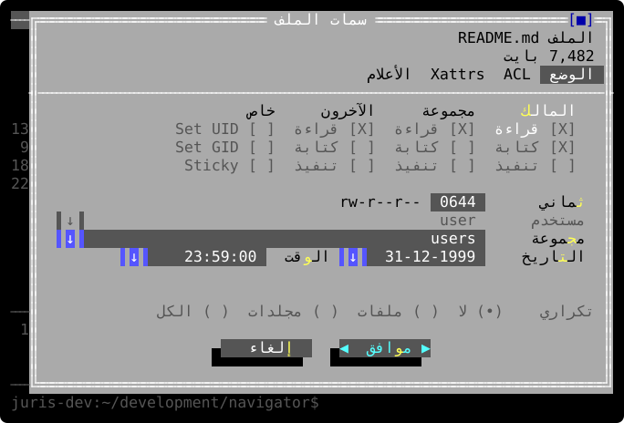

- في *الوضع* الصلاحيات: شبكة من القراءة والكتابة والتنفيذ للمالك والمجموعة والآخرين، والشيء نفسه رقما ثمانيا،
  والمالك والمجموعة، والتاريخ والوقت. وفي الشبكة تعلّم `R` و`W` و`X` صفا كاملا.
- يسرد *ACL* مدخلات التحكم في الوصول الزائدة على الوضع، ويضيفها ويحررها ويزيلها.
- يسرد *Xattrs* السمات الموسعة.
- في *الأعلام* أعلام نظام الملفات، مثل غير القابل للتغيير والإلحاق فقط.

المربع الذي يعرض `?` يعني أن الملفات تختلف فيه؛ اتركه كما هو ليبقى كل ملف على حاله.

### مدخلات ACL

يفتح *إضافة* و*تحرير* في صفحة *ACL* مدخلا واحدا. يقول *النوع* هل يسمّي مستخدما أم مجموعة، ويختار *الاسم* أيهما،
و*الصلاحيات* هي *قراءة* و*كتابة* و*تنفيذ*. ويجعله *افتراضي، ترثه الملفات الجديدة* مدخلا افتراضيا لمجلد: ما يُنشأ
داخل المجلد يرثه.

### السمات الموسعة

يفتح *إضافة* و*تحرير* في صفحة *Xattrs* سمة واحدة، *الاسم* و*القيمة*. القيمة نص، أو `0x` تتبعه أرقام ست عشرية، أو
`0s` يتبعه base64. وعلامات الاقتباس حول القيمة تُبقيها نصا.

## الروابط

ينشئ `Shift+F5` روابط إلى التحديد في المجلد الذي تسمّيه.

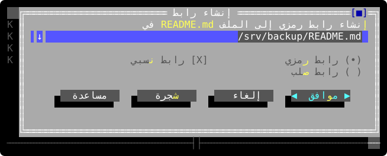

- ينشئ *رابط رمزي* ملفا صغيرا يحمل مسار الأصل. يمكنه أن يشير إلى مجلد، وإلى قرص آخر.
- يعطي *رابط صلب* الملف اسما ثانيا. لا يعمل إلا مع الملفات، وعلى نظام الملفات نفسه فقط.
- يكتب *رابط نسبي* المسار نسبة إلى الرابط، فيمكن نقل الرابط والأصل معا. لا ينطبق إلا على الروابط الرمزية.

وفي *ملف > الروابط* المزيد: تحرير ما يشير إليه الرابط، وجعل الروابط نسبية أو مطلقة، وتحديد الروابط المكسورة، وعرض
كل اسم لملف له روابط صلبة.

### تغيير ما تشير إليه الروابط

يغيّر *ملف > الروابط > تحرير هدف الرابط* الروابط الرمزية المحددة.

- مع تحديد رابط واحد، يحمل سطر هدفه لتحرره. ويكتب *رابط نسبي* الهدف الجديد نسبة إلى الرابط.
- مع تحديد عدة روابط، يغيّر *بحث عن* و*استبدال بـ* الجزء نفسه من كل هدف، وهو ما تحتاجه شجرة نُقلت.

يعيد *جعله نسبيا* و*جعله مطلقا* كتابة هدف كل رابط محدد بالطريقة الأخرى، فيصل إلى الملف نفسه. ويحدد *تحديد الروابط
المكسورة* كل رابط في اللوحة لا يشير إلى شيء: تلك المعلَّمة بـ `!` في القائمة حين لا تعرض أيقونات.

### كل أسماء الملف

للملف ذي الروابط الصلبة عدة أسماء، ربما في مجلدات مختلفة. يجد *ملف > الروابط > عرض الروابط الصلبة* كل اسم للملف
الذي تحت المؤشر على نظام ملفاته ويسردها في اللوحة، كما يسرد [البحث عن ملف](panels.md#البحث-عن-ملف) ما وجده؛ و`Enter`
على `..` يعود. وتُتجاوز المجلدات التي لا يُسمح لك بقراءتها، فقد يُعثر على أسماء أقل مما للملف. ويعرض العمود
*الروابط* في العرض المفصّل كم اسما للملف.

## التقسيم والدمج

يعمل *ملف > تقسيم/دمج* على الملف الذي تحت المؤشر، واسم الملف يقرر أي الاثنين يفعل.

### التقسيم

يُقسم أي ملف عادي إلى أجزاء اسمها `NAME.001` و`NAME.002` وهكذا، في المجلد الذي تسمّيه.

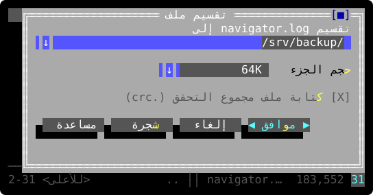

- *حجم الجزء* هو حجم كل جزء: عدد من البايتات، أو عدد يتبعه `K` أو `M` أو `G`، مثل `100M` أو `1.44M`.
- يكتب *كتابة ملف مجموع التحقق (.crc)* أيضا `NAME.crc`، الذي يحمل اسم الملف وحجمه ومجموع التحقق. ومعه يمكن فحص
  الملف المدمج.

الملف الذي لا يزيد على جزء واحد لا يُقسم. ويستطيع Total Commander وDouble Commander و7-Zip دمج هذه الأجزاء.

### الدمج

على جزء (`NAME.001`) أو على `NAME.crc` لمجموعة أجزاء، يعيد الأمر تركيب الملف في المجلد الذي تسمّيه. ويقرأ الأجزاء
بالترتيب إلى أن ينقص أحدها. ومع ملف `.crc` يفحص النتيجة أيضا؛ وإن لم يتطابق مجموع التحقق، يُحتفظ بالملف ويُبلغك.

## الترميز وفك الترميز UU

يحوّل ترميز UU أي ملف إلى نص عادي يمكن إرساله حيث لا يُسمح إلا بالنص.

### الترميز

يرمّز `Ctrl+F7` الملف الذي تحت المؤشر إلى `NAME.uue`. ويُكتب الملف الكبير في أقسام، كل قسم في ملف.

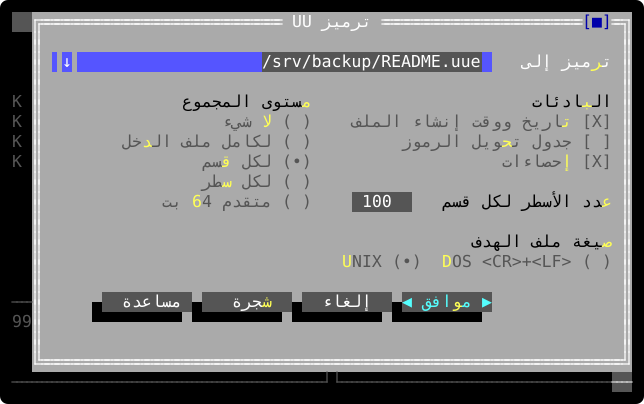

- تضيف *البادئات* أسطرا قبل البيانات: تاريخ الملف ووقته، وجدول الأحرف المستخدم، وإحصاءات.
- يضيف *مستوى المجموع* مجاميع تحقق ليمكن اكتشاف التلف عند فك الترميز: لا شيء، أو للملف كله، أو لكل قسم، أو لكل سطر،
  أو المجموع ذو 64 بت.
- *عدد الأسطر لكل قسم* هو كم سطرا من البيانات يدخل في قسم واحد.
- يختار *صيغة ملف الهدف* كيف تنتهي الأسطر: كما في DOS، أو كما في UNIX.

### فك الترميز

يفك `Ctrl+F8` ترميز الملف الذي تحت المؤشر إلى المجلد الذي تسمّيه. وقد يحمل ملف واحد عدة ملفات مرمَّزة وأقسامها بأي
ترتيب.

- يسأل *فحص الملفات الموجودة* قبل استبدال ملف موجود.
- يعرض *عرض رسائل الخطأ* كل خطأ يُعثر عليه في البيانات.
- يكتب *حفظ الملفات التالفة* الملف حتى حين تكون بياناته تالفة.

## مجاميع التحقق

تحمل قائمة مجاميع التحقق خلاصة لكل ملف، ليمكن فحص الملفات لاحقا بحثا عن تلف أو تغيير.

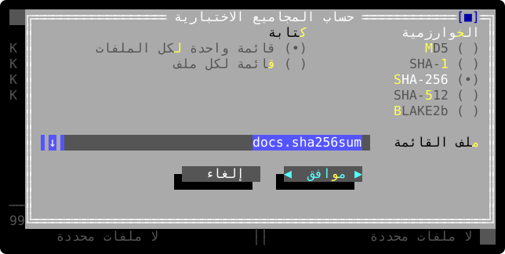

يحسب *ملف > ترميز > مجاميع التحقق > حساب* خلاصات الملفات المحددة، وكل ما داخل مجلد محدد.

- *الخوارزمية* هي *MD5* أو *SHA-1* أو *SHA-256* أو *SHA-512* أو *BLAKE2b*.
- يكتب *قائمة واحدة لكل الملفات* قائمة واحدة، تُسمّى في سطر *ملف القائمة*. ويكتب *قائمة لكل ملف* قائمة بجانب كل
  ملف.

يقرأ *تحقق* القوائم المحددة، أو القائمة التي تحت المؤشر، ويحسب خلاصات الملفات التي تسمّيها مجددا ويبلغ كم منها
تطابق. والملفات التي لم تتطابق، أو المفقودة، تُسرد تحت *المشكلات*.

هذه القوائم هي نفسها التي يكتبها ويفحصها `md5sum` و`sha256sum` وأقرباؤهما، فيستطيع كل طرف التحقق من قوائم الآخر.
وتُعرف خوارزمية القائمة من اسمها، مثل `.sha256sum` أو `.sha256` أو `SHA256SUMS`، وإلا فمن طول خلاصاتها.

## التشفير

يشفّر *ملف > ترميز > تشفير* الملفات ويفك تشفيرها بـ GnuPG (`gpg`) أو `age`. والبرنامج غير المثبت يظهر باهتا.

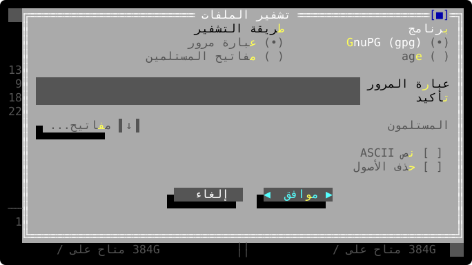

يعمل *تشفير* على الملفات المحددة، وكل ما داخل مجلد محدد. ويُكتب كل ملف بجانب نفسه باسم `NAME.gpg` أو `NAME.age`.

- *البرنامج* هو *GnuPG (gpg)* أو *age*.
- *طريقة التشفير*: *عبارة المرور*، تُكتب مرتين، أو *مفاتيح المستلمين*. يُفصل بين المستلمين بمسافات: معرّفات مفاتيح
  أو بصمات لـ gpg، ومفاتيح أو ملفات مفاتيح لـ age. ويختار *مفاتيح...* من مفاتيح gpg.
- يكتب *نص ASCII* الملفات المشفرة نصا؛ ويسمّيها gpg `NAME.asc`.
- يزيل *حذف الأصول* كل ملف بعد كتابة نسخته المشفرة.

يعمل *فك التشفير* على الملفات المشفرة المحددة، أو التي تحت المؤشر، ويكتب كلا منها بجانب نفسه باسمه دون النهاية.
ولا تُطلب عبارة المرور إلا حين يحتاج إليها ملف، ومرة واحدة لها كلها.

## تحويل النص

يعيد *ملف > ترميز > تحويل النص* كتابة الملفات النصية المحددة، أو التي تحت المؤشر، بترميز آخر أو بنهايات أسطر أخرى.
ويُغيَّر كل ملف في مكانه.

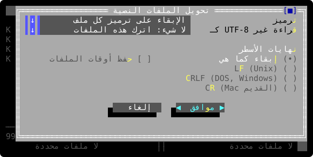

- *الترميز* هو الترميز الذي تُكتب به الملفات.
- *قراءة غير UTF-8 كـ* هو الترميز المفترض لملف ليس UTF-8 وليس فيه علامة ترتيب البايتات. وإن لم يُختر شيء، يُترك
  هذا الملف كما هو.
- *نهايات الأسطر*: *إبقاء كما هي*، أو *LF (Unix)*، أو *CRLF (DOS, Windows)*، أو *CR (Mac القديم)*.
- يعطي *حفظ أوقات الملفات* كل ملف أعيدت كتابته الوقت الذي كان له.

الملف الذي يبدو ثنائيا، والملف الذي لا يستطيع الترميز المختار كتابة نصه، والملف الكبير جدا، تُترك كما هي، ويُقال لك
السبب. والملف الذي سيخرج دون تغيير لا يُكتب.

## فتح بواسطة

يفتح *ملف > فتح بواسطة* الملف الذي تحت المؤشر في أحد تطبيقات سطح المكتب، يُختار من قائمة التطبيقات التي تعالج نوعه،
والمعتاد منها أولا.

- يسرد *تطبيقات بديلة* كل تطبيق آخر مثبت.
- يختار *تعيين الافتراضي* التطبيق الذي يُفتح فيه النوع من الآن فصاعدا، ولا يفتح شيئا.
- يطلب *أمر...* سطر أوامر خاصا بك. يمثل `!.!` فيه الملف؛ ودونه يُضاف اسم الملف في النهاية. يعمل الأمر في وحدة
  التحكم، ولكل لاحقة سجل بالأوامر المستخدمة.

يحتاج إلى `gio` الخاص بسطح المكتب أو أدوات KDE؛ انظر *سطح المكتب* في صفحة [الاتصالات](settings.md#الاتصالات)
من الإعدادات. والملف الذي على خادم يُجلب أولا. ما يغيّره التطبيق لا يُعاد إرساله؛ أما ما يغيّره *أمر...* فيُعاد،
بعد انتهاء الأمر.

ويفتح `Enter` على ملف لا يأخذه أي مدخل في `extensions.ini` ذلك الملف أيضا في تطبيق سطح المكتب، ما دام *إرسال البقية
لسطح المكتب* معلَّما في صفحة [لوحات الملفات](settings.md#لوحات-الملفات).

## الطباعة

يطبع `Ctrl+F9`، أو *ملف > طباعة*، الملفات المحددة بعد السؤال. تذهب إلى طابعة النظام عبر `lp`، أو `lpr` حيث لا
يوجد `lp`، اللذين يطبعان على `$PRINTER` أو الطابعة الافتراضية. وتُتجاوز المجلدات، ويزول تحديد كل ملف بعد إرساله إلى
الطابعة. ويطبع المحرر نصه بـ `F8`.
