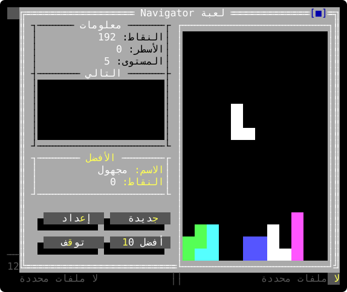

# اللعبة

يفتح `Alt+F9`، أو *لعبة* في القائمة `≡`، اللعبة: تسقط الأشكال في وعاء، ويختفي كل صف يمتلئ. لها نوعان: تتريس
بسبعة أشكال، وبنتيكس بسبعة وعشرين شكلا.

## المفاتيح

| المفتاح | ما يفعله |
|---|---|
| `Left` أو `Home` | تحريك الشكل يسارا |
| `Right` أو `PgUp` | تحريك الشكل يمينا |
| `Up` | تدوير الشكل |
| `Down` أو `Space` | إسقاط الشكل |
| `F2` | بدء لعبة جديدة |
| `F3` | الإيقاف المؤقت، والمتابعة |
| `F4` | عرض *أفضل 10* |
| `F5` | إعداد اللعبة: مستوى البداية، والنوع، وعرض القطعة التالية |
| `Gray +` | رفع المستوى |
| `Gray *` | إظهار الشكل التالي أو إخفاؤه |
| `Esc` | إغلاق اللعبة |

تتوقف اللعبة مؤقتا من تلقاء نفسها حين تنتقل إلى نافذة أخرى.

## أفضل عشرة

حين تنتهي لعبة بنتيجة تكفي لدخول قائمة أفضل عشرة، يُطلب منك اسم تُدرج تحته. إن لم تكتب اسما، أو اخترت *إلغاء*،
تُدرج باسم *مجهول*. لكل نوع قائمته.

## الإعداد

يُعدّ `F5`، أو الزر *إعداد*، اللعبة.

- *المستوى* هو المستوى الذي تبدأ منه اللعبة، من *1 - رضيع* إلى *10 - مصحة*. تسقط الأشكال أسرع في كل مستوى.
- *نوع اللعبة* هو *تتريس كلاسيكي* أو *بنتيكس*.
- يعرض *عرض القطعة التالية* الشكل التالي بجانب الوعاء.
