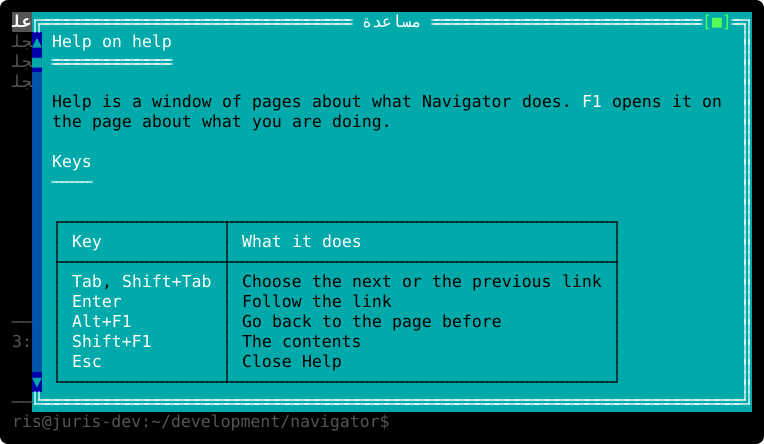

# حول المساعدة

يفتح `F1` هذا الدليل على الصفحة التي تتحدث عما تفعله. الصفحات مرتبطة ببعضها: يظهر الرابط بلونه الخاص، ويكون
أحد الروابط دائما هو المحدد.

## المساعدة حيث أنت

يعمل `F1` في كل مكان، ويفتح الصفحة الخاصة بما يتلقى لوحة المفاتيح:

- في مربع حوار، القسم الخاص بذلك المربع. وفي كثير من المربعات أيضا زر *مساعدة* يفعل الشيء نفسه؛
- في قائمة مفتوحة، الصفحة الخاصة بالبند المميز، أو بقائمته؛
- في نافذة، كالعارض أو المحرر أو الآلة الحاسبة، صفحة تلك النافذة؛
- في اللوحات، الصفحة الخاصة باللوحات.

وحيث لا توجد صفحة عما تفعله، تُفتح [المحتويات](README.md). يغلق `Esc` المساعدة ويعيدك إلى حيث كنت، وتبقى القائمة
مفتوحة إن كانت كذلك. وأثناء تشغيل برنامج في وحدة التحكم، يكون `F1` لذلك البرنامج.

## المفاتيح

| المفتاح | ما يفعله |
|---|---|
| `Tab` | تحديد الرابط التالي |
| `Shift+Tab` | تحديد الرابط السابق |
| `Enter` | الانتقال إلى الرابط المحدد |
| `Alt+F1` | الرجوع إلى حيث أتيت |
| `Shift+F1` | فتح [المحتويات](README.md) |
| `F1` | فتح هذه الصفحة |
| `Up`, `Down`, `PgUp`, `PgDn`, `Home`, `End` | تمرير الصفحة |
| `Left`, `Right` | التمرير جانبيا، حين يكون سطر من الشيفرة أعرض من النافذة |
| `Alt+Z` | تكبير النافذة إلى الشاشة كلها، ثم إعادتها |
| `Ctrl+F5` | نقل النافذة وتغيير حجمها: تنقلها الأسهم، ويغير `Shift` مع الأسهم حجمها، ويثبتها `Enter` في مكانها، ويعيدها `Esc` |
| `Esc` | إغلاق المساعدة |

يمكن تغيير هذه المفاتيح: خيارات > تهيئة > ربط المفاتيح، تحت *نافذة المساعدة*.

## الفأرة

انقر رابطا للانتقال إليه. تمرر العجلة الصفحة، وكذلك الشريط على الحافة اليمنى للنافذة حين تكون الصفحة أطول من
النافذة. وللصفحة التي فيها سطر شيفرة أعرض من النافذة شريط على الحافة السفلية أيضا؛ ويمررها `Shift` مع العجلة
جانبيا.

## روابط إلى مواقع أخرى

الرابط الذي يقود خارج هذا الدليل، إلى موقع ويب، لا يتبعه Navigator. قد تفتحه طرفيتك: في أغلب الطرفيات اضغط
`Ctrl` مع النقر عليه.
