# اللوحات

يعرض مدير الملفات لوحتين جنبا إلى جنب، تسرد كل منهما ملفات مجلد واحد. إحداهما نشطة: فيها شريط المؤشر، وتعمل
الأوامر على ملفاتها وتعرض عادة مجلد اللوحة الأخرى مكانا لوضع النتيجة.

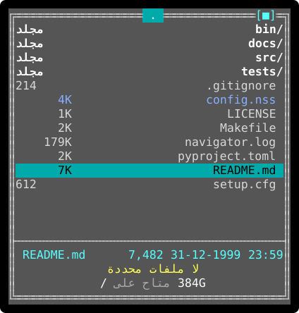

## التنقل

| المفتاح | ما يفعله |
|---|---|
| `Tab` | الانتقال إلى اللوحة الأخرى |
| `Up`, `Down`, `PgUp`, `PgDn`, `Home`, `End` | تحريك المؤشر |
| `Enter` | الدخول إلى مجلد أو أرشيف، أو تشغيل برنامج، أو فتح ملف |
| `Backspace`, `Ctrl+PgUp` | الانتقال إلى المجلد الأب |
| `Ctrl+\` | الانتقال إلى المجلد الجذر |
| `Ctrl+R` | قراءة المجلد من جديد |
| `Alt+Backspace` | سرد المجلدات التي زرتها |
| `Alt+=` | عرض المجلد نفسه في اللوحة الأخرى |
| `Ctrl+U` | تبديل اللوحتين |

كتابة الأحرف تكتب في سطر الأوامر الذي تحت اللوحات؛ انظر [سطر الأوامر](console.md).

وتعيد اللوحة قراءة مجلدها من تلقاء نفسها حين يتغير فيه شيء.

## أنماط العرض

ينتقل `Ctrl+Y` بين ثلاثة أنماط لعرض اللوحة:

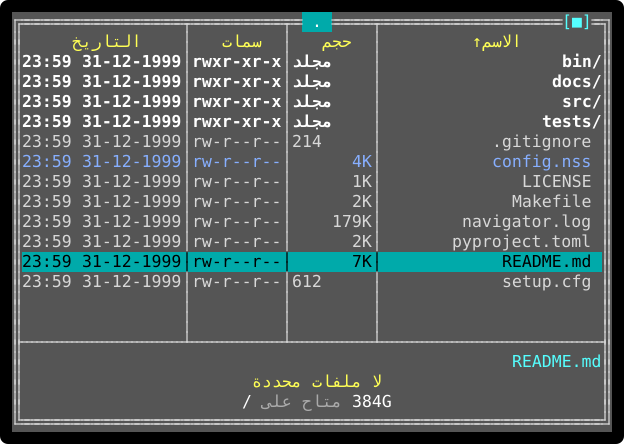

- *بسيط*: الأسماء والأحجام.
- *مفصل*: الأسماء مع الحجم والسمات والمالك والتاريخ في أعمدة. ويختار `Alt+K` الأعمدة.
- *قائمة*: الأسماء وحدها، في عدة أعمدة.

في العرضين البسيط والمفصل يمرر `Left` و`Right` الأسماء الطويلة. وفي العرض المفصل يفرز النقر على عنوان عمود حسب
ذلك العمود، ويعكس النقر الثاني الترتيب.

يُظهر `Ctrl+H` الملفات المخفية أو يخفيها، ويُظهر `Alt+I` الأسطر التي تحت القائمة أو يخفيها.

## الفرز

يختار `Alt+B` ترتيب اللوحة: حسب الاسم أو الامتداد أو الحجم أو الوقت أو السمات أو المالك أو النوع، كلٌّ في أي من
الاتجاهين، أو بلا فرز. وتُسرد المجلدات قبل الملفات.

## تعليم الملفات

تعمل الأوامر على الملفات المعلّمة، أو على الملف الذي تحت المؤشر حين لا يكون شيء معلّما.

| المفتاح | ما يفعله |
|---|---|
| `Ins`، أو `Space` وسطر الأوامر فارغ | تعليم الملف أو إلغاء تعليمه والنزول |
| `Gray +` | تعليم الملفات المطابقة لقناع |
| `Gray -` | إلغاء تعليم الملفات المطابقة لقناع |
| `Gray *` | عكس العلامات |
| `Ctrl+A` | تعليم كل شيء |

وبالفأرة، يعلّم الزر الأوسط ملفا، والسحب به يعلّم كل ملف يمر عليه. ويعلّم `Shift` أو `Ctrl` مع النقر الأيسر من
المؤشر إلى الملف المنقور.

وتذكر الأسطر التي تحت القائمة عدد الملفات المعلّمة وحجمها الإجمالي.

## البحث السريع

يبدأ `Ctrl+S` بحثا بالاسم: اكتب الأحرف الأولى فينتقل المؤشر إلى أول اسم يبدأ بها. وينتقل `Ctrl+S` ثانية إلى
التالي. ينهي `Esc` البحث؛ وأي مفتاح آخر ينهيه ويفعل ما يفعله عادة، فيدخل `Enter` مباشرة إلى المجلد الذي عُثر عليه.

## النسخ عبر الحافظة

ينسخ `Ctrl+C` التحديد ويقصه `Ctrl+X`؛ ويلصق `Ctrl+V` في مجلد آخر الملفات هناك، سائلا كما يسأل
[النسخ والنقل](file-operations.md#النسخ-والنقل). وينسى `Esc` الملفات. تعمل هذه المفاتيح على اللوحة ما دام سطر
الأوامر فارغا.

## الجهة الأخرى

يمكن للجهة غير النشطة أن تعرض شيئا آخر مكان اللوحة:

| المفتاح | ما يعرضه |
|---|---|
| `Ctrl+T` | شجرة مجلدات |
| `Ctrl+Q` | عرضا سريعا للملف الذي تحت المؤشر |
| `Ctrl+L` | [معلومات](#لوحة-المعلومات) عن المجلد والقرص والملف الذي تحت المؤشر |

والمفتاح نفسه يعيد اللوحة. يخفي `Ctrl+F1` و`Ctrl+F2` الجهة اليسرى واليمنى، ويخفي `Ctrl+P` الجهة غير النشطة،
وينقل `Alt+Left` و`Alt+Right` الفاصل بين الجهتين.

ويبدّل `Alt+F12` إلى أعمدة Miller: صف من الأعمدة الضيقة، عمود لكل مجلد في الطريق، مع معاينة لما تحت المؤشر.

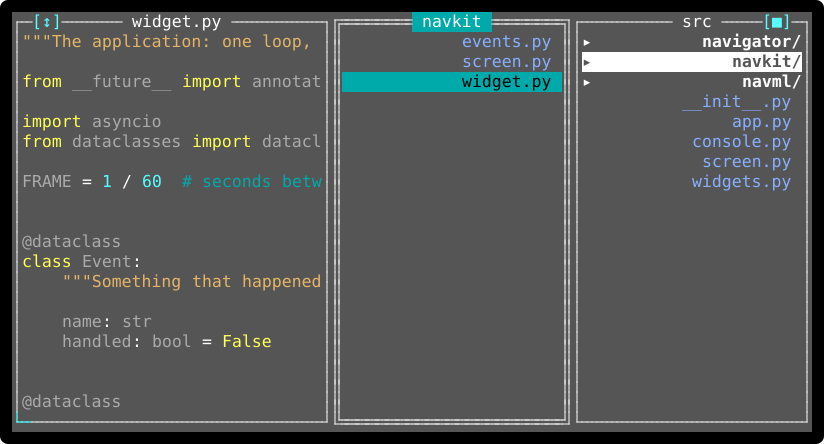

## لوحة المعلومات

يضع `Ctrl+L` معلومات عن اللوحة النشطة مكان اللوحة الأخرى، ويعيد `Ctrl+L` ثانية اللوحة. وهي تتبع اللوحة النشطة
أثناء تنقلك:

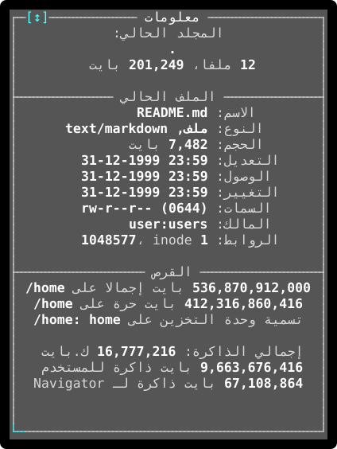

- اسم المجلد، وعدد الملفات فيه وحجمها؛
- الملف الذي تحت المؤشر: نوعه وحجمه وأوقاته وسماته ومالكه وعدد روابطه وعقدته (inode). وتحصل الصورة والصوت
  والفيديو وملف PDF والبرنامج على المزيد: أبعادها بالبكسل، أو مدتها، أو مساراتها، أو صفحاتها، أو المكتبات التي
  يحتاجها البرنامج. وما يحصل عليه الصوت أو الفيديو يحتاج إلى `ffprobe` من FFmpeg؛
- نظام الملفات الذي فيه المجلد: حجمه، والمساحة الحرة، وجهازه أو تسميته. وعلى خادم، الخادم وطريقة الاتصال؛ وفي
  أرشيف، الأرشيف؛
- ذاكرة الحاسوب، وما يمكن للبرامج استعماله بعد، وما يأخذه Navigator نفسه؛
- ملف معلومات المجلد، `DirInfo` أو `File_ID.DIZ`، إن وُجد.

وحين يكون فيها أكثر مما يتسع، ينقل `Tab` لوحة المفاتيح إليها لتمريرها بالأسهم و`PgUp` و`PgDn`؛ وتمررها عجلة
الفأرة أيضا. وتختار صفحة [لوحة المعلومات](settings.md#لوحة-المعلومات) من الإعدادات الأسطر المعروضة.

## أكثر من مدير ملفات

يفتح `Ctrl+F3` نافذة مدير ملفات أخرى. وانظر [النوافذ](windows.md) للتنقل بين النوافذ.

## أقنعة الملفات

تأخذ عدة مربعات قناع ملفات. القناع نمط واحد أو أكثر تفصل بينها `;`، حيث يعني `*` أي نص و`?` أي حرف واحد. والنمط
الذي يبدأ بـ `-` يستبعد ما يطابقه، وآخر نمط يطابق اسما هو الذي يحسم: `*;-*.bak` هو كل الملفات عدا النسخ
الاحتياطية.

## خيارات اللوحة

يضبط `Alt+S`، أو *لوحة > إعداد اللوحة*، طريقة سرد اللوحة النشطة لملفاتها. والخيارات نفسها لكل لوحة جديدة في صفحة
*افتراضيات اللوحة* من [الإعدادات](settings.md#افتراضيات-اللوحات).

- يختار *الترتيب حسب* الترتيب: حسب الاسم أو الامتداد أو الحجم أو الوقت أو السمات أو المالك أو النوع، أو بلا فرز.
  ويعكسه *ترتيب عكسي*.
- يحسب *حجم المجلدات* حجم كل مجلد ويعرضه.
- تختار *الملف الحالي* و*الملفات المحددة* و*المجاميع* و*المساحة الحرة* الأسطر المعروضة تحت القائمة.
- يلوّن *تلوين الملفات* الملفات حسب نوعها.
- يسرد *التنفيذية أولا* و*الأرشيفات أولا* تلك الملفات قبل غيرها.
- يقصر *قناع الملفات* اللوحة على الملفات المطابقة لـ[قناع](#أقنعة-الملفات).

## المرشح

يختار `Alt+Del`، أو *لوحة > التحديد > مرشح متقدم*، الملفات التي تعرضها اللوحة حسب امتداداتها. يسرد المربع `*`
وقناعا لكل امتداد موجود في المجلد.

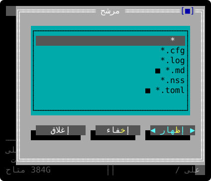

- يعلّم `Space` أو `Ins` قناعا وينتقل إلى التالي. ويعلّمها `+` كلها، و`-` لا شيء، ويعكس `*` العلامات.
- يجعل *إظهار* اللوحة تعرض الأقنعة المعلّمة، أو القناع الذي تحت المؤشر حين لا يكون شيء معلّما.
- يجعل *إخفاء* اللوحة تستبعدها.
- يغلق *إغلاق* المربع. ويبقى مفتوحا بعد *إظهار* و*إخفاء*، فتستطيع متابعة الاختيار.

واختيار `*` يعرض كل شيء من جديد.

## البحث عن ملف

يبحث `Alt+F7`، أو *ملف > بحث*، عن الملفات باسمها وبما تحويه.

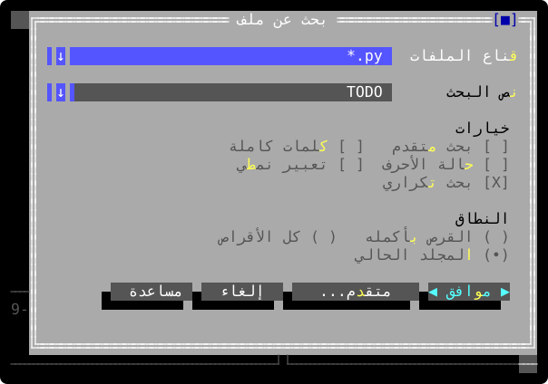

- *قناع الملفات* هو الأسماء المبحوث عنها. والكلمة العادية التي بلا `*` ولا نقطة تجد كل اسم يبدأ بها.
- يقصر *نص البحث* البحث على الملفات التي تحوي النص. اتركه فارغا للبحث بالاسم وحده.

### الخيارات

- يطبق *بحث متقدم* أيضا القيود المضبوطة بزر *متقدم*.
- يميّز *حالة الأحرف* الأحرف الكبيرة من الصغيرة في النص.
- يبحث *بحث تكراري* في المجلدات الفرعية أيضا.
- يتخطى *كلمات كاملة* النص الذي هو جزء من كلمة أطول.
- يقرأ *تعبير نمطي* النص كتعبير نمطي، يُطابق عبر الأسطر.

### النطاق

- يبحث *القرص بأكمله* في القرص كله الذي عليه اللوحة.
- يبحث *المجلد الحالي* في مجلد اللوحة.
- يبحث *كل الأقراص* في كل قرص.

### النتائج

تُسرد الملفات التي عُثر عليها في اللوحة، بعنوان *بحث:* والقناع. يمكنك عرضها وتحريرها ونسخها وحذفها هناك كأي
ملفات أخرى؛ ويذكر السطر الذي تحت اللوحة في أي مجلد كل منها. ويعيدك `Enter` على `..` إلى المجلد الذي بحثت منه.

### البحث المتقدم

يضبط زر *متقدم* قيودا تسري ما دام *بحث متقدم* محددا:

- يقيّد *التاريخ بعد* و*التاريخ قبل* الملفات بوقت تغييرها. وتُكتب التواريخ سنة-شهر-يوم، مثل `2026-01-31`.
- يقيّدها *الحجم أكبر من* و*الحجم أصغر من* بالحجم.
- يقصرها *النوع* على الملفات التنفيذية، أو الروابط الرمزية، أو الملفات المخفية، أو الملفات للقراءة فقط، أو الروابط
  المعطوبة.

ويزيل *مسح الكل* كل القيود.

### الاستبدال في الملفات

يفتح `Alt+Shift+F7` المربع نفسه بسطر إضافي، *استبدال بـ*. يعثر على الملفات بالطريقة نفسها ويستبدل النص في كل منها.

## إنشاء ملف قائمة

يكتب `Alt+L`، أو *لوحة > إنشاء ملف قائمة*، أسماء الملفات المعلّمة في ملف نصي.

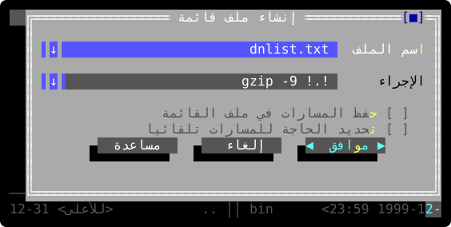

- *اسم الملف* هو الملف المراد كتابته. وإن كان موجودا، تُسأل أتستبدله أم تضيف إلى آخره.
- يحوّل *الإجراء*، إن مُلئ، القائمة إلى نص برمجي: سطر لكل ملف، يوضع فيه اسم الملف داخل النص الذي تعطيه. وتُفصل
  الأسطر المتعددة للملف الواحد بـ `;`.
- يكتب *حفظ المسارات في ملف القائمة* المسار الكامل لكل ملف، لا اسمه وحده.
- يكتب *تحديد الحاجة للمسارات تلقائيا* المسار فقط للملف الذي ليس في مجلد ملف القائمة نفسه.

في الإجراء، تعني هذه الرموز أجزاء من اسم كل ملف:

| ما تكتبه | ما يصبح |
|---|---|
| `!` | الاسم دون امتداده |
| `.!` | الامتداد، مع نقطته |
| `!\` | مجلد الملف، منتهيا بـ `/` |
| `!/` | مجلد الملف، دون `/` الأخيرة |
| `!!` | علامة `!` |

والإجراء الذي ليس فيه أي منها يُضاف اسم الملف إلى آخره: يصبح `cp` هو `cp name`.

## تحديد مجموعة

يعلّم `Gray +` ملفات اللوحة المطابقة لـ[قناع ملفات](#أقنعة-الملفات)، ويلغي `Gray -` تعليمها. وهما أيضا *تحديد مجموعة*
و*إلغاء تحديد مجموعة* في قائمة *لوحة*.

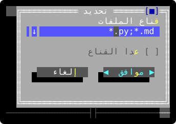

يعكس *عدا القناع* القناع: تُعلّم الملفات التي لا يطابقها أو يُلغى تعليمها.

## إعداد الأعمدة

يختار `Alt+K`، أو *لوحة > إعداد الأعمدة*، ما يعرضه العرض المفصل بجانب كل اسم: *الحجم* و*سمات* و*الروابط* و*مالك*
و*التاريخ*.

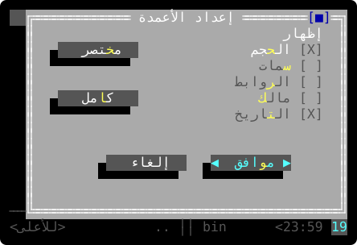

- يعرض *موافق* الأعمدة المحددة.
- يعرض *مختصر* الأسماء وحدها.
- يعرض *كامل* كل الأعمدة عدا *الروابط*.

والأعمدة التي تبدأ بها اللوحة الجديدة في صفحة [الأعمدة](settings.md#الأعمدة) من الإعدادات.

## البحث عن التكرارات

يبحث *لوحة > البحث عن التكرارات* تحت مجلد اللوحة عن ملفات بالمحتوى نفسه ويسردها في اللوحة، كما يفعل البحث.

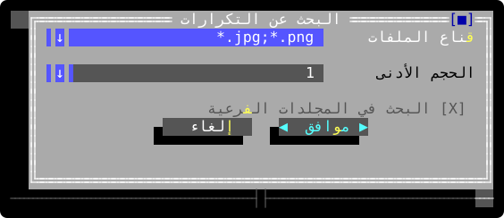

- يختار *قناع الملفات* الملفات التي تُقارن.
- يستبعد *الحجم الأدنى* الملفات الأصغر.
- يبحث *البحث في المجلدات الفرعية* في المجلدات التي تحته أيضا.

تأتي المجموعات التي تهدر أكبر مساحة أولا، وتبقى ملفات المجموعة الواحدة معا أيا كان فرز اللوحة. لا يُعلَّم شيء:
علّم النسخ التي لا تريدها واحذفها بـ `F8`. وتُتجاوز الروابط الرمزية، ولا يُعد اسمان مرتبطان ربطا صلبا بملف واحد
تكرارا.

## أمر إلى اللوحة

يشغّل `Alt+Y`، أو *لوحة > أمر إلى اللوحة*، أمر صدفة في مجلد اللوحة ويسرد الملفات التي يطبعها، اسم ملف في كل سطر،
على أنها قائمة اللوحة. وهو للأوامر التي تجيب عن سؤال "أي الملفات؟":

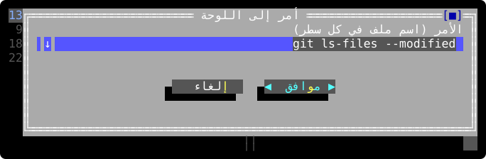

```sh
git ls-files -m
grep -l TODO *.py
```

وسطر الأوامر الذي يبدأ بـ `|` يفعل الشيء نفسه دون المربع.

## سجل المجلدات

يسرد `Alt+BkSp`، أو *لوحة > سجل المجلدات*، المجلدات التي زارتها اللوحات، والأخير أولا. يفتح *انتقال* المجلد الذي
تحت المؤشر في اللوحة النشطة، ويزيله *حذف السجل* من القائمة.

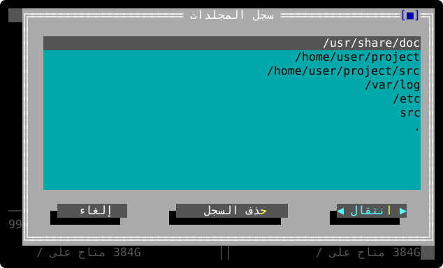

## تذكر مجلد

يحفظ *لوحة > تذكّر لهذا المجلد* ترتيب الفرز ونمط العرض وقناع الملفات التي تعرضها اللوحة الآن، ويستعملها كلما كانت
لوحة في ذلك المجلد. ويعرض *وأيضًا لمجلداته الفرعية* كل مجلد تحته بالطريقة نفسها، إلا إذا كان أحدها محفوظا لنفسه.

يعرض *قائمة المجلدات المحفوظة* المجلدات المحفوظة. ينتقل `Enter` إلى أحدها، وينساه `Del`.
