# الإعدادات

يضم *خيارات > الإعدادات* كل الإعدادات في خمس عشرة صفحة. يغيّر `Ctrl+PgUp` و`Ctrl+PgDn` الصفحة؛ والمداخل التي تحت
*خيارات > تهيئة* و*خيارات > مدير الملفات* تفتح المربع على صفحتها. وإبقاء الفأرة فوق خيار يُظهر ما يفعله.

يطبّق *موافق* التغييرات فورا ويكتبها في `navigator.ini`. ويتخلى *إلغاء* عنها.

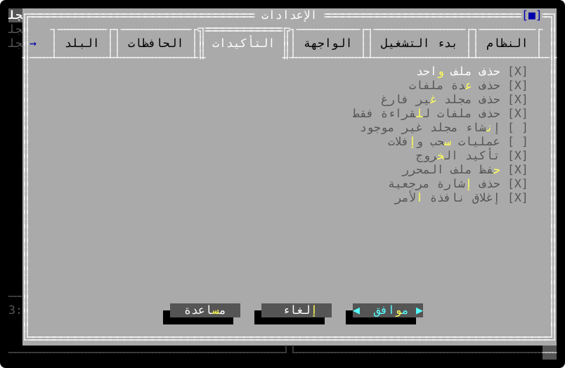

## النظام

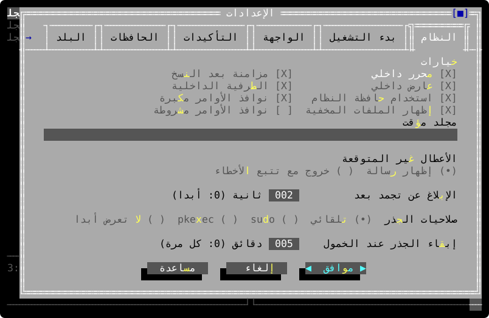

- *محرر داخلي* و*عارض داخلي*: يستخدم `F4` و`F3` محرر Navigator وعارضه. وعند إلغائهما يشغّلان البرنامج المسمّى في
  `$EDITOR` و`$PAGER`.
- *استخدام حافظة النظام*: النسخ إلى حافظة سطح المكتب واللصق منها. وعند إلغائه يحتفظ Navigator بحافظة خاصة به.
- *إظهار الملفات المخفية*: تعرض اللوحة الجديدة الملفات المخفية. ويبدّل `Ctrl+H` ذلك للوحة واحدة.
- *مزامنة بعد النسخ*: يُكتب كل ملف منسوخ إلى القرص فعليا قبل أن يُعدّ منجزا.
- *الطرفية الداخلية*: يعرض `Ctrl+O` وحدة التحكم داخل Navigator. وعند إلغائه يسلّم الطرفية كلها إلى الصدفة.
- *نوافذ الأوامر مكبرة* و*نوافذ الأوامر مشروطة*: كيف يُفتح الأمر الذي يعمل في نافذة خاصة به.
- *مجلد مؤقت*: مكان الملفات المؤقتة. والفارغ يعني `$TMPDIR`.
- *الأعطال غير المتوقعة*: الخطأ غير المتوقع إما يعرض رسالة بتفاصيله، وإما يُنهي Navigator ويطبعها.
- *الإبلاغ عن تجمد بعد*: كم ثانية يجوز أن يتوقف Navigator فيها عن الاستجابة قبل أن يُكتب السبب في `errors.log`.
- *صلاحيات الجذر*: كيف تُعاد خطوة رُفض إذنها بصلاحيات root: عبر `sudo`، أو عبر `pkexec`، أو لا تُعاد أبدا.
- *إبقاء الجذر عند الخمول*: كم دقيقة تبقى صلاحيات root مفتوحة بعد آخر استخدام لها. انظر
  [العمل بصلاحيات root](as-root.md).

## بدء التشغيل

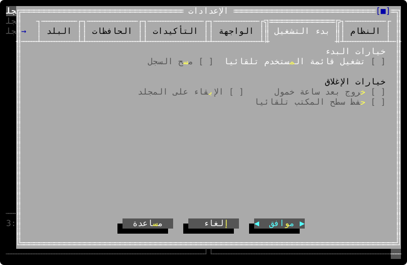

- *تشغيل قائمة المستخدم تلقائيا*: تُفتح قائمة المستخدم (`F2`) حين يبدأ Navigator.
- *مسح السجل*: تُزال مدخلات السجل غير المثبّتة في كل بدء.
- *خروج بعد ساعة خمول*: يُنهي Navigator نفسه بعد ساعة بلا ضغطة مفتاح أو نقرة.
- *حفظ سطح المكتب تلقائيا*: تُحفظ النوافذ عند الخروج وتعود في البدء التالي.
- *الإبقاء على المجلد*: تحتفظ اللوحة النشطة بمجلدها بعد الأمر، وفي سطح المكتب المستعاد.

## الواجهة

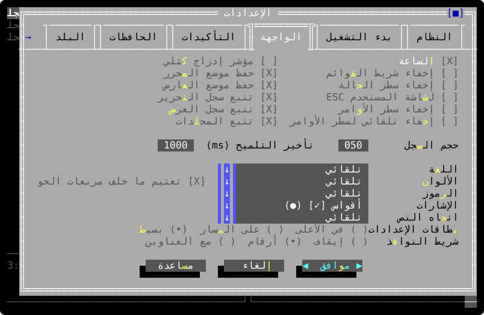

- *الساعة*، *إخفاء شريط القوائم*، *إخفاء سطر الحالة*: الساعة على شريط القوائم، وشريط القوائم نفسه إلى أن يُضغط
  `F10`، وشريط المفاتيح في السطر السفلي.
- *ESC لشاشة المستخدم*: يعرض `Esc` على سطر أوامر فارغ وحدة التحكم حتى المفتاح التالي.
- *إخفاء سطر الأوامر* و*إخفاء تلقائي لسطر الأوامر*: إخفاء سطر الأوامر دائما، أو ما دام فارغا.
- *مؤشر إدراج كتلي*: مؤشر كتلي على سطر الأوامر.
- *حفظ موضع المحرر* و*حفظ موضع العارض*: يُعاد فتح الملف في النافذة، وفي الموضع، الذي تُرك فيه.
- *تتبع سجل التحرير*، *تتبع سجل العرض*، *تتبع المجلدات*: الاحتفاظ بالقوائم التي يعرضها `Alt+PgUp` و`Alt+PgDn`
  و`Alt+Backspace`.
- *حجم السجل*: كم مدخلا تحتفظ به كل قائمة سجل.
- *تأخير التلميح (ms)*: كم تبقى الفأرة ساكنة قبل ظهور التلميح؛ و0 لعدم إظهاره.
- *اللغة*: لغة التسميات والرسائل.
- *الألوان*: كم لونا يُرسل إلى الطرفية.
- *الرموز*: أي الأحرف يُفترض أن خط الطرفية يحتويها: ASCII العادي، أو Unicode، أو أيقونات خط Nerd Font.
- *تعتيم ما خلف الحوار*: يُرسم ما خلف مربع الحوار باهتا.
- *الإشارات*: كيف تُرسم مربعات الاختيار وأزرار الراديو.
- *اتجاه النص*: من اليسار إلى اليمين، أو من اليمين إلى اليسار، أو كما تُقرأ اللغة.
- *بطاقات الإعدادات*: أين يعرض هذا المربع بطاقاته.
- *شريط النوافذ*: هل تُسرد النوافذ المفتوحة على شريط القوائم، بأرقامها أو بعناوينها.

## التأكيدات

كل مربع يجعل Navigator يسأل قبل الإجراء: مسح ملف واحد، ومسح عدة ملفات، ومسح مجلد غير فارغ، ومسح ملفات للقراءة فقط،
وإنشاء مجلد يسمّيه نسخ، والسحب والإفلات، والخروج، والحفظ في المحرر، وحذف إشارة مرجعية، وإغلاق نافذة أوامر لا يزال
أمرها يعمل.

## الحافظات

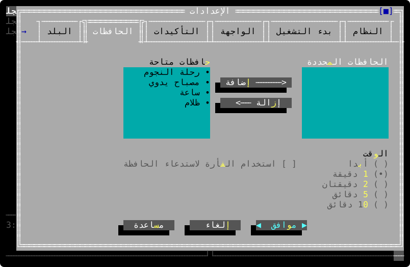

تستولي حافظة الشاشة على الشاشة بعد مدة بلا ضغطة مفتاح أو نقرة.

- تتناوب *الحافظات المحددة*. ينقل *إضافة* واحدة إليها من *حافظات متاحة*، ويخرجها *إزالة*.
- *الوقت* هو مدة الانتظار، أو *أبدا*.
- *استخدام الفأرة لاستدعاء الحافظة*: تحريك المؤشر إلى الزاوية العليا اليمنى يبدأ حافظة فورا؛ وما دام في الزاوية
  السفلى اليمنى لا تبدأ أي حافظة.

## البلد

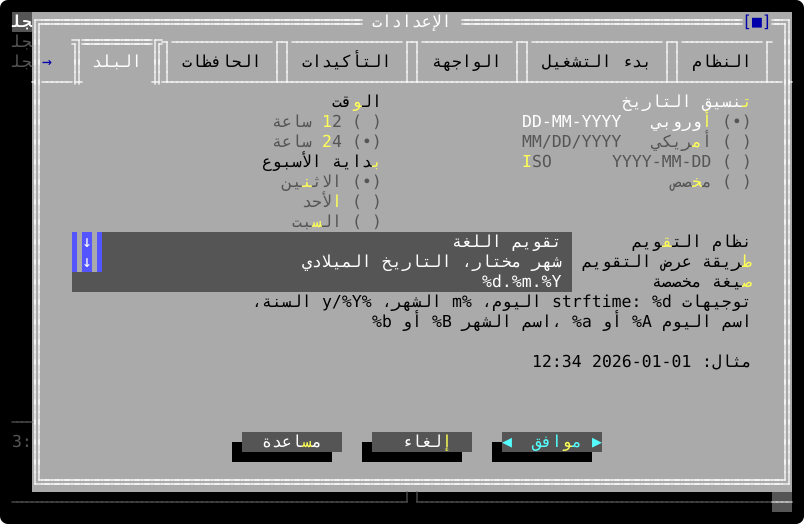

- *تنسيق التاريخ*: الترتيب الذي تُكتب به التواريخ، أو *مخصص* مع الصيغة مكتوبة في سطر *صيغة مخصصة*.
- *الوقت*: ساعة بنظام 12 ساعة أو 24 ساعة.
- *بداية الأسبوع*: أول أيام الأسبوع في التقاويم.
- *نظام التقويم* و*طريقة عرض التقويم*: أي تقويم تعرضه نافذة التقويم، وهل يقف بجانب التقويم الميلادي.

يعرض *مثال* تاريخا ووقتا مكتوبين كما اخترت.

## المحرر/العارض

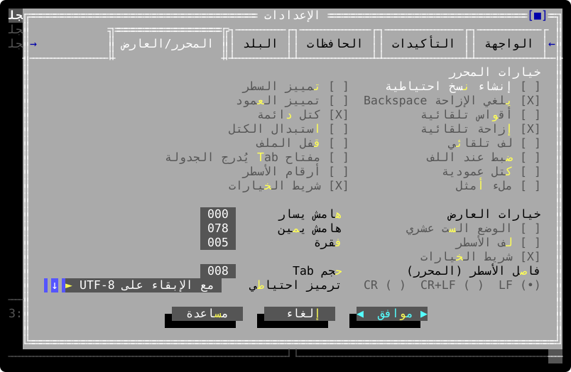

ما تبدأ به نافذة المحرر أو العارض الجديدة. ويمكن تبديل معظم خيارات المحرر لنافذة واحدة من قائمة *خيارات* فيها.

خيارات المحرر:

- *إنشاء نسخ احتياطية*: الحفظ بـ `F2` يُبقي الملف القديم باسم `NAME.bak`.
- *Backspace يلغي الإزاحة*: يعود `Backspace` في الفراغات البادئة إلى إزاحة سطر أعلى.
- *أقواس تلقائية*: كتابة `(` أو `{` أو `[` تكتب نظيره أيضا.
- *إزاحة تلقائية*: يُزيح `Enter` السطر الجديد كالسطر الذي فوقه.
- *لف تلقائي* و*ضبط عند اللف*: السطر المكتوب بعد الهامش الأيمن يُلف، ويُمدّ السطر المتروك خلفه حتى الهامش.
- *كتل عمودية*: تُعلَّم الكتل أعمدةً.
- *تعبئة مثلى*: الفراغات التي تبلغ موقف جدولة تُكتب جدولةً.
- *تمييز السطر* و*تمييز العمود*: يُميَّز سطر المؤشر وعموده.
- *كتل دائمة*: تبقى الكتلة معلَّمة حين يتحرك المؤشر. و*استبدال الكتل*، حين يكون ذلك ملغى: الكتابة واللصق
  يستبدلان الكتلة.
- *قفل الملف*: يضع المحرر على ملفه قفلا تراه البرامج الأخرى.
- *مفتاح Tab يُدرج الجدولة*: يُدرج `Tab` حرف جدولة، لا مسافات.
- *أرقام الأسطر*: تُرقَّم الأسطر على اليسار.
- *شريط الخيارات*: يعرض الإطار السفلي خيارات النافذة، والنقر يبدّل أحدها.

خيارات العارض: *الوضع الست عشري* يفتح الملفات بالست عشري، و*لف الأسطر* يلف الأسطر الطويلة، و*شريط الخيارات* كما في
المحرر.

- *هامش يسار*، *هامش يمين*، *الفقرة*: هوامش [تنسيق الفقرات](editor.md#الهوامش).
- *حجم الجدولة*: عرض الجدولة.
- *فاصل الأسطر (المحرر)*: نهاية السطر التي يُعطاها الملف الجديد.
- *ترميز احتياطي*: الترميز الذي يقرأ به المحرر ملفا ليس بترميز UTF-8.

## أنواع العارض

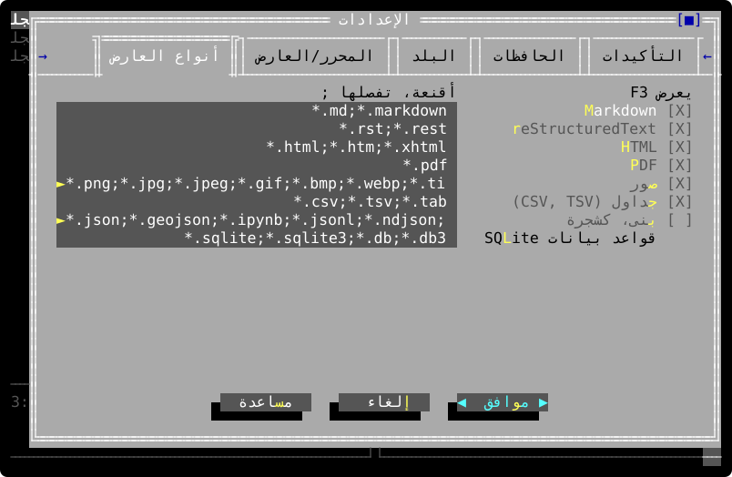

أي الملفات يعرضها `F3` بشكل غير نصها: Markdown وreStructuredText وHTML صفحةً، وPDF نصا، والصور صورا، وCSV وTSV
جدولا، والملفات المهيكلة (JSON وYAML وTOML وXML) شجرةً. لكل منها مربع لتشغيله وسطر من [أقنعة الملفات](panels.md#أقنعة-الملفات)
يحدد الملفات التي ينطبق عليها. و*قواعد بيانات SQLite* هو قناع الملفات التي تُفتح قاعدة بيانات.

## لوحات الملفات

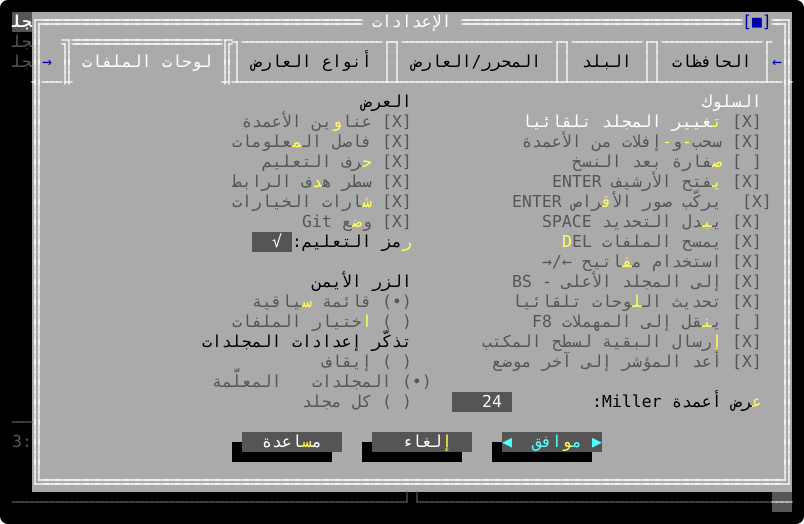

السلوك:

- *تغيير المجلد تلقائيا*: تتبع اللوحة المؤشر في الشجرة التي بجانبها.
- *سحب-و-إفلات من الأعمدة*: يمكن سحب الملفات من اللوحة بالفأرة.
- *صفارة بعد النسخ*: يرن جرس الطرفية حين ينتهي النسخ.
- *ENTER يفتح الأرشيف*: يدخل `Enter` على أرشيف إليه كأنه مجلد.
- *ENTER يركّب صور الأقراص*: يركّب `Enter` على ملف `.iso` أو `.img` ذلك الملف ويفتحه.
- *SPACE يبدل التحديد*، *DEL يمسح الملفات*، *BS - إلى المجلد الأعلى*: تعمل هذه المفاتيح على اللوحة ما دام سطر
  الأوامر فارغا.
- *استخدام مفاتيح ←/→*: تحرّر الأسهم و`Home` و`End` سطر أوامر فيه نص. وعند إلغائه تفعل ذلك مع `Shift`.
- *تحديث اللوحات تلقائيا*: تعيد اللوحة قراءة مجلدها حين يتغير على القرص.
- *F8 ينقل إلى المهملات*: ينقل `F8` الملفات إلى المهملات بدلا من مسحها.
- *إرسال البقية لسطح المكتب*: يفتح `Enter` على ملف لم يُحدَّد له برنامج ذلك الملف في تطبيق سطح المكتب.
- *أعد المؤشر إلى آخر موضع*: العودة إلى مجلد تضع المؤشر حيث تُرك.
- *عرض أعمدة Miller*: عرض العمود في عرض Miller.

العرض:

- *عناوين الأعمدة*: صف عناوين فوق الأعمدة.
- *فاصل المعلومات*: خط فوق المجاميع تحت القائمة.
- *حرف التعليم* و*علامة التحديد*: يُعلَّم الملف المحدد بعلامة، وأي علامة.
- *سطر هدف الرابط*: يعرض سطر تحت اللوحة إلى أين يشير الرابط الرمزي.
- *شارات الخيارات*: يعرض الإطار السفلي خيارات اللوحة، والنقر يبدّل أحدها.
- *وضع Git*: في شجرة عمل git، حالة كل ملف، والفرع في العنوان.

يختار *الزر الأيمن* ما يفعله زر الفأرة الأيمن في اللوحة: فتح قائمة السياق، أو تحديد الملفات. ويختار *تذكّر
إعدادات المجلدات* أي المجلدات تحتفظ بترتيبها وعرضها وأعمدتها وقناع ملفاتها الخاصة.

## لوحة المعلومات

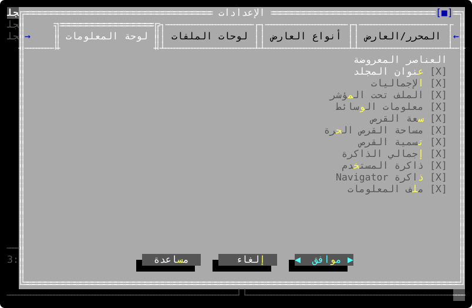

أي الأسطر تعرضها لوحة المعلومات (`Ctrl+L`): اسم المجلد، ومجاميعه، والملف الذي تحت المؤشر، وتفاصيل الوسائط، وحجم
وحدة التخزين ومساحتها الحرة وتسميتها، وذاكرة الجهاز، وملف معلومات المجلد.

## افتراضيات اللوحات

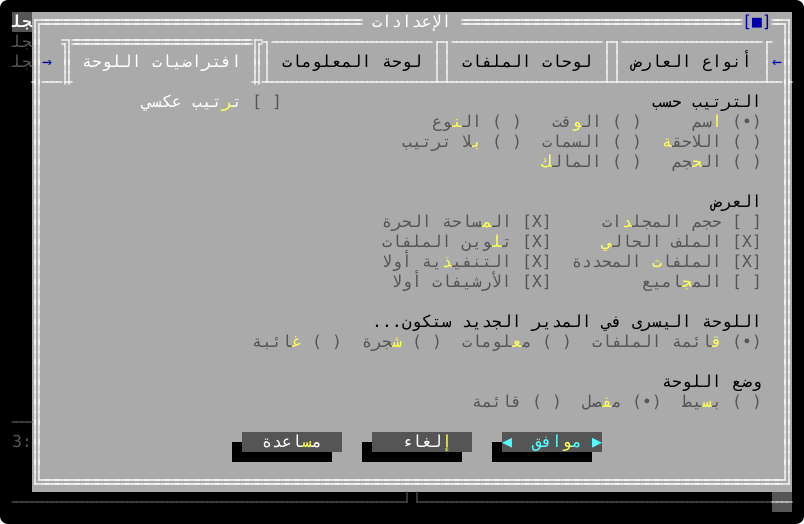

كيف تبدأ لوحات مدير ملفات جديد.

- *الترتيب حسب* و*ترتيب عكسي*: الترتيب الذي تُسرد به الملفات.
- *حجم المجلدات*: يُحسب حجم كل مجلد ويُعرض.
- *الملف الحالي*، *الملفات المحددة*، *المجاميع*، *المساحة الحرة*: الأسطر تحت القائمة.
- *تلوين الملفات*: تُلوَّن الملفات حسب نوعها.
- *التنفيذية أولا* و*الأرشيفات أولا*: تُسرد تلك الملفات قبل غيرها.
- *اللوحة اليسرى في المدير الجديد ستكون*: لوحة ملفات، أو لوحة المعلومات، أو شجرة، أو لا شيء.
- *وضع اللوحة*: العرض البسيط أو المفصّل أو القائمة.

## الأعمدة

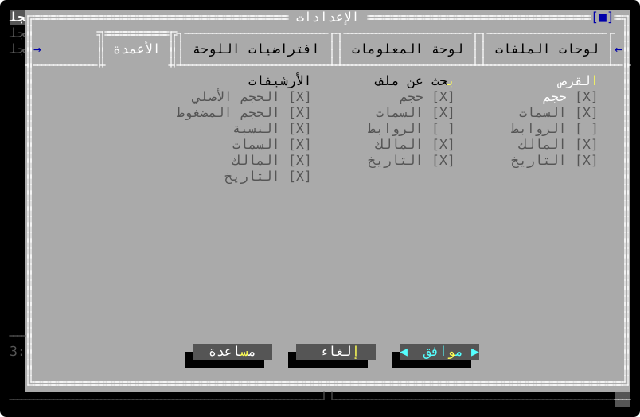

أي الأعمدة تعرضها اللوحة في عرضها المفصّل، تُضبط على حدة لثلاثة أنواع من القوائم. ويغيّرها `Alt+K` للوحة واحدة؛
انظر [إعداد الأعمدة](panels.md#إعداد-الأعمدة).

- *القرص*: مجلد على القرص أو على خادم. الأعمدة هي *الحجم*، و*السمات*، و*الروابط* (كم اسما للملف)، و*المالك*،
  و*التاريخ*.
- *بحث عن ملف*: القائمة التي يملأ بها [البحث عن ملف](panels.md#البحث-عن-ملف) لوحةً. الأعمدة نفسها.
- *الأرشيفات*: داخل الأرشيف. *الحجم الأصلي*، و*الحجم المضغوط*، و*نسبة الضغط* (مقدار ضغطه)، و*السمات*، و*المالك*،
  و*التاريخ*.

## التلوين

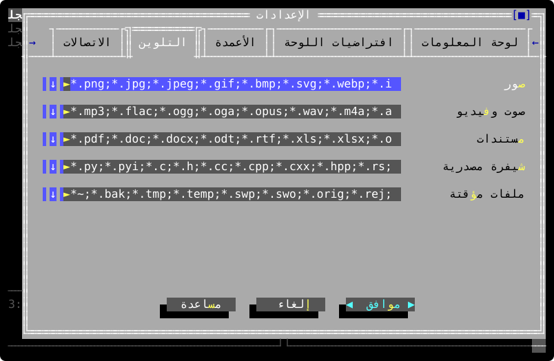

[أقنعة الملفات](panels.md#أقنعة-الملفات) للمجموعات الخمس التي تلوّنها اللوحات: *الصور*، و*الصوت والفيديو*، و*المستندات*،
و*الشيفرة المصدرية*، و*ملفات مؤقتة*. الملف المطابق لقناع مجموعة يُسرد بلون تلك المجموعة ما دام *تلوين الملفات*
معلَّما للوحة. أما الألوان نفسها فهي ألوان السمة، وتُغيَّر من *خيارات > الألوان* ([الألوان](customizing.md#الألوان)).

تلوّن هذه المجموعات الأسماء في اللوحات؛ أما الألوان التي يأخذها النص داخل الملف في العارض والمحرر فتُضبط في
`highlight.ini` ([تلوين الصيغة](editor.md#تلوين-الصياغة)).

## الاتصالات

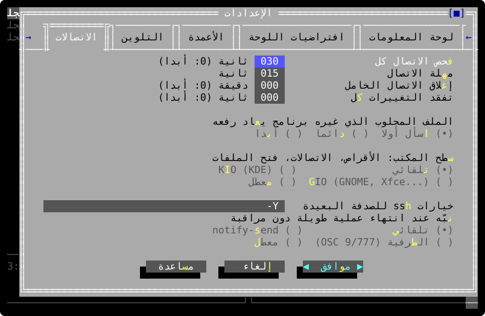

- *فحص الاتصال كل*: كم مرة تُرسل رسالة لإبقاء الاتصال بخادم مفتوحا.
- *مهلة الاتصال*: كم يُنتظر رد الخادم.
- *إغلاق الاتصال الخامل*: كم يبقى الاتصال غير المستخدم مفتوحا.
- *تفقد التغييرات كل*: كم مرة يُفحص مجلد الخادم بحثا عن تغييرات.
- *الملف المجلوب الذي غيره برنامج يعاد رفعه*: هل يُرفع هذا الملف مجددا: بعد السؤال، أو دائما، أو أبدا.
- *سطح المكتب*: خدمات أي سطح مكتب تُستخدم للأقراص والاتصالات وفتح الملفات.
- *خيارات ssh للصدفة البعيدة*: كلمات تُضاف إلى أمر `ssh` لكل صدفة بعيدة.
- *نبّه عند انتهاء عملية طويلة دون مراقبة*: كيف يُبلَّغ سطح المكتب بانتهاء عملية طويلة بينما كانت الطرفية في
  الخلفية.

## أدوات

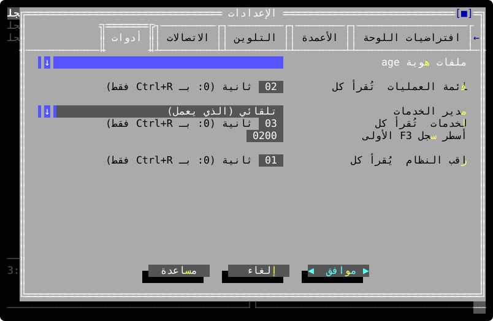

- *ملفات هوية age*: ملفات المفاتيح التي يفك بها `age` التشفير.
- *قائمة العمليات تُقرأ كل*، *الخدمات تُقرأ كل*، *راقب النظام يُقرأ كل*: كم مرة تتحدّث تلك النوافذ.
- *مدير الخدمات*: أي مدير خدمات تتواصل معه نافذة الخدمات.
- *أسطر سجل F3 الأولى*: كم من سجل الخدمة يفتح عليه `F3`.
