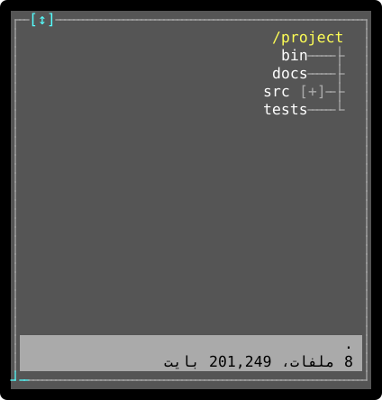
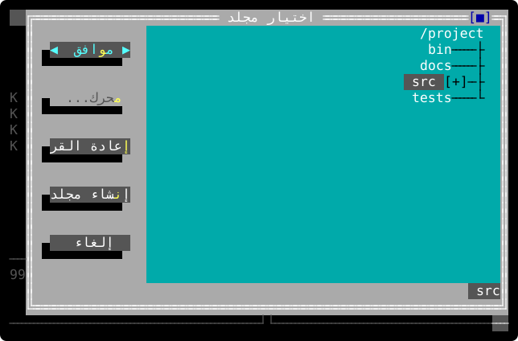
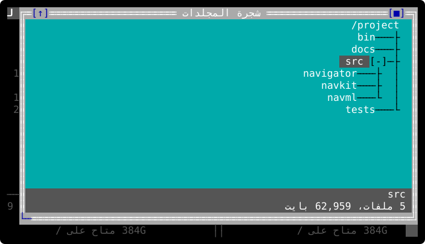
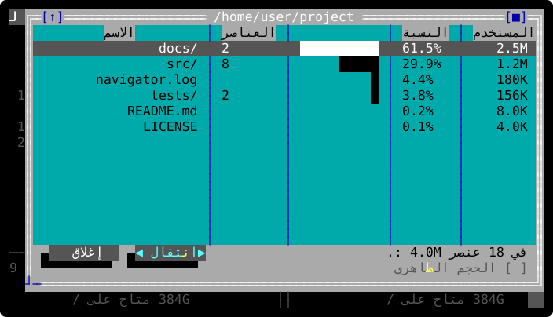

# أشجار المجلدات

تعرض الشجرة المجلدات، وتحت كل منها المجلدات التي فيه بإزاحة.

| المفتاح | ما يفعله |
|---|---|
| `Up`, `Down` | تحريك المؤشر |
| `Right` | فتح المجلد والدخول إليه |
| `Left` | الانتقال إلى المجلد الذي يحويه |
| `+`, `-` أو `Space` | فتح المجلد أو طيه |
| `*` | فتح كل المجلدات |
| `Enter` | اختيار المجلد |
| `Ctrl+S` | البحث: اكتب بداية الاسم؛ ويتابع `/` البحث داخل المجلد الذي عُثر عليه |

تعرض الشجرة المجلدات المخفية حين تعرضها اللوحة (`Ctrl+H`).

## الشجرة بجانب اللوحة

يضع `Ctrl+T` شجرة مكان اللوحة غير النشطة. تتبع الشجرة اللوحة النشطة، وتتبعها اللوحة: إيقاف المؤشر على مجلد في
الشجرة يعرض ذلك المجلد في اللوحة. وإذا أُلغي تحديد *تغيير المجلد تلقائيا* في صفحة [لوحات الملفات](settings.md#لوحات-الملفات)
من الإعدادات، فلا يفعل ذلك إلا `Enter`.

## تغيير المجلد

يفتح `Alt+T` شجرة في مربع لاختيار مجلد اللوحة النشطة منها. ينشئ *إنشاء مجلد* مجلدا تحت المؤشر، ويقرأ *إعادة
القراءة* الشجرة من جديد.

## نافذة الشجرة

يفتح *قرص > شجرة المجلدات* الشجرة في نافذة خاصة بها على سطح المكتب، تبقى مفتوحة وأنت تعمل في مكان آخر. يرسل
`Enter` على مجلد اللوحةَ النشطة في مدير الملفات النشط إليه. وللنافذة قائمة *شجرة* خاصة بها، فيها *إعادة القراءة*
(`Ctrl+R`) و*بحث سريع* (`Ctrl+S`) و*إغلاق*؛ ويغلقها `Esc` أيضا.

## أحجام المجلدات

يقيس *قرص > أحجام المجلدات* مجلد اللوحة النشطة ويسرد ما فيه حسب الحجم، لترى ما يشغل المساحة.

| المفتاح | ما يفعله |
|---|---|
| `Enter`, `Right` | الدخول إلى مجلد |
| `Backspace`, `Left` | الخروج منه |
| `Ctrl+N`, `Ctrl+S`, `Ctrl+E` | الفرز حسب الاسم أو الحجم أو عدد العناصر؛ والضغط ثانية يعكس الترتيب |
| `Ctrl+A` | التبديل بين حجم المحتوى والمساحة المشغولة على القرص |
| `F8`, `Del` | الحذف، كما في اللوحة |
| `Ctrl+R` | القياس من جديد |
