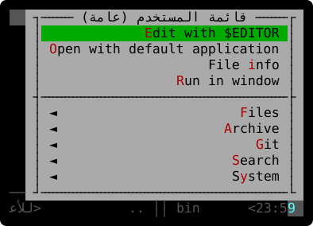

# قائمة المستخدم وارتباطات الملفات

## قائمة المستخدم

يفتح `F2` قائمة بأوامرك الخاصة. يبحث Navigator عن ملف اسمه `.navigator-menu.ini` في مجلد اللوحة وفي كل مجلد
فوقه؛ وهذه هي القائمة *المحلية*. وإن لم يجده استعمل القائمة *الشاملة*، وهي `menu.ini` في مجلد إعدادات Navigator.



في القائمة، يبدّل `F2` بين القائمة المحلية والشاملة، ويفتح `F4` القائمة المعروضة في المحرر. ويحررهما أيضا
*خيارات > تعريف القائمة الشاملة* و*تعريف القائمة المحلية*.

### كتابة قائمة

```ini
# A comment
~S~how the file = less !.!

[Archive]
~P~ack this file = tar czf !.tar.gz !.!
-
~L~ist = tar tf !.!
```

- `Caption = command` بند. والأسطر المزاحة تحته أوامر إضافية للبند نفسه.
- `[Name]` يبدأ قائمة فرعية، و`[Name/Inner]` قائمة داخلها.
- السطر الذي ليس فيه إلا `-` فاصل.
- `~` قبل حرف تجعله مفتاح البند السريع. والعنوان الذي يبدأ بـ `F1` إلى `F12` تليه مسافة يُختار بذلك المفتاح.

هذه الرموز تعني الملف الذي تحت المؤشر في اللوحة النشطة:

| ما تكتبه | ما يصبح |
|---|---|
| `!` | الاسم دون امتداده |
| `.!` | الامتداد، مع نقطته |
| `!.!` | الاسم كاملا |
| `!\` | المجلد، منتهيا بـ `/` |
| `!/` | المجلد، دون `/` الأخيرة |
| `!!` | علامة `!` |

والرموز نفسها مع `$` مكان `!` تعني الملف في اللوحة الأخرى، فاكتب `$$` لعلامة `$` تريدها أنت. `%1` ملف يسرد
الأسماء المعلّمة في اللوحة النشطة، و`%2` أسماء اللوحة الأخرى.

`%3` إلى `%9` كلمات تُسأل عنها حين يعمل البند. يعطي السطر `<Title` السؤال عنوانا، ويملأ `<=text` إجابة يُبدأ منها.

تُقتبس الأسماء للصدفة حيث يلزم، فلا تضع حولها علامات اقتباس. تعمل الأوامر في صدفة وحدة التحكم، كأنك كتبتها.

## ارتباطات الملفات

خمسة ملفات أخرى في مجلد الإعدادات تحدد طريقة التعامل مع كل نوع من الملفات. لكل منها قسم لكل قناع ملفات.

| الملف | ما يحدده | يُحرر من |
|---|---|---|
| `extensions.ini` | ما يشغّله `Enter` لملف | *خيارات > تحرير ملف الامتدادات* |
| `viewers.ini` | ما يشغّله `F3` بدلا من العارض | *خيارات > عارضات* |
| `editors.ini` | ما يشغّله `F4` بدلا من المحرر | *خيارات > محررات* |
| `quickrun.ini` | ما يشغّله `Ctrl+Shift+F1` إلى `Ctrl+Shift+F10` | *خيارات > تحرير ملف التشغيل السريع* |
| `highlight.ini` | كيف يلوّن المحرر والعارض الملف، وخيارات المحرر له | *خيارات > تحرير ملف التلوين* |

يستعمل `Alt+F3` دائما عارض Navigator نفسه. ويستعمل `Alt+F4` برنامج `editors.ini` حين يستعمل `F4` محرر
Navigator، والعكس بالعكس؛ انظر [المحرر](editor.md#فتح-ملف). يُكتب كل ملف بأمثلة عند أول تشغيل لـ Navigator.
ويرد وصف `highlight.ini` تحت [تلوين الصياغة](editor.md#تلوين-الصياغة).
