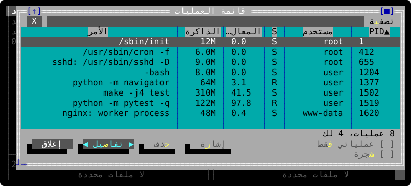
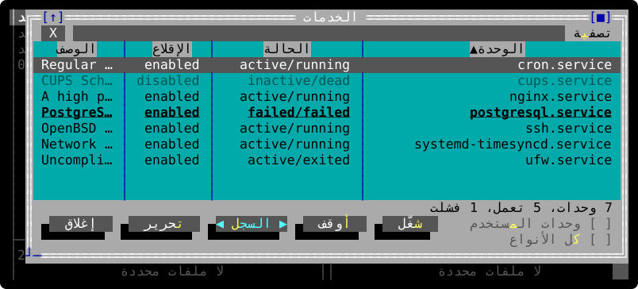
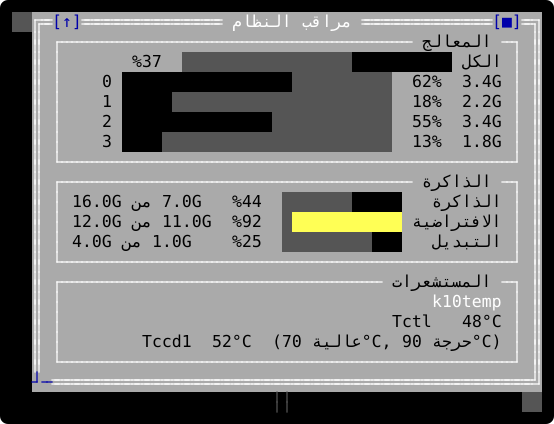
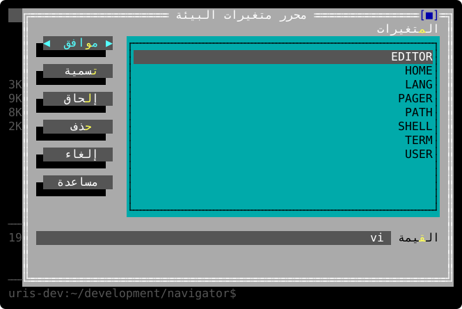
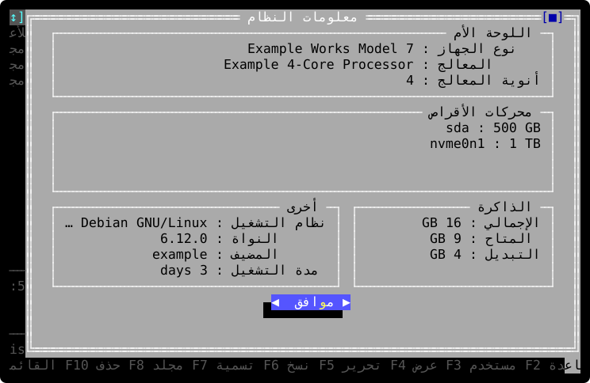
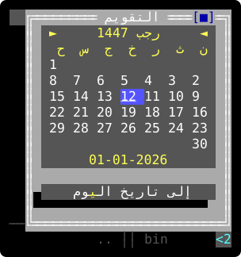
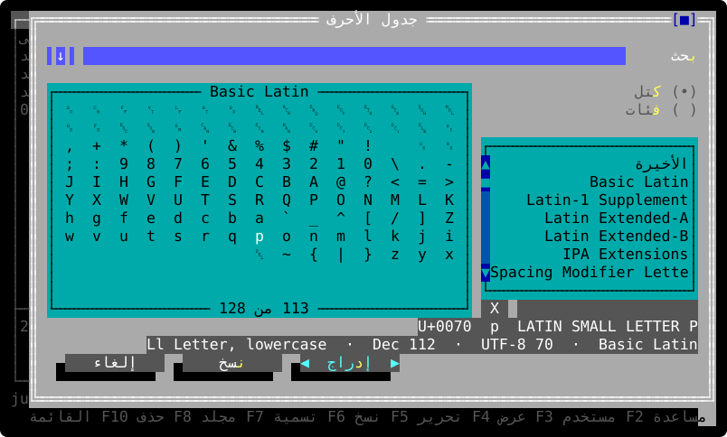

# الأدوات

## قائمة العمليات

يعرض *أدوات > قائمة العمليات* العمليات الجارية.

| المفتاح | ما يفعله |
|---|---|
| الكتابة، `F4` | ترشيح القائمة إلى العمليات التي يحوي أمرها أو اسمها أو مستخدمها أو رقمها النص؛ ويمسحه `Esc` |
| `Ctrl+T` | عرض العمليات على شكل شجرة من الآباء والأبناء |
| `Ctrl+H` | عرض عملياتك أنت فقط |
| `Ctrl+P`, `Ctrl+U`, `Ctrl+E`, `Ctrl+L`, `Ctrl+Z`, `Ctrl+N` | الفرز حسب الرقم أو المستخدم أو الحالة أو حمل المعالج أو الذاكرة أو الأمر |
| `Left`, `Right` | تمرير الأوامر الطويلة |
| `F3` | عرض تفاصيل عملية |
| `F7` | إرسال إشارة تختارها |
| `F8`, `Del` | إنهاء العملية، بعد السؤال |
| `Ctrl+R` | قراءة القائمة من جديد |

النقر على عنوان عمود يفرز حسبه. وحين تُرفض إشارة لنقص الصلاحية يُعرض عليك إرسالها بصلاحيات root.

## الخدمات

يسرد *أدوات > الخدمات* خدمات النظام ويتحكم فيها، عبر systemd أو OpenRC أو runit أو SysVinit.

| المفتاح | ما يفعله |
|---|---|
| `Enter` | عرض تفاصيل خدمة |
| `F3` | عرض سجلها ومتابعته |
| `F4` | تحرير إعداداتها |
| `F5`, `F6`, `F7` | البدء، وإعادة التشغيل، وإعادة التحميل |
| `F8`, `Del` | الإيقاف، بعد السؤال |
| `Ctrl+E`, `Ctrl+D` | تفعيل البدء عند الإقلاع وتعطيله |
| `Ctrl+U` | عرض خدماتك أنت |
| `Ctrl+A` | عرض الوحدات من كل الأنواع |
| `Ctrl+S` | ترشيح القائمة |
| `Ctrl+R` | قراءة القائمة من جديد |

تغيير خدمة نظام يحتاج عادة إلى صلاحيات root، وهو ما يُعرض عليك.

## مراقب النظام

يعرض *أدوات > مراقب النظام* الحمل على كل معالج، والذاكرة ومساحة التبديل المستعملتين، ودرجات الحرارة وسرعات المراوح
التي يبلّغ عنها الجهاز.

## تحرير البيئة

يعرض *أدوات > تحرير البيئة* متغيرات البيئة التي تُعطى للبرامج المشغّلة من Navigator، ويتيح لك تغييرها.

- يسرد *المتغيرات* الأسماء. وقيمة المتغير الذي تحت المؤشر في سطر *القيمة*، حيث يمكنك تحريرها.
- يعطي *تسمية* المتغير اسما آخر.
- يضيف *إلحاق* متغيرا جديدا.
- يزيل *حذف* المتغير الذي تحت المؤشر.
- يحفظ *موافق* التغييرات؛ ويتخلى *إلغاء* عنها كلها.

تصل التغييرات إلى البرامج التي يشغّلها Navigator من بعدها: العارض والمحرر الخارجيين، وأوامر قائمة المستخدم،
والصدفة في وحدة التحكم. وتدوم حتى تخرج من Navigator.

## معلومات النظام

يعرض *أدوات > معلومات النظام* ماهية الجهاز: *اللوحة الأم* والمعالج، و*محركات الأقراص*، و*الذاكرة*، وتحت *أخرى*
النظام ونواته واسم المضيف ومدة تشغيله.

## التقويم

يعرض *أدوات > التقويم* شهرا، واليوم الحالي معلّم. وتحت الأسابيع يُكتب اليوم الذي تحت المؤشر كاملا بصيغة التاريخ
في إعدادات [البلد](settings.md#البلد).

| المفتاح | ما يفعله |
|---|---|
| الأسهم | الانتقال من يوم إلى يوم |
| `PgUp`, `PgDn` | الشهر السابق والتالي |
| `Ctrl+PgUp`, `Ctrl+PgDn` | السنة السابقة والتالية |
| `M`, `Y` | اختيار شهر، أو سنة، من قائمة |
| `T` | الانتقال إلى اليوم؛ وكذلك الزر *إلى تاريخ اليوم* |
| `C` | التبديل بين التقويم الآخر والتقويم الميلادي |
| `Esc` | إغلاق التقويم |

في قائمة *التقويم* الأوامر نفسها واثنان آخران. يعرض *نظام التقويم* الشهر بتقويم آخر، كالعبري أو الهجري أو
الفارسي. ويحدد *طريقة عرض التقويم* ما يُعرض منه بجانب الشهر الميلادي: شهره وحده، أو اليوم مكتوبا به تحت الشهر
الميلادي، أو شهره وتحته اليوم الميلادي مكتوبا، أو الشهرين جنبا إلى جنب.

## جدول الرموز

يعثر `Ctrl+B`، أو *أدوات > جدول الرموز*، على حرف ويكتبه حيث المؤشر.

- يعثر *بحث* على الأحرف باسمها، مثل `arrow` أو `euro`.
- تختار القائمة التي على اليسار مجموعة أحرف، ويضيّق السطر الذي تحتها المجموعات بالاسم.
- تعرض الشبكة التي على اليمين المجموعة. ويوصف الحرف الذي تحت المؤشر في الأسفل.
- يكتب *إدراج* الحرف، ويضعه *نسخ* في الحافظة.

وفي طرفية مضبوطة على أحرف ASCII العادية، يكون الجدول *جدول ASCII* من DOS Navigator: 256 حرفا، مع رمز الحرف الذي تحت
المؤشر بالعشري والست عشري.

## SmartPad

يفتح `Alt+Q`، أو *SmartPad* في القائمة `≡`، مفكرة تُحفظ من جلسة إلى أخرى. في كل مرة تُفتح، تضيف سطرا بالتاريخ والوقت
في آخرها وتضع المؤشر تحته، فتُقرأ المفكرة كسجل. وهي نافذة [محرر](editor.md)، وتحفظ نفسها حين تغلقها.

## قائمة النظام

في القائمة `≡`، عند الطرف الأيسر من شريط القوائم، ما يخص Navigator ككل.

| البند | ما يفعله |
|---|---|
| *حول* | يعرض الإصدار والترخيص والمؤلف |
| *لوحة الأوامر* | يعثر على أي [أمر](windows.md#لوحة-الأوامر) ببضعة من أحرفه |
| *تحديث الشاشة* | يعيد رسم الشاشة كلها، فوق ما تركه عليها برنامج آخر |
| *راحة الشاشة* | يشغّل حافظ الشاشة الآن |
| *لاقط الشاشة*, `Shift+Alt+Ins` | ينسخ مستطيلا من الشاشة إلى الحافظة |
| *شاشة المستخدم*, `Alt+F5` | يعرض [وحدة التحكم](console.md#وحدة-التحكم) حتى الضغط على مفتاح |
| *نافذة الإخراج*, `Ctrl+O` | يبعد النوافذ للكتابة في وحدة التحكم، ويعيدها |
| *SmartPad*, `Alt+Q` | يفتح [المفكرة](#smartpad) |
| *سلة المهملات تشغيل/إيقاف* | يُظهر أو يخفي سلة المهملات التي تُسقط عليها الملفات لحذفها |
| *لعبة*, `Alt+F9` | يفتح [اللعبة](game.md) |

يخرج `Alt+X` من Navigator. ويسأل أولا؛ ويعطّل السؤالَ *عدم السؤال مجددا* في السؤال نفسه، أو *تأكيد الخروج* في صفحة
[التأكيدات](settings.md#التأكيدات).
