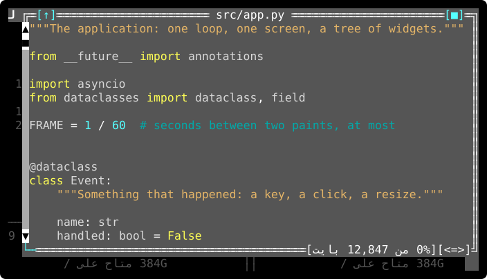
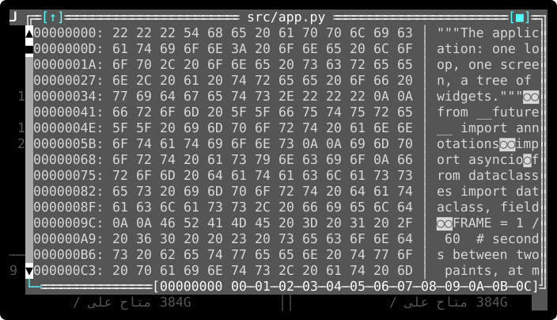
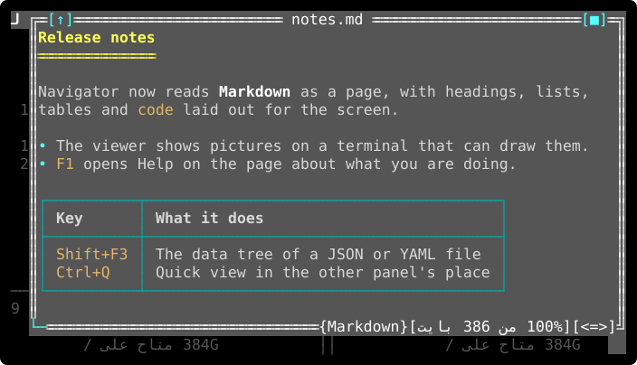
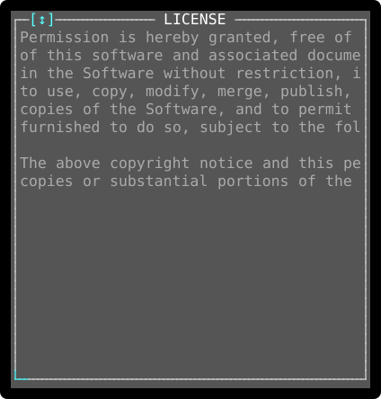
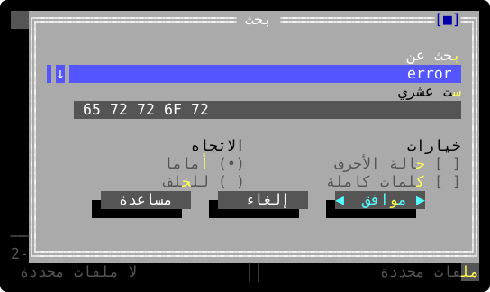
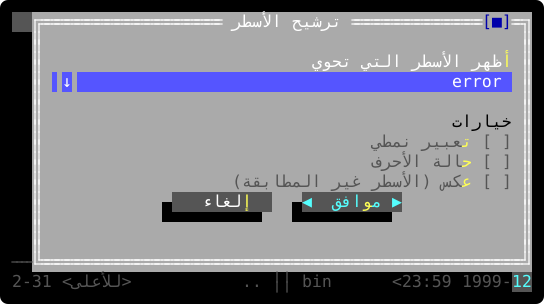
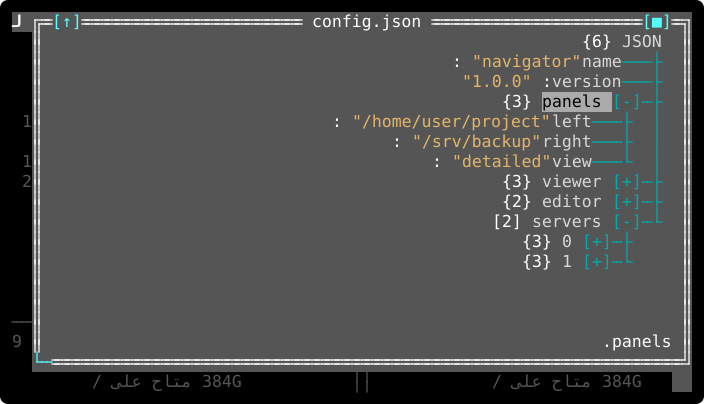
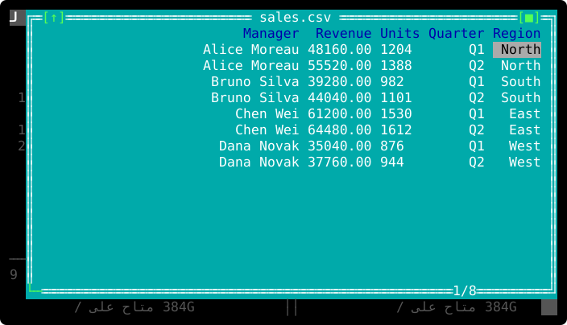

# العارض

يعرض `F3` الملف الذي تحت المؤشر دون تغييره. ويفتح فورا مهما كان حجم الملف.

## المفاتيح

| المفتاح | ما يفعله |
|---|---|
| `Up`، `Down`، `PgUp`، `PgDn` | التمرير |
| `F2` | لف الأسطر الطويلة، أو إيقاف اللف |
| `F4` | التبديل بين النص والست عشري والتفريغ |
| `F5` | الانتقال إلى عنوان |
| `F6` | تغيير مرشح الأحرف |
| `F7` | البحث؛ `Shift+F7` يبحث مجددا، و`Ctrl+F7` إلى الخلف |
| `Shift+F3` | عرض ملف Markdown أو HTML أو ما شابههما منسَّقا، أو بمصدره |
| `Shift+F4` | تحرير الملف |
| `Shift+F5` | حفظ الملف باسم آخر |
| `Shift+F6` | اختيار الترميز الذي يُقرأ به النص |
| `Ctrl+T` | متابعة نهاية ملف يكبر |
| `Ctrl+G` | عرض الأسطر المطابقة لنص فقط |
| `Alt+PgDn` | سرد الملفات المعروضة من قبل |
| `Esc`، `F3` | إغلاق العارض |

الأوامر نفسها موجودة في القائمة *عرض*، التي تظهر في شريط القوائم ما دام العارض مفتوحا.

في الوضع الست عشري يمكنك تغيير البايتات: اكتب أرقاما ست عشرية فوقها، أو اضغط `Tab` واكتب أحرفا. ويكتب `Shift+F2`
التغييرات في الملف.

## فتح ملف

| المفتاح أو المدخل | ما يفعله |
|---|---|
| `F3`، *ملف > عرض > كما هو* | يعرض الملف الذي تحت المؤشر بالطريقة الأنسب لنوعه، كما يلي |
| `Alt+F3`، *ملف > عرض > عرض بديل* | يعرضه في عارض Navigator، لا جدولا ولا أرشيفا ولا ببرنامج `viewers.ini` أبدا |
| *ملف > عرض > كنص*، *كست عشري* | يفتح العارض في الوضع النصي أو الست عشري |
| *ملف > عرض > كقاعدة بيانات* | يفتح ملف dBase أو SQLite [جدولا](#الجداول)، أيا كان اسمه |
| *ملف > عرض > كجدول حسابي* | يفتح ملف CSV أو TSV جدولا |
| *ملف > عرض > فتح...* | يعرض ملفا تختاره في [مربع ملفات](dialogs.md#اختيار-ملف)، دون حاجة إلى مدير الملفات |
| `Alt+PgDn` | يعرض ملفا من قائمة الملفات المعروضة من قبل |

يفتح `F3` ملف dBase أو SQLite أو CSV جدولا، ويدخل إلى الأرشيف كما يفعل `Enter`. وفيما عدا ذلك، حين يسمّي
`viewers.ini` برنامجا للملف، يعرضه ذلك البرنامج ([اقترانات الملفات](user-menu.md#ارتباطات-الملفات))؛ وإلا يعرضه
عارض Navigator. وإذا أُلغي تعليم *عارض داخلي* في صفحة [النظام](settings.md#النظام) من الإعدادات، يشغّل `F3`
برنامج `viewers.ini`، وإلا `$PAGER`.

ويحسب `F3` على مجلد حجم كل ما فيه.

## ما يعرضه بطريقة خاصة

تُعرض بعض الملفات بشكل غير نصها. يبدّل `Shift+F3`، أو *عرض > عرض منسق*، بين ذلك الشكل ونص الملف نفسه؛ وتظهر علامة
على الإطار السفلي، مثل `{Markdown}`، مشطوبة ما دمت ترى النص، والنقر عليها يبدّل أيضا.

- **Markdown وreStructuredText وHTML** تُعرض صفحةً: العناوين والقوائم والجداول والاقتباسات وكتل الشيفرة مرتبة،
  والفقرات ممتدة على عرض النافذة. قد تفتح طرفيتك رابطا في الصفحة. والبحث بـ `F7` يبحث في نص الملف نفسه ويُظهر
  الموضع في الصفحة.
- **ملف PDF** يُعرض نصه صفحةً صفحة. تُترك الصور التي فيه، ولا يجد `F7` نص PDF لأنه مضغوط داخل الملف.
- **الصورة** تُرسم صورةً على طرفية قادرة على ذلك، عبر بروتوكول الرسوم في kitty أو sixel. تحتاج معظم أنواع الصور
  إلى حزمة Python المسماة Pillow (`pip install navigator-fm[images]`)؛ ودونها لا يُرسم إلا PNG على kitty. وفي غير
  ذلك تُعرض بايتات الصورة. ويحدد `--graphics` في [سطر الأوامر](command-line.md#الألوان-والأحرف) ما تقدر عليه
  الطرفية حين يخفق سؤالها عن ذلك.
- **JSON وYAML وTOML وXML وقوائم الخصائص** تُفتح نصا، ويعرضها `Shift+F3` [شجرةَ بيانات](#شجرة-البيانات).
- **ملفات dBase وSQLite وCSV** تُفتح [جدولا](#الجداول) من السجلات في نافذة خاصة بها.

الملف الأكبر من 4 MB، أو ملف PDF أو الصورة الأكبر من 64 MB، يُعرض نصه. وتحدد إعدادات
[أنواع العارض](settings.md#أنواع-العارض) أي الأنواع تُعرض بطريقة خاصة، وبأي أقنعة ملفات.

## العرض السريع

يعرض `Ctrl+Q` الملف الذي تحت المؤشر في مكان اللوحة الأخرى، ويتبع المؤشر وهو يتحرك. وينقل `Tab` لوحة المفاتيح إلى
العرض، حيث تعمل مفاتيح العارض.

## البحث

يبحث `F7` في الملف. ويبحث `Shift+F7` مجددا، و`Ctrl+F7` إلى الخلف.

- *بحث عن* هو النص المطلوب. و*ست عشري* هو البحث نفسه مكتوبا بايتاتٍ بأرقام ست عشرية؛ اكتب في السطر الذي يناسب ما
  تبحث عنه.
- يميّز *مطابقة حالة الأحرف* الأحرف الكبيرة من الصغيرة.
- يتجاوز *كلمات كاملة* النص حيث يكون جزءا من كلمة أطول.
- *الاتجاه*: *للأمام* نحو نهاية الملف، أو *للخلف* نحو بدايته.

يُظهر البحث في ملف كبير تقدّمه، وينهيه *أوقف* أو `Esc` أو `Enter`.

## الانتقال إلى عنوان

يطلب `F5` في الوضع الست عشري *العنوان*، وهو موضع في الملف مكتوب بالست عشري، ويعرض الملف من هناك.

## ترشيح الأسطر

يعرض `Ctrl+G`، أو *عرض > ترشيح الأسطر*، الأسطر التي تحتوي نصا فقط.

- يعامل *تعبير نمطي* النص بوصفه تعبيرا نمطيا.
- يميّز *مطابقة حالة الأحرف* الأحرف الكبيرة من الصغيرة.
- يعرض *عكس (الأسطر غير المطابقة)* الأسطر التي لا تحتويه.

## شجرة البيانات

يعرض `Shift+F3` على ملف JSON أو YAML أو TOML أو XML أو قائمة خصائص بياناته شجرةً، ويعود `Shift+F3` مجددا إلى
النص. والصف السفلي هو مسار العقدة التي تحت المؤشر.

| المفتاح | ما يفعله |
|---|---|
| `F7` | البحث في المفاتيح والقيم؛ `Shift+F7` يبحث مجددا |
| `Ctrl+S` | إيجاد مفتاح أثناء كتابته |
| `Ctrl+Ins` | نسخ مسار العقدة إلى الحافظة |
| `Ctrl+Shift+C` | نسخ قيمة العقدة إلى الحافظة |
| `Shift+F4` | تحرير الملف |
| `Esc` | إغلاق النافذة |

في القائمة *البيانات* الأوامر نفسها، و*فتح الكل*.

## البحث في جدول

يبحث `F7` في الجدول عن نص في السجلات. ويكرر `Shift+F7` البحث.

- *نص البحث* هو النص المطلوب.
- يميّز *مطابقة حالة الأحرف* الأحرف الكبيرة من الصغيرة.
- *النطاق*: *في الحقل الحالي* يبحث في العمود الذي فيه المؤشر فقط، و*كل الحقول* في كل الأعمدة.
- *الاتجاه*: *للأمام* من المؤشر نحو آخر سجل، و*للخلف* نحو أوله، أو *من البداية* من أول سجل فصاعدا.

## الجداول

يُفتح ملف dBase أو SQLite أو CSV جدولا من السجلات.

- يعرض `F2` بنية الجدول: حقوله وأنواعها.
- يعرض `F3` على حقل مذكرة نص المذكرة في مربع، حيث تعمل مفاتيح العارض.
- يطلب `F6` على ملف SQLite استعلاما. لا يُنفَّذ إلا الاستعلام الذي يقرأ؛ ولا يتغير الملف أبدا.
- يحدد `Shift+F6` على ملف CSV أو TSV كيف يُقسم إلى خلايا: *الفاصل* (*فاصلة*، *فاصلة منقوطة*، *جدولة*، *خط عمودي*،
  أو *أخرى* مع الحرف المكتوب بجانبها)، وهل *الصف الأول عنوان*، و*الترميز*.
