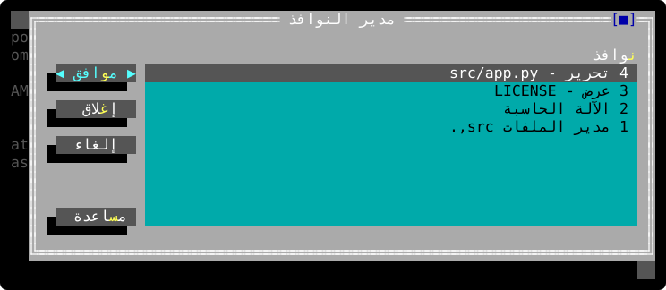
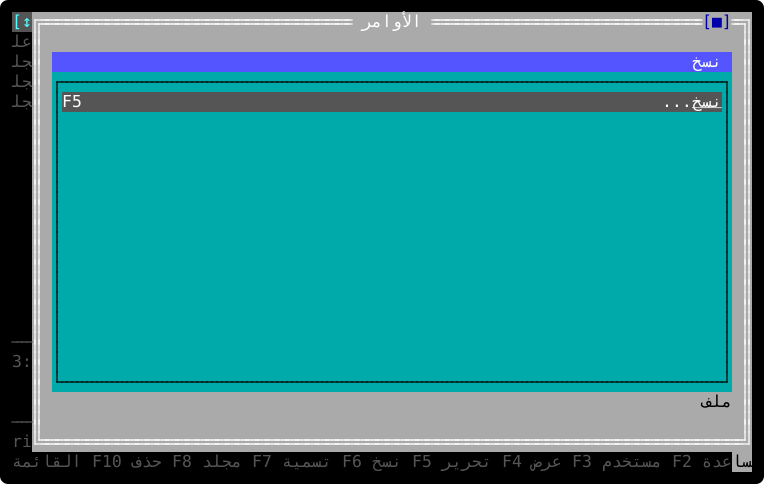

# النوافذ

يُفتح كل من مديري الملفات والعارضات والمحررات والأدوات في نافذة خاصة به على سطح المكتب. وترتبها قائمة *نافذة*.

## العمل بالنوافذ

| المفتاح | ما يفعله |
|---|---|
| `F9` | الانتقال إلى النافذة التالية |
| `Shift+F9` | الانتقال إلى النافذة السابقة |
| `Alt+0` | سرد النوافذ |
| `Alt+Z` | تكبير النافذة إلى سطح المكتب كله، ثم إعادتها |
| `Ctrl+F5` | نقل النافذة بالأسهم، أو تغيير حجمها بـ `Shift` والأسهم؛ يثبتها `Enter`، ويعيدها `Esc` |
| `Ctrl+F4` | إغلاق النافذة |

يرتب *نافذة > رصف* و*متتالية* كل النوافذ دفعة واحدة، ويغلقها *إغلاق الكل* جميعا. وبالفأرة، اسحب النافذة من
حافتها العليا، وغيّر حجمها من زاويتها اليمنى السفلى، وانقر نافذة لإحضارها إلى الأمام.

لكل نافذة رقم، يظهر في قائمة النوافذ.

## عرضان لنص واحد

يفتح *نافذة > عرض جديد*، أو *المحرر > ملف > عرض جديد*، نافذة ثانية على نص المحرر الذي في الأمام. تعرض النافذتان
النص نفسه: ما تكتبه في إحداهما يظهر في الأخرى، وتتشاركان سجل تراجع واحدا وحفظا واحدا. ولكل منهما مؤشرها وتمريرها
وكتلتها، فتستطيع العمل في موضعين من ملف طويل في آن واحد.

## العمليات في الخلفية

يمكن إرسال النسخ أو النقل أو الحذف إلى الخلفية بزر *الخلفية* في مربع تقدّمه. تُظهر عندئذ نسبة مئوية على شريط
القوائم مقدار التقدم، وتُظهر `?` أنه ينتظر إجابة. يعيد *نافذة > عملية في الخلفية*، أو النقر على النسبة المئوية،
مربع التقدم؛ وإن كانت تعمل أكثر من عملية، يسردها أولا، الأقدم أولا، والمؤشر على عملية تنتظر إجابة.

## حفظ سطح المكتب

يحفظ *خيارات > حفظ سطح المكتب* النوافذ المفتوحة: كل مدير ملفات بمجلدات لوحاته وأنماط عرضها وفرزها، وكل محرر على
ملفه وموضعه، وكل عارض على ملفه وموضعه، وكل جدول على سجله، ونافذة الشجرة، ونافذة وحدات التخزين، والآلة الحاسبة،
والتقويم، وموضع كل نافذة. ويغلق *خيارات > استعادة سطح المكتب* النوافذ المفتوحة الآن ويعيد المحفوظة؛ وتبقى اللوحة
النشطة في المجلد الذي هي فيه الآن، إلا إذا كان *الإبقاء على المجلد* محددا في صفحة [بدء التشغيل](settings.md#بدء-التشغيل)
من الإعدادات. ومع تحديد *حفظ سطح المكتب تلقائيا* هناك، يُحفظ سطح المكتب عند الخروج ويُعاد في التشغيل التالي؛
والمجلدات المعطاة في [سطر الأوامر](command-line.md) تتقدم على المحفوظة.

## قائمة النوافذ

يسرد `Alt+0`، أو *نافذة > قائمة*، النوافذ المفتوحة، والتي في الأمام أولا.

- ينتقل *موافق*، أو `Enter`، إلى النافذة التي تحت المؤشر.
- ينتقل الرقم مباشرة إلى النافذة التي تحمل ذلك الرقم.
- يغلق *إغلاق* النافذة التي تحت المؤشر. وتبقى القائمة مفتوحة، فتستطيع إغلاق عدة نوافذ.
- يترك *إلغاء* كل شيء على حاله.

## لوحة الأوامر

يسرد `Alt+Shift+P`، أو *لوحة الأوامر* في القائمة `≡`، كل أمر ينطبق حيث أنت: بنود القوائم، ومنها بنود النافذة
النشطة نفسها، والأوامر التي لا يشغّلها إلا مفتاح. يظهر كل أمر بمفتاحه، ويكون الأمر الذي لا يمكن تشغيله الآن رماديا.

اكتب بضعة أحرف من اسم أمر، بالترتيب، لتضييق القائمة. يشغّل `Enter` الأمر الذي تحت المؤشر، ويغلق `Esc` القائمة.
