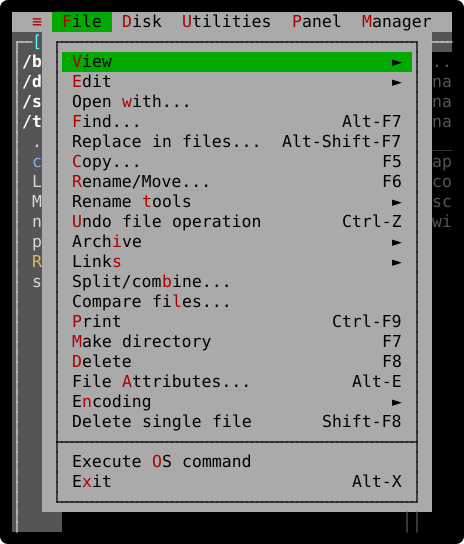

# Navigator help

Navigator is a recreation of the DOS Navigator two-panel file manager for modern terminals. These pages are its
manual: the same files are what `F1` shows inside Navigator.

## Getting started

The screen has a menu bar on top, two [panels](panels.md) of files, a [command line](console.md) under them, and
a key bar on the bottom line that names what the function keys do. In a terminal that reports it, holding `Alt`,
`Ctrl` or `Shift` shows what they do with that key held.

| Key | What it does |
|---|---|
| `Tab` | Switch between the panels |
| `Enter` | Go into a directory, or open a file |
| `F3`, `F4` | [View](viewer.md) or [edit](editor.md) the file |
| `F5`, `F6` | [Copy, or rename and move](file-operations.md#copy-and-move) |
| `F7` | Make a directory |
| `F8` | Erase |
| `F10` | Open the menu |
| `Ctrl+O` | Show the [console](console.md) behind the windows |
| `Alt+X` | Quit |
| `F1` | Help on what you are doing; see [Help on help](help.md) |

Every command is in the menus, with its key beside it. `Alt+Shift+P` finds a command by typing part of its name.

## Contents

Files and directories:

- [Panels](panels.md): moving around, views, sorting, tagging, the information panel, columns, the filter,
  finding files and duplicates, list files
- [File operations](file-operations.md): copy and move, renaming, erase, undo, attributes, links, split and
  combine, UU, checksums, encryption, converting text, opening with another application, printing
- [Archives](archives.md): the formats, opening, testing, creating an archive and extracting from one
- [Comparing](compare.md): directories, the Synchronize window, two files
- [Directory trees](trees.md): the tree beside a panel, changing directory, the tree window, directory sizes
- [Places other than the disk](drives.md): archives, servers, containers, volumes, disk images, the Trash
- [Working as root](as-root.md): doing what you lack the permission for, and root access
- [Connections](connections.md): the link manager, passwords, host keys, port forwards, saved links
- [Bookmarks](bookmarks.md): the list and its keys

Looking at files and changing them:

- [The viewer](viewer.md): its keys, opening a file, pages, PDFs and pictures, searching, filtering lines, the
  data tree, tables
- [The editor](editor.md): its keys, opening a file, blocks, find and replace, go to a line, margins, syntax
  highlighting
- [Macros](macros.md): recorded keys, and the editor's macros

Working with Navigator:

- [The command line and the console](console.md): running commands, command windows, the histories
- [Starting Navigator](command-line.md): the options of the `nav` command
- [Windows](windows.md): moving between windows, two views of one text, operations in the background, saving the
  desktop, the window list, the command palette
- [Dialog boxes](dialogs.md): their keys, and choosing a file
- [Copy and paste](clipboard.md): the keys, the clipboard tools, and what each terminal does with them
- [Settings](settings.md): every page of Options > Settings
- [Keys and colours](customizing.md): key bindings, the colours of a theme
- [The user menu and file associations](user-menu.md)

Tools:

- [The calculator](calculator.md): its four faces, expressions and keys
- [Utilities](utilities.md): the process list, services, the system monitor, the environment, system
  information, the calendar, the character table, SmartPad, the system menu
- [The game](game.md): its keys, the Top Ten, its setup

- [Help on help](help.md): help where you are, and the keys of this window
