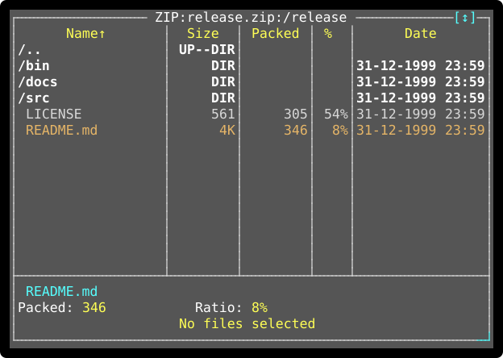
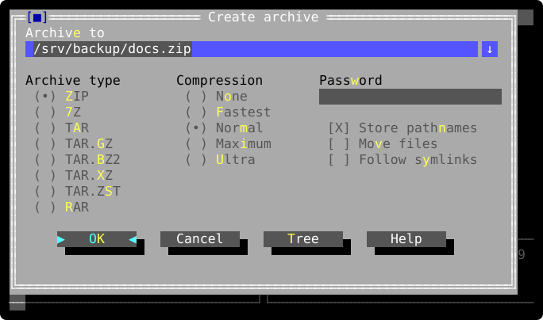
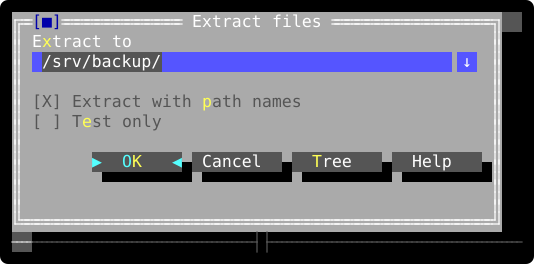

# Archives

Navigator shows an archive as a directory: `Enter` on a zip or tar file goes inside it, and the files in it can be
viewed and copied out like any others. This page is about opening, making and unpacking archives.

## Open an archive

`Enter` or `Ctrl+PgDn` on an archive goes inside it; `..` at its top comes back out. `Enter` knows an archive by
its name: `.zip`, `.tar.gz`, `.7z`, `.deb` and the like. *File > Archive > Open archive*, or `Ctrl+PgDn`, opens
the file under the cursor as an archive whatever its name, which is how to look inside a static library (`.a`), or
an AppImage, which `Enter` would run. With *ENTER opens archive* unticked on the [File
panels](settings.md#file-panels) page of the settings, only `Ctrl+PgDn` does.

Inside, `F5` copies files out. Where the format can be changed, `F8` erases files and files can be copied in, too.
The detailed view shows each file's packed size and how much it was packed.

| Format | What it needs | Can be changed |
|---|---|---|
| ZIP, TAR, and TAR packed with gzip, bzip2 or xz | Nothing | Yes |
| A single file packed with gzip, bzip2, xz or lzma | Nothing | Only that one file |
| TAR or a single file packed with zstd | The `zstd` program, before Python 3.14 | Yes; a single file, only that file |
| 7Z | 7-Zip (`7z`, `7zz` or `7za`) | Yes |
| RAR | `unrar`, or 7-Zip's `7z` or `7zz` | Only with RARLAB's `rar` |
| Debian and RPM packages, CPIO, static libraries (`.a`) | Nothing | No |
| SquashFS images and AppImages | `unsquashfs`, from squashfs-tools | No |

When a program is missing, `Enter` says which one to install rather than running the file. An archive with a
password asks for it.

## Test an archive

*File > Archive > Test archive*, inside an archive, reads the selected files through and checks each one, or the
whole archive when the cursor is on `..` and nothing is tagged. A file that fails its check is named. *Test only*
in the [Extract](#extract-files) box does the same from outside.

## Create an archive

`Shift+F1`, or *File > Archive > Create archive*, packs the selection into a new archive.

- *Archive to* is the archive's name. The line opens on the other panel's directory; a name with no directory makes
  the archive in the current one. *Tree* picks the directory from a tree. If the archive is already there, you are
  asked whether to add to it or replace it.
- *Archive type* chooses the format. The name's ending follows the type, and typing an ending chooses the type. A
  type that needs a program you do not have installed is greyed, and the line above the buttons says which.
- *Compression* trades time for size, from *None* to *Ultra*. Levels a format does not have are greyed; a plain
  TAR has none.
- *Password* encrypts the archive. It is available for ZIP and 7Z when 7-Zip is installed, and for RAR. You are
  asked to type it a second time.

Options:

- *Store pathnames* keeps each file's directories inside the archive, not its name alone.
- *Move files* deletes the files once they are in the archive.
- *Follow symlinks* packs what a link points to, not the link itself.

## Extract files

`Shift+F2` on an archive, or *File > Archive > Extract archive*, unpacks it into the directory you name. Inside an
archive, *Extract to* unpacks the selection.

- *Extract with path names* makes the archive's directories. Without it every file goes straight into the target
  directory.
- *Test only* checks the archive for errors and writes nothing.

*Tree* picks the target directory from a tree.
