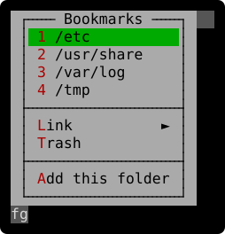

# Bookmarks

Bookmarks are directories you go to often. `Alt+F1` opens the list for the left panel, `Alt+F2` for the right,
and `Alt+C` for the active one; they are also *Bookmarks left* and *Bookmarks right* in the *Manager* menu.

## The list

Each bookmark has a key, `1` to `9`, `0`, then letters: press it, or move to the bookmark and press `Enter`, and
the panel goes there. A bookmark whose directory is not there now is greyed.

| Key | What it does |
|---|---|
| `Enter`, or the bookmark's key | Go to the directory |
| `F2` | Give the bookmark a label, shown in place of its path. An empty label takes it away |
| `Ctrl+Up`, `Ctrl+Down` | Move the bookmark up or down the list |
| `Del` | Delete the bookmark |
| `Esc` | Close the list |

The last entry is *Add this folder*, which bookmarks the panel's directory, or *Remove this folder* when it is
bookmarked already.

Under a line come the disks that are mounted now and are not bookmarks, such as a USB stick. They are places to
go; they are not kept. The list also has a *Link* part, with your [saved connections](connections.md).

Deleting asks first. *Don't ask again* in the question, or *Delete bookmark* on the
[Confirmations](settings.md#confirmations) page, turns the question off.

## Without the list

`Alt+1` to `Alt+9` send the active panel straight to the first nine bookmarks. `Alt+Shift+1` to `Alt+Shift+9`
bookmark the panel's directory in that place.

## The first bookmarks

The first time Navigator starts it bookmarks your home directory, the desktop's folders that exist, such as
Documents and Downloads, and the directories where disks are mounted. After that the list is yours: bookmarks you
delete do not come back.
