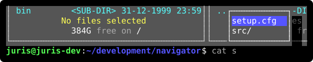

# The command line and the console

Under the panels is a command line, and behind the windows is a console: a terminal in which your shell runs.

## The command line

Whatever you type while a panel has the keyboard goes to the command line. `Enter` runs it in the shell, in the
active panel's directory, and the output appears in the console.

| Key | What it does |
|---|---|
| `Enter` | Run the command |
| `Ctrl+Enter` | Put the name of the file under the cursor on the line |
| `Ctrl+E`, `Ctrl+X` | Recall the previous and the next command |
| `Tab` | Complete the word being typed, when the line has text |
| `Esc` | Clear the line |

While the line has text, `Left`, `Right`, `Home` and `End` edit it. `Enter` on a program in a panel runs it.

After a command the panels read their directories again, and the active panel follows the shell if the command
changed directory.

## The console

`Ctrl+O` hides the windows and shows the console; `Ctrl+O` again brings them back. While the windows are hidden
the keys go to the shell, or to the program running in it.

`Shift+PgUp` and `Shift+PgDn` scroll back through what the console has shown, and `Shift+Up` and `Shift+Down`
scroll by a line.

While a program is running in the console it gets every key, `F1` and `F10` included; leave the program its own
way first.

## A command in a window

A command can run in a window of its own, beside the panels, instead of on the console. Start the command line
with `&`, or press `Shift+Enter` in place of `Enter`.

The program in the window gets every key except those that bring another window forward. When it ends the window
keeps its output and its title says how it ended; `Esc` or `Enter` closes it. Closing the window while the
program runs ends the program.

*Utilities > Remote shell* opens a shell on a server, in a container or on a device in such a window.

## Execute a command

*File > Execute OS command* asks for a command on a line that shares the command line's history.

- *In a window* runs it in a window of its own, not on the console.
- *Zoomed* opens that window over the whole desktop.
- *Modal* keeps the keyboard in that window until it is closed.

## Commands history

`Alt+F8`, or *Utilities > Commands History*, lists the commands you have typed, the newest last.

- *Run*, or `Enter`, runs the command under the cursor.
- *Drop* puts it on the command line without running it.
- *Edit* changes it in a box; the changed command becomes the newest.
- *Kill*, or `Del`, removes it from the history.

*Utilities > Fuzzy history search*, `Alt+Shift+F8`, searches the commands typed here and in the shell with `fzf`.

## File histories

`Alt+PgDn` lists the files viewed before and `Alt+PgUp` the files edited before; they are *File View History* and
*File Edit History* in the *Utilities* menu. *Open* opens the file under the cursor again, and *Delete record*
removes it from the list.
