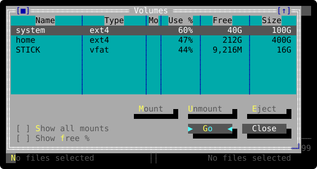
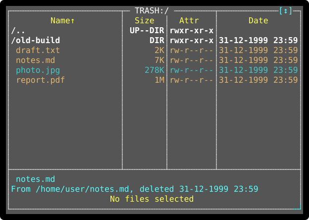

# Places other than the disk

A panel can show more than the directories of your disk. Wherever it is, files are viewed, edited, copied and
deleted in the same way.

## Archives

`Enter` on an archive, such as a zip or a tar file, goes inside it as if it were a directory. Copy files out of
it, or into it, with `F5`. [Archives](archives.md) covers creating and extracting.

## Servers, containers and devices

*Utilities > Link* opens a panel on another machine or service. Each entry keeps a list of the connections you
have made, to connect again; [Connections](connections.md) describes its box.

| Entry | What it reaches |
|---|---|
| *SSH (SFTP)*, `Alt+F11` | A server over SSH |
| *FTP* | An FTP or FTPS server |
| *SMB* | A Windows share |
| *S3* | A bucket in S3 or a compatible service |
| *Docker container*, *Podman container* | The files inside a running container |
| *Android device* | A phone or tablet, over `adb` |
| *rclone remote* | Any remote set up in `rclone`, such as Google Drive or Dropbox |
| *GVfs/KIO link* | Whatever the desktop can reach, such as a phone over MTP or a WebDAV server |

An entry is greyed when the program it needs is not installed; its tooltip names the program.

You can also type an address where a directory is asked for, such as `sftp://user@host/dir` or
`smb://host/share`.

*Utilities > Remote shell* opens a shell on the server, in the container or on the device. *Utilities >
Disconnect*, `Alt+H`, closes a connection; a panel that was showing it goes back to the disk.

## Volumes

*Disk > Volumes* lists the disks and removable media, and mounts, unmounts and ejects them.

### Disk images

`Enter` on a disk image, an `.iso` or `.img` file, or *Disk > Mount image* with the cursor on one, mounts it
read-only and opens it in the panel. *Disk > Unmount image*, in the image or on it, unmounts it again and takes
the panels that were inside it back to the image file. This needs udisks2, which most desktops run; *ENTER
mounts disc images* on the [File panels](settings.md#file-panels) page of the settings turns `Enter`'s part off.

## The Trash

`F8` moves files on the disk to the Trash instead of erasing them when *F8 moves to Trash* is ticked on the
[File panels](settings.md#file-panels) page of the settings. The [Erase](file-operations.md#erase) box then has
*Move to Trash* ticked; untick it to erase the files for good. [Undo](file-operations.md#undo), `Ctrl+Z`, takes the
last move to the Trash back.

*Disk > Trash*, or a double click on the trash can, shows the files in the Trash in the active panel. The line
under the panel says where the file under the cursor came from and when it was erased.

- *File > Restore from Trash* puts the selected files back where they came from.
- `F8` there erases them for good.
- `F5` copies them out, as from any directory.

*Disk > Empty Trash* erases everything in the Trash for good, after asking.

## Bookmarks

`Alt+F1` and `Alt+F2` open a list of bookmarked directories for the left and the right panel, and `Alt+C` for
the active one. [Bookmarks](bookmarks.md) has the list's keys.
