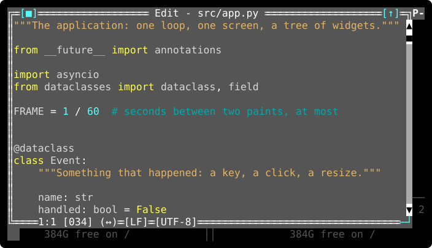
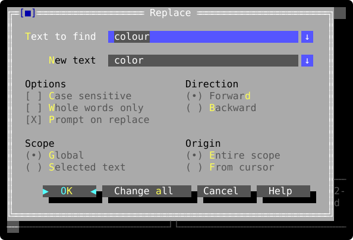

# The editor

`F4` opens the file under the cursor in the editor. Every command is also in the *Editor* menu, which is on the
menu bar while an editor is open.



## Keys

| Key | What it does |
|---|---|
| `F2` | Save |
| `Shift+F2` | Save under another name |
| `Ctrl+F4` | Close the editor; it asks first if the text was changed |
| `Alt+Backspace` | Undo |
| `Alt+Shift+Backspace` | Redo |
| `Ctrl+Y` | Delete the line |
| `Ctrl+Backspace` | Delete the word to the left |
| `Ctrl+N` | Insert a line |
| `F7`, `Ctrl+F7` | [Find and replace](#find-and-replace) |
| `Alt+G` | [Go to a line](#go-to-a-line) |
| `Alt+PgUp` | List the files edited before |

## Opening a file

| Key or entry | What it opens |
|---|---|
| `F4` | The file under the cursor |
| `Alt+F4`, `Ctrl+K`, *File > Edit > Alternate edit* | The file under the cursor in the other editor: see below |
| `Shift+F4`, *File > Edit > Edit new file* | A file you name in a [file box](dialogs.md#choosing-a-file). A name that is not there yet is made when you save |
| *File > Edit > Open...* | A file you choose in a file box, with no file manager needed. A name that is not there yet is made when you save |
| `Alt+PgUp` | A file from the list of files edited before |

`F4` uses Navigator's editor, and *Alternate edit* another program: the one `editors.ini` names for the file
([file associations](user-menu.md#file-associations)), else a list of the editors installed in the terminal, such
as `vim` or `nano`, the one you choose running in a window of its own. With *Internal editor* unticked on the
[System](settings.md#system) page of the settings the two keys change places: `F4` runs `editors.ini`'s program,
else `$EDITOR`, and *Alternate edit* uses Navigator's editor. `Ctrl+K` is there because many window managers close
the terminal on `Alt+F4`.

`F4` on a directory opens its [file attributes](file-operations.md#file-attributes).

A file that was edited before opens where you left it.

## Blocks and the clipboard

Hold `Shift` while moving the cursor, or drag with the mouse, to mark a block.

| Key | What it does |
|---|---|
| `Ctrl+Ins`, `Ctrl+C` | Copy the block |
| `Shift+Del`, `Ctrl+X` | Cut the block |
| `Shift+Ins`, `Ctrl+V` | Paste |
| `Ctrl+Del` | Delete the block |
| `Alt+Shift+I`, `Alt+Shift+O` | Indent and unindent the block |
| `Alt+Shift+U`, `Alt+Shift+L` | Make the block upper case, lower case |
| `Alt+T` | Sort the block's lines |
| `Alt+H` | Hide or show the block |

[Copy and paste](clipboard.md) explains which of the copy and paste keys work in which terminal.

The *Options* submenu switches this window's behaviour, such as automatic indenting, line numbers and syntax
highlighting. What a new editor starts with is set on the [Editor/Viewer](settings.md#editorviewer) page of the
settings.

## Find and replace

`F7` finds text and `Ctrl+F7` replaces it. `Shift+F7` repeats the last search, replacement included.

The box opens with a guess at what you are looking for: the marked text if it is on one line, else the word under
the cursor.



- *Text to find* is the text to look for. `Down` on the line opens the history of earlier searches.
- *New text*, when replacing, is what to put in its place.

### Options

- *Case sensitive* tells capital letters from small ones.
- *Whole words only* skips a match that is part of a longer word.
- *Prompt on replace* asks before each replacement: *Yes*, *No*, *All* for this and every later one, or *Cancel*.

### Where to look

- *Direction*: *Forward* towards the end of the text, or *Backward* towards its start.
- *Scope*: *Global* searches the whole text, *Selected text* only the marked block.
- *Origin*: *Entire scope* starts at the beginning of the scope, *From cursor* at the cursor.

### Replacing

*OK* replaces the first match. *Change all* replaces every one, and says how many were replaced. Each replacement
can be undone on its own.

### The find bar

`Ctrl+F` and `Ctrl+R` open a bar inside the editor window instead of a box. It finds as you type, lights every match
on the screen, and can search by regular expression.

## Go to a line

`Alt+G` asks for a line number and puts the cursor on that line. Lines are counted from 1. The box opens with the
number you typed last.

## Margins

*Editor > Paragraph > Margins* sets the three numbers that paragraph formatting works between. They apply to this
editor window only; the starting values come from the editor setup.

- *Left margin* is the column every line starts at.
- *Right margin* is the last column a line may reach.
- *Paragraph* is the column the first line of a paragraph starts at.

To format a paragraph, mark it as a block and press `Alt+J` to justify it, `Alt+L` to set it against the left
margin, `Alt+R` against the right, or `Alt+C` to centre it. The whole block is treated as one paragraph.

## Syntax highlighting

The editor and the viewer colour the text of a program, a web page, a configuration file and many others by what
each part is. Which colouring a file gets is decided by its name, in `highlight.ini`, and for a script with no
known ending by its first line, such as `#!/bin/sh`: *Options > Highlight file edit* opens that file in the editor.

```ini
[*.conf]
lexer = ini

[*.txt]
lexer = none
autowrap = on
right_margin = 72
```

- Each section is a [file mask](panels.md#file-masks). The first section that matches the file and names a
  `lexer` chooses the language; a file no section takes is left to Pygments to guess.
- `lexer` names the language, as Pygments names it (`python3 -m pygments -L lexers` lists them). `none` colours
  nothing; `auto` lets Pygments guess from the name and the contents.
- A section may also set the editor's options for those files, under the names they have in `navigator.ini`'s
  `[editor]` section: `auto_indent`, `insert_tabs`, `line_numbers`, `soft_wrap`, `autowrap`, `right_margin`,
  `line_ending` and others. Each comes from the first matching section that sets it. The file's own comments list
  them all. A file edited before keeps the options it was left with.

For one window, *Editor > File type* (`Ctrl+Shift+H`) chooses another language, and *Editor > Options > Syntax
highlight* turns colouring off and on. The colours are the theme's.
