# File operations

Copying, moving, linking, splitting and encoding work on the selection: the tagged files of the active panel, or the
file under the cursor when nothing is tagged. Most of them open on the other panel's directory as the place to put
the result.

## Copy and move

`F5` copies the selection and `F6` renames or moves it. Both open the same box: a line saying where to, the copy
modes, and four options.

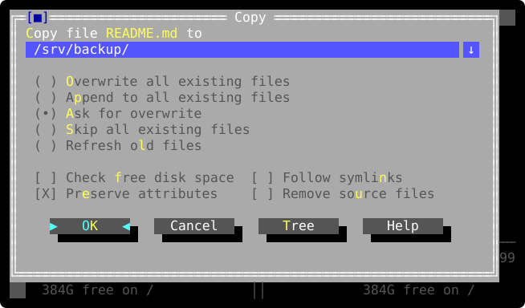

### Where to

What you type on the line decides what happens:

| You type | What it means |
|---|---|
| A directory that exists, or a name ending in `/` | The files go into that directory |
| A name with `*` or `?` | Each file is renamed by that mask, where it is going |
| Any other name, with one file selected | The file's new name |
| Any other name, with several files selected | A directory to create and copy into |

A mask is applied to the name and the extension separately: `*.bak` gives every file the extension `bak`. A mask
with no dot covers the whole name, so `*` keeps each name as it is.

`F10`, or the *Tree* button, picks the directory from a tree. `Down` on the line opens the history of the places
you copied to before.

### What to do with files that are already there

| Mode | What it does |
|---|---|
| *Overwrite all existing files* | Replaces them without asking |
| *Append to all existing files* | Adds each file to the end of the one already there |
| *Ask for overwrite* | Asks for each one. The answer can be made to stand for all the rest |
| *Skip all existing files* | Leaves them alone and copies the others |
| *Refresh old files* | Replaces a file only when the one being copied is newer |

When it asks, *Rename* lets you give the copy another name instead.

### Options

- *Check free disk space* stops before copying when the target has too little room.
- *Preserve attributes* keeps permissions, owner and times on the copies. What could not be kept is reported; the
  copy itself still succeeds.
- *Follow symlinks* copies what a link points to, not the link itself.
- *Remove source files* deletes the originals once they are copied, which makes the copy a move.

The mode and the options are remembered until you leave Navigator.

### While it runs

The progress box shows the speed and the time left. *Background* sends the copy away so you can keep working: a
percentage appears on the menu bar, and a click on it brings the box back. If the copy has a question while it is
away, the percentage shows a `?` and waits for you. *Stop* asks before abandoning the copy.

Files that were copied lose their tags; files that were skipped keep them.

`Ctrl+Z` takes back the last copy, move or rename. A copy is removed only if nothing has changed it since.

## Make a directory

`F7` makes a directory in the active panel. Type a path such as `a/b/c` to make every directory on the way, or
several names separated by `;` to make several.

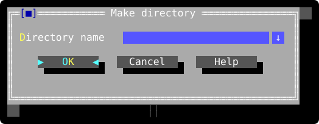

## Quick rename

`Shift+F6`, or *File > Rename tools > Quick rename*, asks for the new name of the file under the cursor in a small
box. It renames one file where it is; to move a file, or to rename several by a mask, use `F6`.

## Multi-rename

`Alt+A`, or *File > Rename tools > Multi-rename*, renames the tagged files by one pattern. The list in the lower
half shows every new name before anything is done, and the line under it says what is wrong when a name cannot be
used: an empty name, a name with `/` in it, two files given one name, or a name that is already taken.

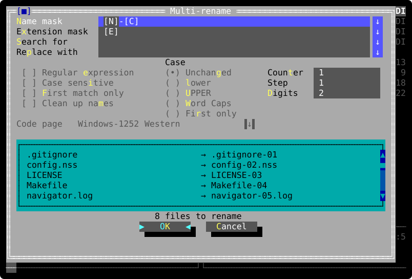

A new name is made in three steps.

**The masks.** *Name mask* builds the name and *Extension mask* the extension. Text is taken as it is, and a
placeholder in square brackets is replaced:

| Placeholder | Stands for |
|---|---|
| `[N]` | The old name without its extension |
| `[N3]` | Its third character |
| `[N2-5]` | Its second to fifth characters |
| `[N2-]` | From the second character on |
| `[N2,4]` | Four characters from the second |
| `[N-3-]` | The last three characters |
| `[E]` | The old extension, cut in the same ways |
| `[P]` | The name of the directory the file is in, cut in the same ways |
| `[C]` | A counter, from *Counter*, *Step* and *Digits* |
| `[C10+5:3]` | A counter that starts at 10, steps by 5 and has three digits: 010, 015, 020 |
| `[Y]` `[M]` `[D]` `[h]` `[m]` `[s]` | The file's modification date and time |
| `[[]` `[]]` | A `[` and a `]` |

An empty extension mask leaves the name without a dot.

**Search and replace.** *Search for* and *Replace with* work on the whole name that the masks made.

- *Regular expression* takes the search as a regular expression; the replacement can then use `\1` for a group.
- *Case sensitive* tells capitals from small letters.
- *First match only* replaces one match in each name, not all of them.

**Case.** *Unchanged*, *lower*, *UPPER*, *Word Caps* or *First only*.

*Clean up names* repairs names before the three steps: bytes that are not UTF-8 are read in the *Code page* you
choose, control characters become `_`, and names in one directory that differ only by case are numbered.

A file whose name comes out the same is left alone. Names that swap among the files, `a` to `b` and `b` to `a`,
are renamed correctly.

## Erase

`F8`, or `Del` with an empty command line, erases the selection after asking. `Shift+F8` erases the file under
the cursor whatever is tagged.

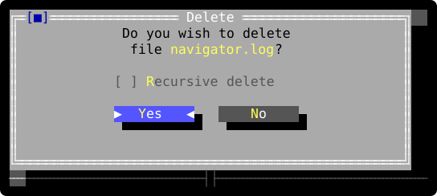

- *Recursive delete* erases directories with everything in them without asking about each one.
- *Move to Trash* is shown when the [Trash](drives.md#the-trash) is in use. Unticked, the files are erased for
  good.

Without *Recursive delete* you are asked about a directory that is not empty, and about files you cannot write
to; each question can be answered for all the rest. Which questions are asked at all is set on the
[Confirmations](settings.md#confirmations) page of the settings.

A long erase can be sent to the background, as a copy can.

## File attributes

`Alt+E` changes the attributes of the selection. Only what you change is applied, so files that differ in other
ways keep their differences. *Recurse* applies the change to everything inside the directories as well.

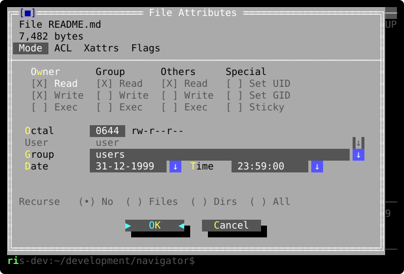

- *Mode* has the permissions: a grid of read, write and execute for the owner, the group and others, the same as
  an octal number, the owner and group, and the date and time. In the grid `R`, `W` and `X` tick a whole row.
- *ACL* lists the access control entries beyond the mode, and adds, edits and removes them.
- *Xattrs* lists the extended attributes.
- *Flags* has the file system's flags, such as immutable and append-only.

A box that shows `?` means the files differ there; leave it alone to keep each file as it is.

### ACL entries

*Add* and *Edit* on the *ACL* page open one entry. *Type* says whether it names a user or a group, *Name* picks
which, and *Permissions* are *Read*, *Write* and *Exec*. *Default, inherited by new files* makes it a default entry
of a directory: what is made inside the directory inherits it.

### Extended attributes

*Add* and *Edit* on the *Xattrs* page open one attribute, its *Name* and its *Value*. A value is text, or `0x`
followed by hex digits, or `0s` followed by base64. Quotes round a value keep it text.

## Links

`Shift+F5` makes links to the selection in the directory you name.

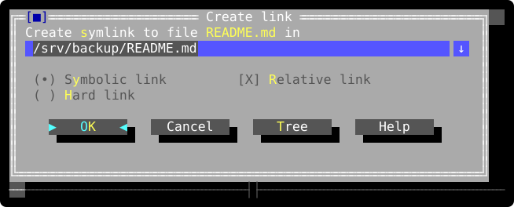

- *Symbolic link* makes a small file holding the path of the original. It can point to a directory, and to another
  disk.
- *Hard link* gives a file a second name. It works only for files, and only on the same file system.
- *Relative link* writes the path relative to the link, so the link and the original can be moved together. It
  applies to symbolic links only.

*File > Links* has more: editing where a link points, making links relative or absolute, tagging broken links, and
showing every name a hard-linked file has.

### Changing where links point

*File > Links > Edit link target* changes the selected symbolic links.

- With one link selected, a line holds its target for you to edit. *Relative link* writes the new target relative
  to the link.
- With several, *Search for* and *Replace with* change the same part of every target, which is what a tree that
  moved needs.

*Make relative* and *Make absolute* rewrite each selected link's target the other way, reaching the same file.
*Select broken links* tags every link in the panel that points nowhere.

## Split and combine

*File > Split/combine* works on the file under the cursor, and the file's name decides which of the two it does.

### Splitting

Any ordinary file is split into parts named `NAME.001`, `NAME.002` and so on, in the directory you name.

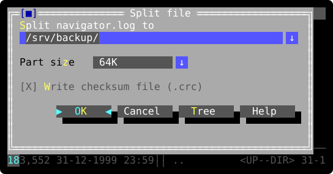

- *Part size* is the size of each part: a number of bytes, or a number followed by `K`, `M` or `G`, such as `100M`
  or `1.44M`.
- *Write checksum file (.crc)* also writes `NAME.crc`, which holds the file's name, size and checksum. With it, the
  combined file can be checked.

A file no larger than one part is not split. Total Commander, Double Commander and 7-Zip can combine these parts.

### Combining

On a part (`NAME.001`) or on the `NAME.crc` of a set, the command puts the file back together in the directory you
name. It reads the parts in order until one is missing. With a `.crc` file it also checks the result; if the
checksum does not match, the file is kept and you are told.

## UU encode and decode

UU encoding turns any file into plain text that can be sent where only text is allowed.

### Encoding

`Ctrl+F7` encodes the file under the cursor into `NAME.uue`. A large file is written in sections, one file each.

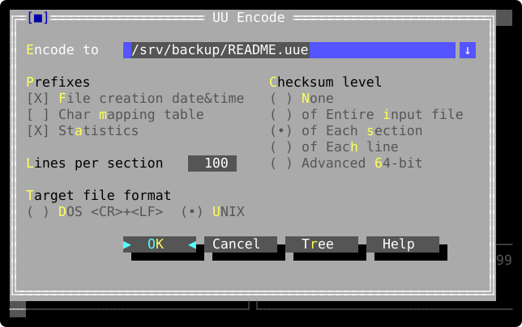

- *Prefixes* add lines before the data: the file's date and time, the character table used, and statistics.
- *Checksum level* adds checksums so that damage can be found when decoding: none, of the whole file, of each
  section, of each line, or the 64-bit one.
- *Lines per section* is how many lines of data go into one section.
- *Target file format* chooses how lines end: as on DOS, or as on UNIX.

### Decoding

`Ctrl+F8` decodes the file under the cursor into the directory you name. One file may hold several encoded files
and their sections in any order.

- *Check existing files* asks before replacing a file that is already there.
- *Display error messages* shows each error found in the data.
- *Save broken files* writes a file even when its data was damaged.

## Checksums

A checksum list holds a digest of each file, so that the files can be checked later for damage or change.

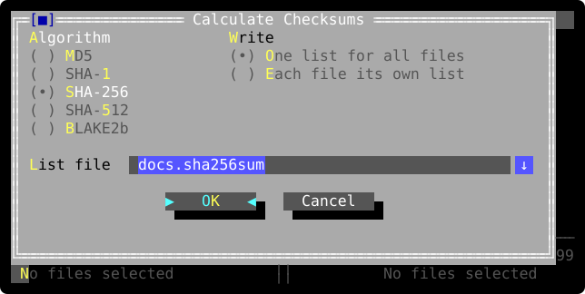

*File > Encoding > Checksums > Calculate* hashes the tagged files, and everything inside a tagged directory.

- *Algorithm* is *MD5*, *SHA-1*, *SHA-256*, *SHA-512* or *BLAKE2b*.
- *One list for all files* writes one list, named on the *List file* line. *Each file its own list* writes a list
  beside every file.

*Verify* reads the tagged lists, or the list under the cursor, hashes the files they name again and reports how
many matched. Files that did not match, or are missing, are listed under *Problems*.

The lists are the ones `md5sum`, `sha256sum` and their relatives write and check, so either side can verify the
other's. The algorithm of a list is told by its name, such as `.sha256sum`, `.sha256` or `SHA256SUMS`, and
otherwise by the length of its digests.

## Encryption

*File > Encoding > Encryption* encrypts and decrypts files with GnuPG (`gpg`) or `age`. A program that is not
installed is greyed.

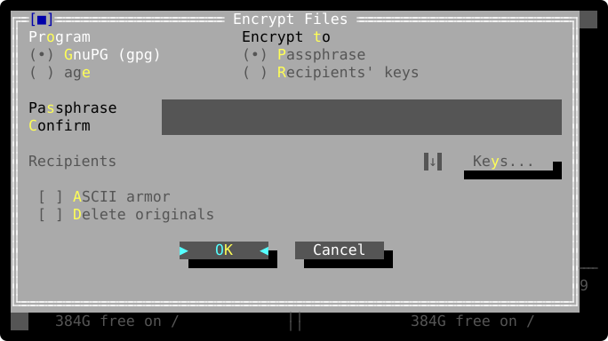

*Encrypt* works on the tagged files, and everything inside a tagged directory. Each file is written beside itself
as `NAME.gpg` or `NAME.age`.

- *Program* is *GnuPG (gpg)* or *age*.
- *Encrypt to* a *Passphrase*, typed twice, or to *Recipients' keys*. Recipients are separated by spaces: key IDs
  or fingerprints for gpg, keys or files of keys for age. *Keys...* picks from gpg's keys.
- *ASCII armor* writes the encrypted files as text; gpg names them `NAME.asc`.
- *Delete originals* removes each file once its encrypted copy is written.

*Decrypt* works on the tagged encrypted files, or the one under the cursor, and writes each back beside itself
under its name without the ending. A passphrase is asked for only when a file needs one, and once for all of them.

## Convert text

*File > Encoding > Convert text* rewrites the tagged text files, or the one under the cursor, in another encoding
or with other line endings. Each file is changed in place.

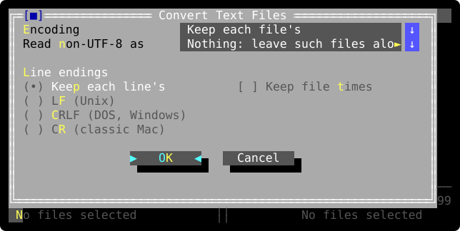

- *Encoding* is the encoding the files are written in.
- *Read non-UTF-8 as* is the encoding assumed for a file that is not UTF-8 and has no byte order mark. With none
  chosen, such a file is left alone.
- *Line endings*: *Keep each line's*, *LF (Unix)*, *CRLF (DOS, Windows)* or *CR (classic Mac)*.
- *Keep file times* gives each rewritten file the time it had.

A file that looks binary, one whose text the chosen encoding cannot write, and a very large file are left alone,
and you are told why. A file that would come out unchanged is not written.
