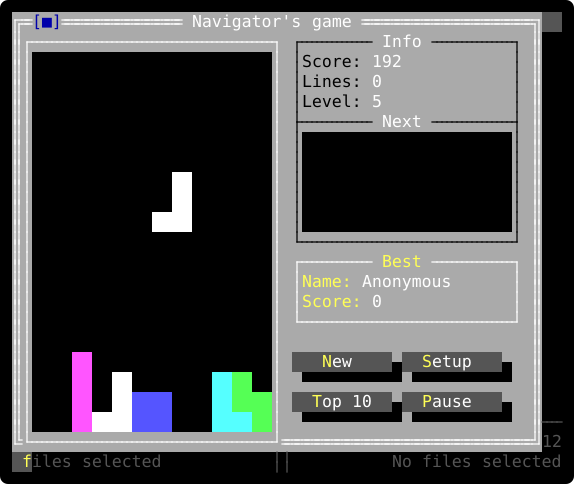

# The game

`Alt+F9`, or *Game* in the `≡` menu, opens the game: figures fall into a glass, and a row that fills up
disappears. It has two styles, Tetris with seven figures and Pentix with twenty-seven.

## Keys

| Key | What it does |
|---|---|
| `Left` or `Home` | Move the figure left |
| `Right` or `PgUp` | Move the figure right |
| `Up` | Turn the figure |
| `Down` or `Space` | Drop the figure |
| `F2` | Start a new game |
| `F3` | Pause, and go on |
| `F4` | Show the Top 10 |
| `F5` | Set up the game: the starting level, the style, and the preview |
| `Gray +` | Raise the level |
| `Gray *` | Show or hide the next figure |
| `Esc` | Close the game |

The game pauses by itself when you switch to another window.

## The Top Ten

When a game ends with a score good enough for the Top Ten, you are asked for a name to list it under. With no
name, or with *Cancel*, it is listed as *Anonymous*. There is one list for each style.

## Setup

`F5`, or the *Setup* button, sets the game up.

- *Level* is the level a game starts at, from *1 - Baby* to *10 - Sanitarium*. The figures fall faster at each.
- *Game style* is *Classic tetris* or *Pentix*.
- *Piece preview* shows the next figure beside the glass.
