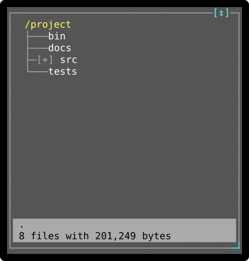
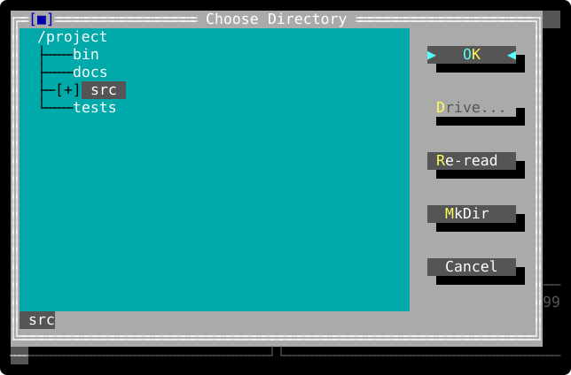
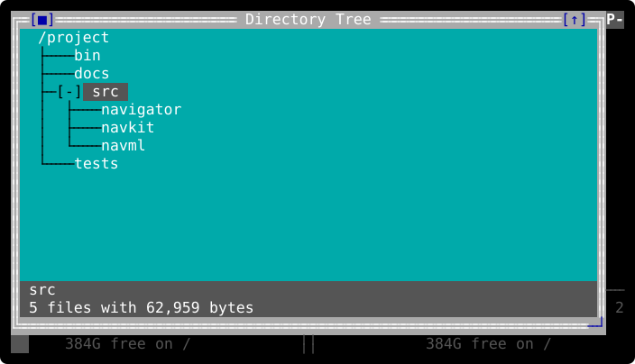
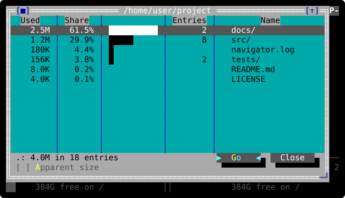

# Directory trees

A tree shows directories with the ones inside them indented beneath.

| Key | What it does |
|---|---|
| `Up`, `Down` | Move the cursor |
| `Right` | Open the directory and go into it |
| `Left` | Go to the directory it is in |
| `+`, `-` or `Space` | Open or close the directory |
| `*` | Open every directory |
| `Enter` | Choose the directory |
| `Ctrl+S` | Search: type the start of a name; `/` goes on inside the directory found |

A tree shows hidden directories when the panel does (`Ctrl+H`).

## The tree beside a panel

`Ctrl+T` puts a tree in the place of the panel that is not active. It follows the active panel, and the panel
follows it: resting the cursor on a directory in the tree shows that directory in the panel. With *Auto change
directory* unticked on the [File panels](settings.md#file-panels) page of the settings, only `Enter` does.

## Change directory

`Alt+T` opens a tree in a box to choose the active panel's directory from. *MkDir* makes a directory under the
cursor, and *Re-read* reads the tree again.

## The tree window

*Disk > Directory tree* opens the tree in a window of its own on the desktop, which stays open while you work
elsewhere. `Enter` on a directory sends the active file manager's active panel there. The window has its own *Tree*
menu, with *Re-read* (`Ctrl+R`), *Quick search* (`Ctrl+S`) and *Close*; `Esc` closes it too.

## Directory sizes

*Disk > Directory sizes* measures the active panel's directory and lists what is in it by size, so you can see
what takes the room.

| Key | What it does |
|---|---|
| `Enter`, `Right` | Go into a directory |
| `Backspace`, `Left` | Go back out |
| `Ctrl+N`, `Ctrl+S`, `Ctrl+E` | Sort by name, size, number of entries; again reverses |
| `Ctrl+A` | Switch between the size of the contents and the room taken on the disk |
| `F8`, `Del` | Erase, as in a panel |
| `Ctrl+R` | Measure again |
