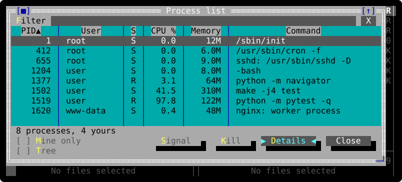
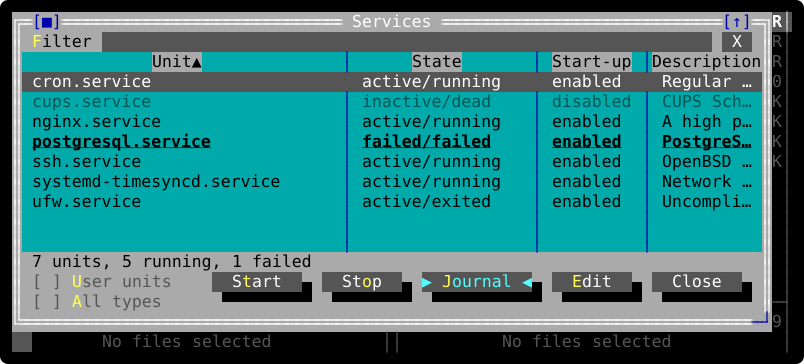
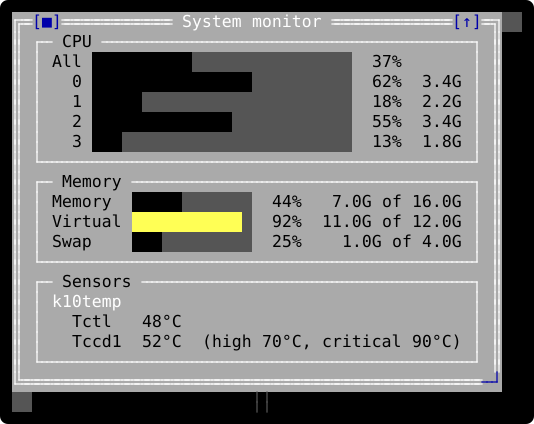
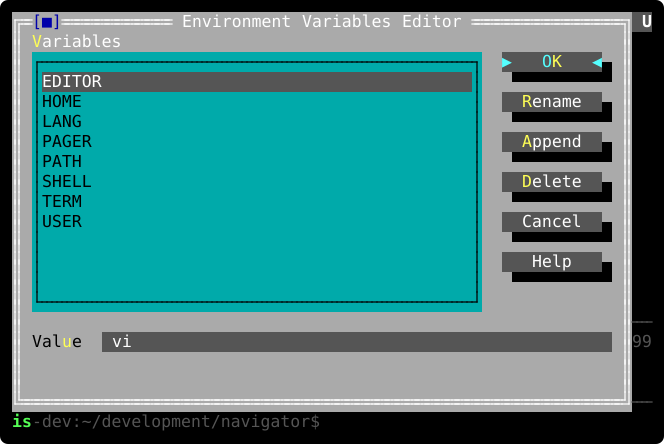
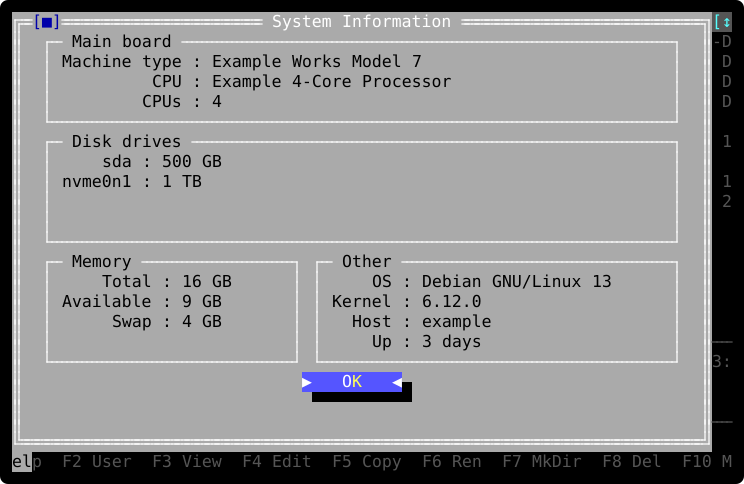
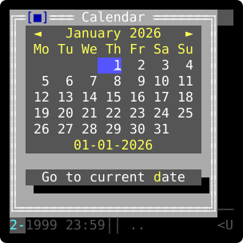
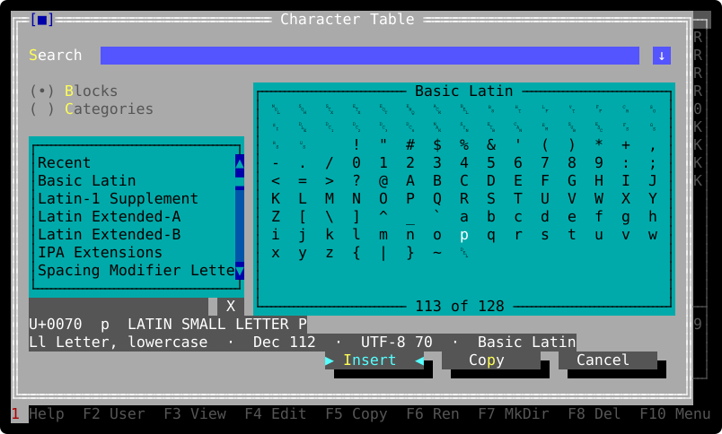

# Utilities

## Process list

*Utilities > Process list* shows the running processes.

| Key | What it does |
|---|---|
| Typing, `F4` | Filter the list to the processes whose command, name, user or number contains the text; `Esc` clears it |
| `Ctrl+T` | Show the processes as a tree of parents and children |
| `Ctrl+H` | Show only your own processes |
| `Ctrl+P`, `Ctrl+U`, `Ctrl+E`, `Ctrl+L`, `Ctrl+Z`, `Ctrl+N` | Sort by number, user, state, CPU load, memory, command |
| `Left`, `Right` | Scroll long commands |
| `F3` | Show the details of a process |
| `F7` | Send a signal you choose |
| `F8`, `Del` | End the process, after asking |
| `Ctrl+R` | Read the list again |

A click on a column's title sorts by it. When a signal is refused for want of permission you are offered to send
it as root.

## Services

*Utilities > Services* lists the system's services and controls them, through systemd, OpenRC, runit or SysVinit.

| Key | What it does |
|---|---|
| `Enter` | Show the details of a service |
| `F3` | Show its log, and follow it |
| `F4` | Edit its configuration |
| `F5`, `F6`, `F7` | Start, restart, reload |
| `F8`, `Del` | Stop, after asking |
| `Ctrl+E`, `Ctrl+D` | Enable and disable starting at boot |
| `Ctrl+U` | Show your own services |
| `Ctrl+A` | Show units of every type |
| `Ctrl+S` | Filter the list |
| `Ctrl+R` | Read the list again |

Changing a system service usually needs root, which you are offered.

## System monitor

*Utilities > System monitor* shows the load on each processor, the memory and swap in use, and the temperatures
and fan speeds the machine reports.

## Edit the environment

*Utilities > Edit environment* shows the environment variables that programs started from Navigator are given, and
lets you change them.

- *Variables* lists the names. The value of the one under the cursor is on the *Value* line, where you can edit
  it.
- *Rename* gives the variable another name.
- *Append* adds a new variable.
- *Delete* removes the variable under the cursor.
- *OK* keeps the changes; *Cancel* drops them all.

The changes reach the programs Navigator starts from then on: the external viewer and editor, the user menu's
commands, and the shell in the console. They last until you leave Navigator.

## System information

*Utilities > System Information* shows what the machine is: the *Main board* and processor, the *Disk drives*,
the *Memory*, and under *Other* the system, its kernel, the host's name and how long it has been up.

## Calendar

*Utilities > Calendar* shows a month, with today marked. Under the weeks, the day under the cursor is written out
in the date format of the [Country](settings.md#country) settings.

| Key | What it does |
|---|---|
| Arrows | Move from day to day |
| `PgUp`, `PgDn` | The previous and the next month |
| `Ctrl+PgUp`, `Ctrl+PgDn` | The previous and the next year |
| `M`, `Y` | Choose a month, or a year, from a list |
| `T` | Go to today; also the *Go to current date* button |
| `C` | Swap between the other calendar and the Gregorian one |
| `Esc` | Close the calendar |

The *Calendar* menu has the same commands and two more. *Calendar system* shows the month in another calendar,
such as the Hebrew, the Islamic or the Persian one. *Calendar view* says what of it is shown beside the Gregorian
month: its month alone, the day written out in it under the Gregorian month, its month with the Gregorian day
written out under it, or the two months side by side.

## Character table

`Ctrl+B`, or *Utilities > Character table*, finds a character and types it where the cursor is.

- *Search* finds characters by name, such as `arrow` or `euro`.
- The list on the left chooses a group of characters, and the line under it narrows the groups by name.
- The grid on the right shows the group. The character under the cursor is described at the bottom.
- *Insert* types the character, and *Copy* puts it on the clipboard.

On a terminal set to plain ASCII characters, the table is the *ASCII Chart* of DOS Navigator: 256 characters,
with the code of the one under the cursor in decimal and hex.

## SmartPad

`Alt+Q`, or *SmartPad* in the `≡` menu, opens a notepad that is kept from one session to the next. Each time it
opens, it adds a line with the date and time at the end and puts the cursor under it, so the pad reads as a log.
It is an [editor](editor.md) window, and it saves itself when you close it.

## The system menu

The `≡` menu, at the left end of the menu bar, has what belongs to Navigator as a whole.

| Entry | What it does |
|---|---|
| *About* | Shows the version, the licence and the author |
| *Command palette* | Finds any [command](windows.md#command-palette) by a few of its letters |
| *Refresh display* | Paints the whole screen again, over what another program left on it |
| *Screen rest* | Starts the screen saver now |
| *Screen grabber*, `Shift+Alt+Ins` | Copies a rectangle of the screen to the clipboard |
| *User screen*, `Alt+F5` | Shows the [console](console.md#the-console) until a key is pressed |
| *Output window*, `Ctrl+O` | Puts the windows away to type in the console, and brings them back |
| *SmartPad*, `Alt+Q` | Opens the [notepad](#smartpad) |
| *Trashcan on/off* | Shows or hides the trash can that files are dropped on to delete them |
| *Game*, `Alt+F9` | Opens [the game](game.md) |

`Alt+X` leaves Navigator. It asks first; *Don't ask again* in the question, or *Exit confirmation* on the
[Confirmations](settings.md#confirmations) page, turns the question off.
