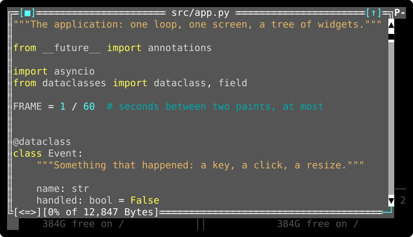
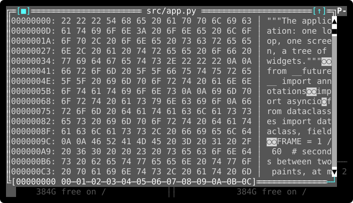
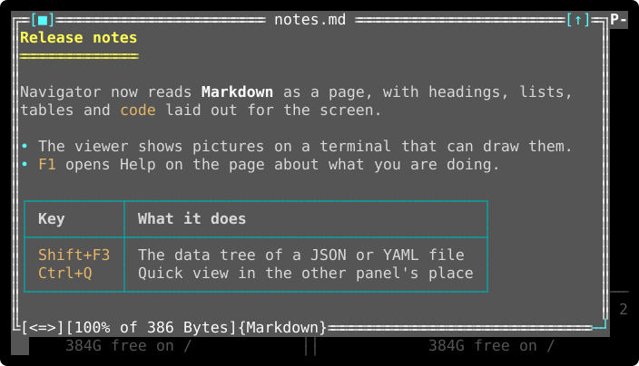
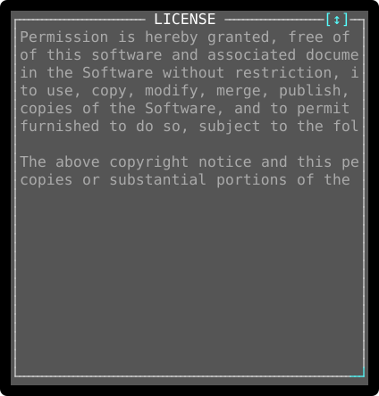
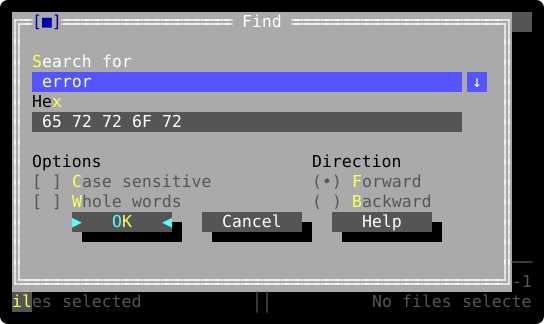
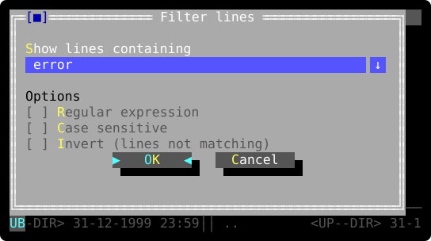
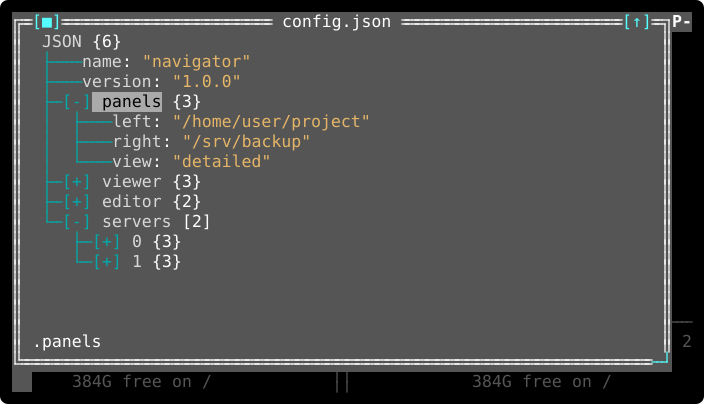
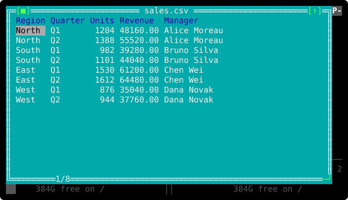

# The viewer

`F3` shows the file under the cursor without changing it. It opens at once however large the file is.

## Keys

| Key | What it does |
|---|---|
| `Up`, `Down`, `PgUp`, `PgDn` | Scroll |
| `F2` | Wrap long lines, or stop wrapping |
| `F4` | Switch between text, hex and dump |
| `F5` | Go to an address |
| `F6` | Change the character filter |
| `F7` | Search; `Shift+F7` searches again, `Ctrl+F7` backwards |
| `Shift+F3` | Show a Markdown, HTML or similar file rendered, or as its source |
| `Shift+F4` | Edit the file |
| `Shift+F5` | Save the file under another name |
| `Shift+F6` | Choose the encoding the text is read in |
| `Ctrl+T` | Follow the end of a file that is growing |
| `Ctrl+G` | Show only the lines that match a text |
| `Alt+PgDn` | List the files viewed before |
| `Esc`, `F3` | Close the viewer |

The same commands are in the *View* menu, which is on the menu bar while a viewer is open.

In hex mode you can change bytes: type hex digits over them, or press `Tab` and type characters. `Shift+F2` writes
the changes to the file.

## Opening a file

| Key or entry | What it does |
|---|---|
| `F3`, *File > View > As is* | Views the file under the cursor the way its kind is shown best, below |
| `Alt+F3`, *File > View > Alternate view* | Views it in Navigator's viewer, never as a table, an archive or with `viewers.ini`'s program |
| *File > View > As Text*, *As Hex* | Opens the viewer in text or in hex mode |
| *File > View > As DataBase* | Opens a dBase or SQLite file as a [table](#tables), whatever its name |
| *File > View > As Spreadsheet* | Opens a CSV or TSV file as a table |
| *File > View > Open...* | Views a file you choose in a [file box](dialogs.md#choosing-a-file), with no file manager needed |
| `Alt+PgDn` | Views a file from the list of files viewed before |

`F3` opens a dBase, SQLite or CSV file as a table and goes inside an archive, as `Enter` does. Otherwise, when
`viewers.ini` names a program for the file, that program shows it ([file associations](user-menu.md#file-associations));
else Navigator's viewer does. With *Internal viewer* unticked on the [System](settings.md#system) page of the
settings, `F3` runs `viewers.ini`'s program, else `$PAGER`.

`F3` on a directory counts the size of everything in it.

## What it shows specially

Some files are shown as something other than their text. `Shift+F3`, or *View > Markup view*, switches between
that and the file's own text; a mark on the bottom frame, such as `{Markdown}`, is struck through while you see
the text, and a click on it switches too.

- **Markdown, reStructuredText and HTML** are shown as a page: headings, lists, tables, quotes and code blocks laid
  out, and paragraphs flowed to the width of the window. Your terminal may open a link on the page.
  Searching with `F7` searches the text of the file itself and shows the place on the page.
- **A PDF** is shown as its text, page by page. Pictures in it are left out, and `F7` does not find the text of a
  PDF, which is packed inside the file.
- **A picture** is drawn as a picture on a terminal that can draw one, through kitty's graphics protocol or
  sixel. Most kinds of picture need the Python package Pillow (`pip install navigator-fm[images]`);
  without it only a PNG on kitty is drawn. Elsewhere the picture's bytes are shown. `--graphics` on the
  [command line](command-line.md#colours-and-characters) says what the terminal can do when asking it goes wrong.
- **JSON, YAML, TOML, XML and property lists** open as text, and `Shift+F3` shows them as a [data
  tree](#the-data-tree).
- **dBase, SQLite and CSV files** open as a [table](#tables) of records in a window of their own.

A file larger than 4 MB, or a PDF or a picture larger than 64 MB, is shown as its text. The
[Viewer types](settings.md#viewer-types) settings say which kinds are shown specially, and by which file masks.

## Quick view

`Ctrl+Q` shows the file under the cursor in the other panel's place, and follows the cursor as it moves. `Tab`
moves the keyboard into the view, where the viewer's keys work.

## Searching

`F7` searches the file. `Shift+F7` searches again and `Ctrl+F7` searches backwards.

- *Search for* is the text to look for. *Hex* is the same search written as bytes in hex digits; type in
  whichever line suits what you are looking for.
- *Case sensitive* tells capital letters from small ones.
- *Whole words* passes over the text where it is part of a longer word.
- *Direction*: *Forward* towards the end of the file, or *Backward* towards its start.

A search of a large file shows its progress, and *Stop*, `Esc` or `Enter` ends it.

## Go to an address

`F5` in hex mode asks for an *Address*, a position in the file written in hex, and shows the file from there.

## Filter lines

`Ctrl+G`, or *View > Filter lines*, shows only the lines that contain a text.

- *Regular expression* takes the text as a regular expression.
- *Case sensitive* tells capital letters from small ones.
- *Invert (lines not matching)* shows the lines that do not contain it.

## The data tree

`Shift+F3` on a JSON, YAML, TOML, XML or property-list file shows its data as a tree, and `Shift+F3` again goes
back to the text. The row at the bottom is the path of the node under the cursor.

| Key | What it does |
|---|---|
| `F7` | Search the keys and values; `Shift+F7` searches again |
| `Ctrl+S` | Find a key as you type it |
| `Ctrl+Ins` | Copy the path of the node to the clipboard |
| `Ctrl+Shift+C` | Copy the node's value to the clipboard |
| `Shift+F4` | Edit the file |
| `Esc` | Close the window |

The *Data* menu has the same commands, and *Expand all*.

## Searching a table

`F7` in the table searches the records for a text. `Shift+F7` repeats the search.

- *Text to search* is the text to look for.
- *Case sensitive* tells capital letters from small ones.
- *Scope*: *In cursor field* looks only in the column the cursor is in, *All fields* in every column.
- *Direction*: *Forward* from the cursor towards the last record, *Backward* towards the first, or *Entire scope*
  from the first record on.

## Tables

A dBase, SQLite or CSV file opens as a table of records.

- `F2` shows the structure of the table: its fields and their types.
- `F3` on a memo field shows the memo's text in a box, where the viewer's keys work.
- `F6` on a SQLite file asks for a query. Only a query that reads is run; the file is never changed.
- `Shift+F6` on a CSV or TSV file sets how it is cut into cells: the *Delimiter* (*Comma*, *Semicolon*, *Tab*,
  *Pipe*, or *Other* with the character typed beside it), whether the *First row is a header*, and the
  *Encoding*.
