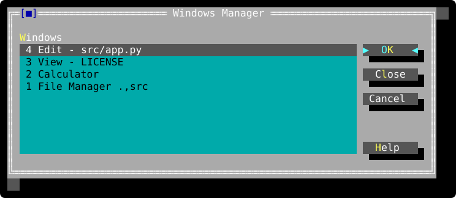
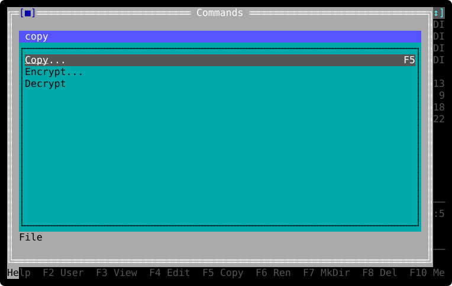

# Windows

File managers, viewers, editors and tools each open in a window of their own on the desktop. The *Window* menu
arranges them.

## Working with windows

| Key | What it does |
|---|---|
| `F9` | Go to the next window |
| `Shift+F9` | Go to the previous window |
| `Alt+0` | List the windows |
| `Alt+Z` | Zoom the window to the whole desktop, and back |
| `Ctrl+F5` | Move the window with the arrows, or size it with `Shift` and the arrows; `Enter` keeps it, `Esc` puts it back |
| `Ctrl+F4` | Close the window |

*Window > Tile* and *Cascade* arrange every window at once, and *Close all* closes them all. With the mouse, drag a
window by its top edge, size it by its bottom right corner, and click a window to bring it forward.

Each window has a number, shown in the window list.

## Two views of one text

*Window > New view*, or *Editor > File > New view*, opens a second window on the text of the editor in front. Both
show the same text: what you type in one appears in the other, and they share one undo history and one save. Each
has its own cursor, scrolling and block, so you can work at two places of a long file at once.

## Operations in the background

A copy, a move or an erase can be sent to the background with *Background* in its progress box. A percentage on
the menu bar then shows how far it is, and a `?` that it is waiting for an answer. *Window > Background
operation*, or a click on the percentage, brings the progress box back up; with more than one operation running,
it first lists them, oldest first, with the cursor on one that waits for an answer.

## Saving the desktop

*Options > Save desktop* keeps the windows that are open: each file manager with its panels' directories, views
and sorting, each viewer and editor on its file and place, the tree window, the calculator, and where every
window stands. *Options > Load desktop* closes the windows open now and puts the kept ones back. With *Autosave
Desktop* ticked on the [Startup](settings.md#startup) page of the settings, the desktop is saved when you quit and
put back at the next start; directories given on the [command line](command-line.md) win over the saved ones.

## Window list

`Alt+0`, or *Window > List*, lists the open windows, the one in front first.

- *OK*, or `Enter`, goes to the window under the cursor.
- A digit goes straight to the window with that number.
- *Close* closes the window under the cursor. The list stays open, so you can close several.
- *Cancel* leaves everything as it is.

## Command palette

`Alt+Shift+P`, or *Command palette* in the `≡` menu, lists every command that applies where you are: the items
of the menus, the active window's own among them, and the commands that only a key runs. Each is shown with its
key, and one that cannot run now is greyed.

Type a few letters of a command, in order, to narrow the list. `Enter` runs the command under the cursor, and
`Esc` closes the list.
