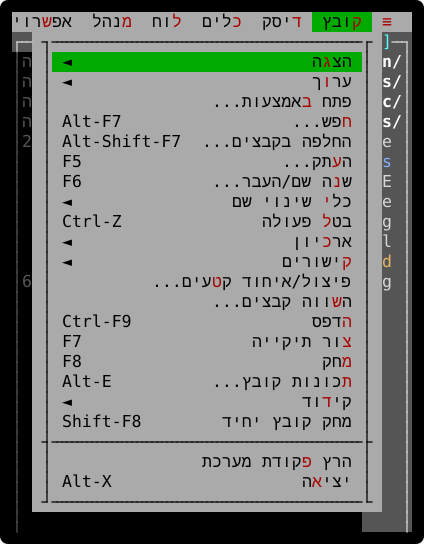

# עזרה ל-Navigator

Navigator הוא שחזור של מנהל הקבצים הדו-לוחי DOS Navigator עבור מסופים מודרניים. דפים אלה הם המדריך שלו: אותם
קבצים הם מה ש-`F1` מציג בתוך Navigator.

## צעדים ראשונים

במסך יש שורת תפריט למעלה, שני [לוחות](panels.md) של קבצים, [שורת פקודה](console.md) מתחתם, ושורת מקשים בשורה
התחתונה שמציינת מה עושים מקשי הפונקציה. במסוף שמדווח על כך, החזקת `Alt`, `Ctrl` או `Shift` מראה מה הם עושים
כשהמקש מוחזק.

| מקש | מה הוא עושה |
|---|---|
| `Tab` | מעבר בין הלוחות |
| `Enter` | כניסה לתיקייה, או פתיחת קובץ |
| `F3`, `F4` | [הצגת](viewer.md) הקובץ או [עריכתו](editor.md) |
| `F5`, `F6` | [העתקה, או שינוי שם והעברה](file-operations.md#העתקה-והעברה) |
| `F7` | יצירת תיקייה |
| `F8` | מחיקה |
| `F10` | פתיחת התפריט |
| `Ctrl+O` | הצגת [המסוף](console.md) שמאחורי החלונות |
| `Alt+X` | יציאה |
| `F1` | עזרה על מה שאתם עושים; ראו [עזרה על העזרה](help.md) |

כל פקודה נמצאת בתפריטים, והמקש שלה לצידה. `Alt+Shift+P` מוצא פקודה כשמקלידים חלק משמה.

## תוכן העניינים

קבצים ותיקיות:

- [לוחות](panels.md): תנועה, תצוגות, מיון, תיוג, לוח המידע, עמודות, המסנן, חיפוש קבצים וכפילויות, קובצי רשימה
- [פעולות על קבצים](file-operations.md): העתקה והעברה, שינוי שם, מחיקה, ביטול, תכונות, קישורים, פיצול ואיחוד,
  UU, סכומי ביקורת, הצפנה, המרת טקסט, פתיחה ביישום אחר, הדפסה
- [ארכיונים](archives.md): הפורמטים, פתיחה, בדיקה, יצירת ארכיון וחילוץ ממנו
- [השוואה](compare.md): תיקיות, חלון הסנכרון, שני קבצים
- [עצי תיקיות](trees.md): העץ שליד לוח, החלפת תיקייה, חלון העץ, גודלי תיקיות
- [מקומות שאינם הדיסק](drives.md): ארכיונים, שרתים, מכולות, כרכים, תמונות דיסק, האשפה
- [עבודה כ-root](as-root.md): ביצוע מה שאין לכם הרשאה אליו, וגישת root
- [חיבורים](connections.md): מנהל הקישורים, סיסמאות, מפתחות מארח, העברות פורטים, קישורים שמורים
- [סימניות](bookmarks.md): הרשימה והמקשים שלה

צפייה בקבצים ושינויים:

- [המציג](viewer.md): המקשים שלו, פתיחת קובץ, עמודים, קובצי PDF ותמונות, חיפוש, סינון שורות, עץ הנתונים, טבלאות
- [העורך](editor.md): המקשים שלו, פתיחת קובץ, בלוקים, חיפוש והחלפה, מעבר לשורה, שוליים, הדגשת תחביר
- [מאקרו](macros.md): מקשים מוקלטים, ופקודות המאקרו של העורך

עבודה עם Navigator:

- [שורת הפקודה והמסוף](console.md): הרצת פקודות, חלונות פקודה, ההיסטוריות
- [הפעלת Navigator](command-line.md): האפשרויות של הפקודה `nav`
- [חלונות](windows.md): מעבר בין חלונות, שתי תצוגות של אותו טקסט, פעולות ברקע, שמירת שולחן העבודה, רשימת
  החלונות, לוח הפקודות
- [תיבות דו-שיח](dialogs.md): המקשים שלהן, ובחירת קובץ
- [העתקה והדבקה](clipboard.md): המקשים, כלי לוח הגזירים, ומה כל מסוף עושה איתם
- [הגדרות](settings.md): כל עמוד של אפשרויות > הגדרות
- [מקשים וצבעים](customizing.md): קיצורי מקשים, הצבעים של ערכת נושא
- [תפריט המשתמש ושיוכי קבצים](user-menu.md)

כלים:

- [המחשבון](calculator.md): ארבעת הפנים שלו, ביטויים ומקשים
- [כלים](utilities.md): רשימת התהליכים, השירותים, ניטור המערכת, הסביבה, מידע על המערכת, לוח השנה, טבלת
  התווים, SmartPad, תפריט המערכת
- [המשחק](game.md): המקשים שלו, עשרת הגדולים, ההגדרות שלו

- [עזרה על העזרה](help.md): עזרה במקום שבו אתם נמצאים, והמקשים של חלון זה
