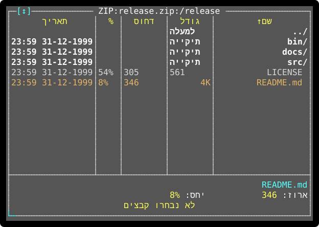
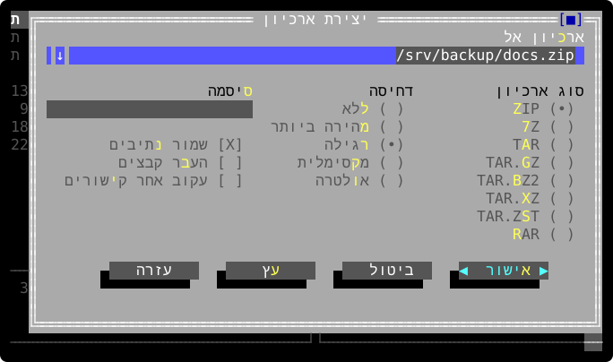
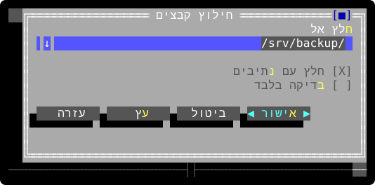

# ארכיונים

Navigator מציג ארכיון כתיקייה: `Enter` על קובץ zip או tar נכנס לתוכו, ואפשר להציג את הקבצים שבו ולהעתיק אותם
החוצה כמו כל קובץ אחר. הדף הזה עוסק בפתיחה, ביצירה ובפריסה של ארכיונים.

## פתיחת ארכיון

`Enter` או `Ctrl+PgDn` על ארכיון נכנס לתוכו; `..` בראשו יוצא ממנו. `Enter` מזהה ארכיון לפי השם שלו: `.zip`,
`.tar.gz`, `.7z`, `.deb` וכדומה. *קובץ > ארכיון > פתח ארכיון*, או `Ctrl+PgDn`, פותח את הקובץ שתחת הסמן כארכיון
בלי קשר לשם שלו, וכך מסתכלים לתוך ספרייה סטטית (`.a`), או לתוך AppImage, ש-`Enter` היה מריץ. כש-*ENTER פותח
ארכיון* אינו מסומן בעמוד [פאנלי קבצים](settings.md#פאנלי-קבצים) של ההגדרות, רק `Ctrl+PgDn` עושה זאת.

בפנים, `F5` מעתיק קבצים החוצה. במקום שבו אפשר לשנות את הפורמט, `F8` מוחק קבצים ואפשר גם להעתיק קבצים פנימה.
התצוגה המפורטת מציגה את הגודל הארוז של כל קובץ וכמה הוא נדחס.

| פורמט | מה הוא צריך | אפשר לשנות |
|---|---|---|
| ZIP, TAR, ו-TAR ארוז ב-gzip, bzip2 או xz | כלום | כן |
| קובץ בודד ארוז ב-gzip, bzip2, xz או lzma | כלום | רק את הקובץ הזה |
| TAR או קובץ בודד ארוז ב-zstd | התוכנית `zstd`, לפני Python 3.14 | כן; קובץ בודד, רק את הקובץ הזה |
| 7Z | 7-Zip (`7z`, `7zz` או `7za`) | כן |
| RAR | `unrar`, או `7z` או `7zz` של 7-Zip | רק עם `rar` של RARLAB |
| חבילות Debian ו-RPM, CPIO, ספריות סטטיות (`.a`) | כלום | לא |
| תמונות SquashFS ו-AppImage | `unsquashfs`, מתוך squashfs-tools | לא |

כשחסרה תוכנית, `Enter` אומר איזו להתקין במקום להריץ את הקובץ. ארכיון עם סיסמה מבקש אותה.

## בדיקת ארכיון

*קובץ > ארכיון > בדוק ארכיון*, בתוך ארכיון, קורא עד הסוף את הקבצים הנבחרים ובודק כל אחד, או את כל הארכיון
כשהסמן על `..` ושום דבר אינו מתויג. קובץ שנכשל בבדיקה מצוין בשמו. *בדיקה בלבד* בתיבה
[חילוץ](#חילוץ-קבצים) עושה אותו דבר מבחוץ.

## יצירת ארכיון

`Shift+F1`, או *קובץ > ארכיון > יצירת ארכיון*, אורז את הבחירה לארכיון חדש.

- *ארכיון אל* הוא שם הארכיון. השורה נפתחת עם התיקייה של הלוח השני; שם בלי תיקייה יוצר את הארכיון בתיקייה
  הנוכחית. *עץ* בוחר את התיקייה מתוך עץ. אם הארכיון כבר קיים, תישאלו אם להוסיף אליו או להחליף אותו.
- *סוג ארכיון* בוחר את הפורמט. הסיומת של השם עוקבת אחרי הסוג, והקלדת סיומת בוחרת את הסוג. סוג שצריך תוכנית
  שאינה מותקנת אצלכם מוצג באפור, והשורה שמעל הכפתורים אומרת איזו.
- *דחיסה* מחליפה זמן בגודל, מ-*ללא* ועד *אולטרה*. רמות שאין לפורמט מוצגות באפור; ל-TAR רגיל אין אף אחת.
- *סיסמה* מצפינה את הארכיון. היא זמינה ל-ZIP ול-7Z כש-7-Zip מותקן, ול-RAR. תתבקשו להקליד אותה פעם שנייה.

אפשרויות:

- *שמור נתיבים* שומר בתוך הארכיון את התיקיות של כל קובץ, ולא רק את שמו.
- *העבר קבצים* מוחק את הקבצים אחרי שהם בארכיון.
- *עקוב אחר קישורים* אורז את מה שקישור מצביע עליו, ולא את הקישור עצמו.

## חילוץ קבצים

`Shift+F2` על ארכיון, או *קובץ > ארכיון > חלץ ארכיון*, פורס אותו לתיקייה שאתם מציינים. בתוך ארכיון, *חלץ אל*
פורס את הבחירה.

- *חלץ עם נתיבים* יוצר את התיקיות של הארכיון. בלעדיו כל קובץ נכנס ישר לתיקיית היעד.
- *בדיקה בלבד* בודק את הארכיון לשגיאות ואינו כותב דבר.

*עץ* בוחר את תיקיית היעד מתוך עץ.
