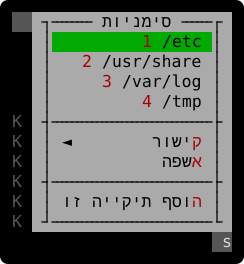

# סימניות

סימניות הן תיקיות שאתם הולכים אליהן לעתים קרובות. `Alt+F1` פותח את הרשימה עבור הלוח השמאלי, `Alt+F2` עבור
הימני, ו-`Alt+C` עבור הפעיל; הן גם *סימניות שמאל* ו*סימניות ימין* בתפריט *מנהל*.

## הרשימה

לכל סימנייה יש מקש, `1` עד `9`, `0`, ואחריהם אותיות: לחצו עליו, או עברו לסימנייה ולחצו `Enter`, והלוח עובר לשם.
סימנייה שהתיקייה שלה אינה קיימת כרגע מוצגת באפור.

| מקש | מה הוא עושה |
|---|---|
| `Enter`, או המקש של הסימנייה | מעבר לתיקייה |
| `F2` | מתן תווית לסימנייה, שמוצגת במקום הנתיב שלה. תווית ריקה מסירה אותה |
| `Ctrl+Up`, `Ctrl+Down` | הזזת הסימנייה למעלה או למטה ברשימה |
| `Del` | מחיקת הסימנייה |
| `Esc` | סגירת הרשימה |

הרשומה האחרונה היא *הוסף תיקייה זו*, שמוסיפה את תיקיית הלוח לסימניות, או *הסר תיקייה זו* כשהיא כבר בסימניות.

מתחת לקו מופיעים הדיסקים שמעוגנים כרגע ואינם סימניות, כמו דיסק USB. הם מקומות ללכת אליהם; הם לא נשמרים.
לרשימה יש גם חלק *קישור*, עם [החיבורים השמורים](connections.md) שלכם.

מחיקה שואלת קודם. *אל תשאל שוב* בשאלה, או *מחיקת סימנייה* בעמוד [אישורים](settings.md#אישורים), מבטל את
השאלה.

## בלי הרשימה

`Alt+1` עד `Alt+9` שולחים את הלוח הפעיל ישירות לתשע הסימניות הראשונות. `Alt+Shift+1` עד `Alt+Shift+9` מוסיפים את
תיקיית הלוח לסימניות במקום הזה.

## הסימניות הראשונות

בהפעלה הראשונה Navigator מוסיף לסימניות את תיקיית הבית שלכם, את תיקיות שולחן העבודה שקיימות, כמו Documents
ו-Downloads, ואת התיקיות שבהן מעוגנים דיסקים. מכאן והלאה הרשימה שלכם: סימניות שתמחקו לא יחזרו.
