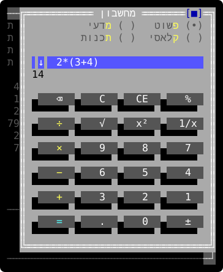
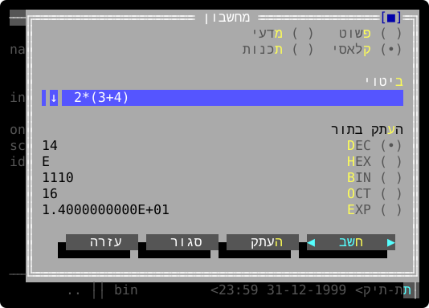
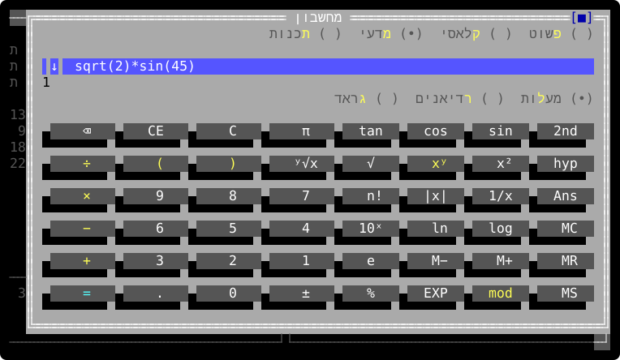
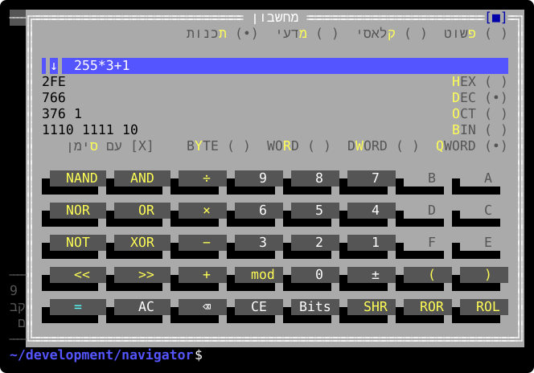

# המחשבון

`Ctrl+F6`, או *כלים > מחשבון*, פותח את המחשבון. מקלידים ביטוי בשורה, והערך שלו מחושב תוך כדי הקלדה. `Enter`
מחשב אותו: הביטוי נכנס להיסטוריה של השורה והערך נשאר מסומן, כך שספרה מתחילה חישוב חדש ואופרטור ממשיך מהערך.

## ארבעת הפנים

למחשבון ארבעה פנים, שבוחרים אותם מהרצועה שלאורך החלק העליון שלו, מהתפריט *מחשבון*, או בלחיצה נוספת על
`Ctrl+F6` כדי לעבור לבאים. הוא זוכר את הפנים שבהם השתמשתם לאחרונה.

- *פשוט* הוא מחשבון כיס: ספרות וארבע פעולות החשבון.
- *קלאסי* מציג את הערך בחמש צורות בבת אחת: עשרונית, הקסדצימלית, בינארית, אוקטלית וכתיב מדעי.
- *מדעי* מוסיף פונקציות, בחירה של יחידת זווית, זיכרון והתשובה האחרונה.
- *תכנות* עובד במספרים שלמים בגודל נבחר, בארבעה בסיסים.

ב-*פשוט*, *מדעי* ו-*תכנות* לוח מקשים שמתחת לשורה מקליד לתוכה, כמו המקלדת. מקש פונקציה עוטף את המספר שלפני
הסמן: `9` ואחריו `√` נותן `SQRT(9)`.

## ביטויים

| כותבים | מה זה |
|---|---|
| `12`, `1.5`, `.5`, `1E+3` | מספרים |
| `$FF`, `0FFh`, `0x1F` | מספרים הקסדצימליים |
| `101b`, `0b101` | מספרים בינאריים |
| `17o` | מספר אוקטלי |
| `+`, `-`, `*`, `/` | ארבע פעולות החשבון |
| `^` | חזקה: `2^10` |
| `%` | השארית של חילוק שני מספרים שלמים |
| `&`, `\|`, `\`, `~` | וגם, או, או בלעדי, ולא, ברמת הסיביות |
| `<<`, `>>` | הזזות |
| `=`, `<>`, `<`, `>`, `<=`, `>=` | השוואות, שנותנות 1 או 0 |
| `&&`, `\|\|` | וגם, או של שני ערכי אמת |
| `(`, `)` | סוגריים |
| `PI` | המספר π |

אין הבדל בין אותיות גדולות לקטנות. כפל וחילוק קודמים לחיבור ולחיסור, וחזקה קודמת לכולם.

הפונקציות הן `SIN`, `COS`, `TAN`, `CTAN`, `ARCTAN`, `SQR` (הריבוע), `SQRT` (השורש הריבועי), `LN`, `LG`
(הלוגריתם לפי בסיס עשר), `EXP`, `SIGN`, ו-`IF(condition, a, b)`, שערכו `a` כשהתנאי אמת ו-`b` אחרת.

## קלאסי

חמש השורות מציגות את הערך בכל צורה; מספר שאינו שלם מציג בהקסדצימלי, בבינארי ובאוקטלי את החלק השלם שלו.

- *חשב* מחשב את הביטוי, כמו `Enter`.
- *העתק בתור* בוחר את הצורה, ו-*העתק* שם את הערך בלוח הגזירים בצורה הזו.
- *סגור* סוגר את המחשבון.

## מדעי

- *מעלות*, *רדיאנים* ו-*גראד* בוחרים את היחידה שהפונקציות הטריגונומטריות מקבלות ונותנות.
- פונקציות נוספות: `ASIN`, `ACOS`, `ATAN`, `SINH`, `COSH`, `TANH`, `ABS`, `CBRT`, `ROOT(x, n)`, `LOG`, `LOG2`,
  `FACT`, ו-`!` אחרי מספר לעצרת שלו. `E` הוא המספר e.
- `ANS`, או המקש *Ans*, הוא הערך האחרון שחושב.
- מקשי הזיכרון: *MS* שומר את הערך, *MR* מחזיר אותו, *M+* ו-*M−* מוסיפים לו ומחסירים ממנו, ו-*MC* מנקה אותו.
- *2nd* ו-*hyp* משנים את מה שמקשי הפונקציות מקלידים: את הפונקציות ההפוכות, ואת ההיפרבוליות.

## תכנות

- *HEX*, *DEC*, *OCT* ו-*BIN* בוחרים את הבסיס שבו מקלידים מספרים. הערך מוצג בכל הארבעה.
- *QWORD*, *DWORD*, *WORD* ו-*BYTE* בוחרים את גודל המספר: 64, 32, 16 או 8 סיביות. תוצאה שאינה נכנסת נחתכת
  לגודל הזה.
- *עם סימן* קורא את המספר כמספר עם סימן. כשאינו מסומן, המספר לעולם אינו שלילי.
- חילוק נותן מספר שלם.
- אפשר לכתוב את הפעולות גם כמילים: `AND`, `OR`, `XOR`, `NAND`, `NOR`, `NOT`, `MOD`, `SHL`, `SHR`, `SAR`, `ROL`
  ו-`ROR`.
- *מקלדת סיביות*, בתפריט *מחשבון*, מציג את 64 הסיביות במקום המקשים. לחיצה או `Space` הופכים סיבית.

## מקשים

| מקש | מה הוא עושה |
|---|---|
| `Enter` | חישוב |
| `Ctrl+F6` | הפנים הבאים |
| `Ctrl+1` עד `Ctrl+4` | פשוט, קלאסי, מדעי, תכנות, במקום שבו המסוף שולח את המקשים האלה |
| `Down` בשורה | ההיסטוריה של הביטויים |
| `Esc` | סגירת המחשבון |
