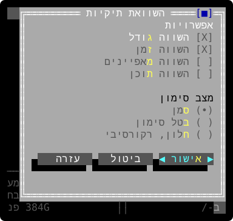
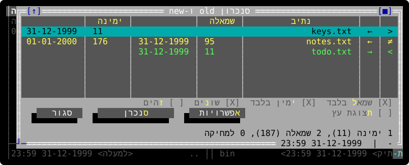
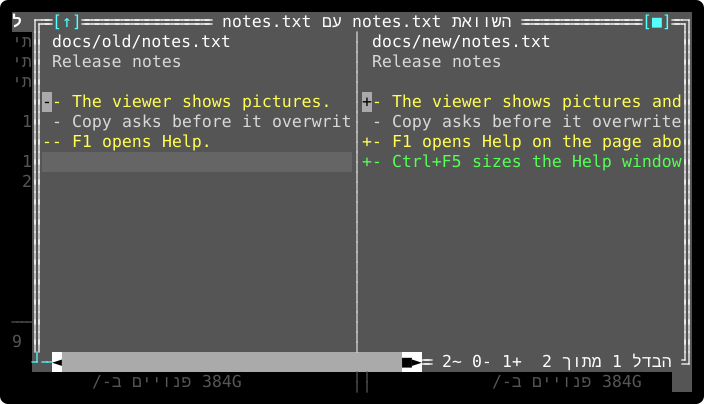

# השוואה

## השוואת תיקיות

*לוח > השוואת תיקיות* משווה את הקבצים של שני הלוחות לפי שם.

- *השווה גודל*, *השווה זמן*, *השווה מאפיינים* ו-*השווה תוכן* בוחרים מה גורם לשני קבצים באותו שם להיחשב זהים.
  רק *השווה תוכן* קורא את הקבצים, וזה לוקח יותר זמן.
- *סמן* מתייג, בכל לוח, את הקבצים שאין להם התאמה בלוח השני. העתקת הקבצים המתויגים לצד השני מעדכנת את התיקייה
  השנייה.
- *בטל סימון* מסיר במקום זאת את התיוג מהקבצים האלה.
- *חלון, רקורסיבי* משווה את התיקיות עם כל מה שבתוכן, ופותח את חלון הסנכרון.

## סנכרון

חלון הסנכרון מציג כל קובץ שנמצא רק בצד אחד או שונה, והתיקייה של הלוח השמאלי משמאל. לכל שורה יש פעולה: העתקה
ימינה, העתקה שמאלה, מחיקה, או דילוג. החלון מציע אחת, והתפריט *סנכרון* משנה אותה לשורה שתחת הסמן או לכל השורות
בבת אחת.

- *סנכרן*, `F5`, מבצע את הפעולות, אחרי שאלה.
- *השווה קבצים*, `Enter` או `F3`, מציג את שני הקבצים של השורה זה לצד זה.
- *השווה מחדש*, `Ctrl+R`, קורא מחדש את שתי התיקיות.
- *הצג שמאל בלבד*, *הצג ימין בלבד*, *הצג שונים* ו-*הצג זהים* בוחרים אילו שורות מוצגות.
- *תצוגת עץ*, `Ctrl+T`, מציג את השורות כעץ של תיקיות.
- *אפשרויות* קובע איך משווים קבצים, ו[מסכת קבצים](panels.md#מסכות-קבצים) לבחירת הקבצים שבודקים.

### אפשרויות

*אפשרויות* בחלון הסנכרון קובע מה משווים ואיך. *אישור* משווה שוב את שתי התיקיות.

- *מסכת קבצים* בוחרת את הקבצים שבודקים; ריקה משווה הכול. התבניות מופרדות ב-`;`. `-` לפני תבנית משמיט את
  הקבצים שלה, ו-`/` אחריה מציין תיקיות: `*.py;-.git/`.
- *זמנים זהים* קובע כמה קרובים צריכים להיות שני זמנים: *בדיוק, עד השנייה*, *בטווח 2 שניות (FAT)*, או *בטווח
  דקה (FTP)*.
- *או הפרש של שעה בדיוק* מחשיב כזהים גם זמנים שההפרש ביניהם שעה אחת, כפי שמעבר לשעון קיץ עושה לדיסק FAT.
- *לא סימטרי: הימין נעשה העתק של השמאל* מציע למחוק את מה שיש רק בצד הימני, ולהעתיק ימינה כל קובץ שונה, בלי
  קשר לאיזה מהם חדש יותר.

## השוואת קבצים

*קובץ > השווה קבצים* מציג שני קבצים זה לצד זה כשההבדלים ביניהם מסומנים. הוא לוקח את שני הקבצים המתויגים של הלוח
הפעיל. כשאף קובץ אינו מתויג הוא לוקח את הקובץ שתחת הסמן ואת הקובץ באותו שם בלוח השני, או, כשאין קובץ בשם הזה,
את הקובץ שתחת הסמן של הלוח השני.

