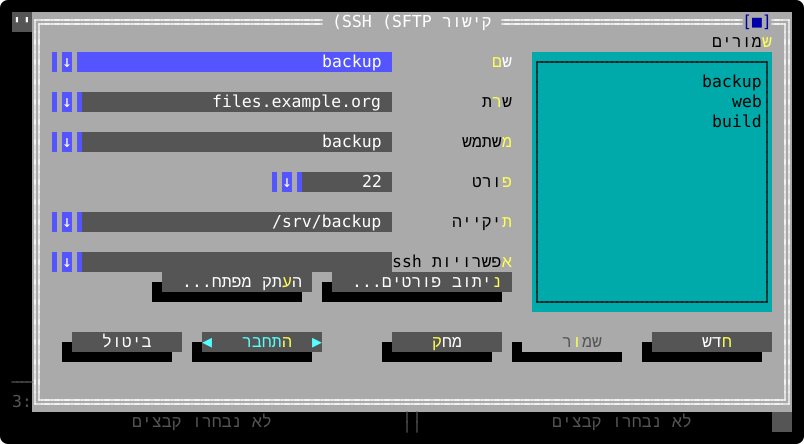
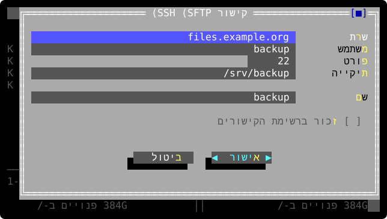
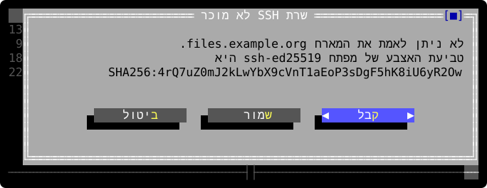
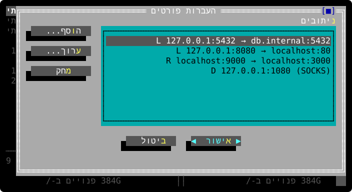
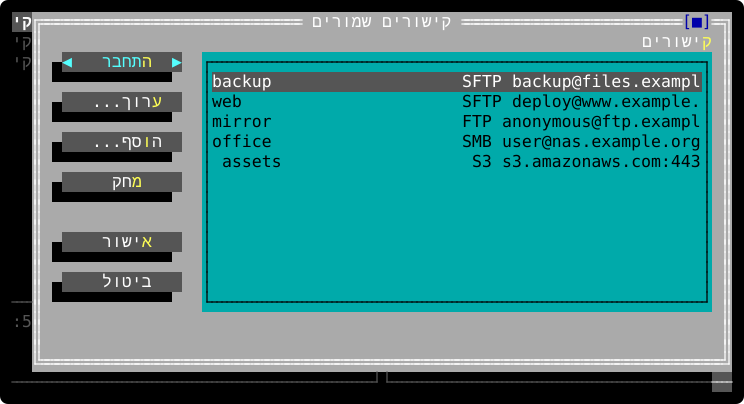

# חיבורים

איך מציבים לוח על שרת, ואיך נשמרים החיבורים שבהם אתם משתמשים. מה כל סוג של מקום, והדרכים האחרות להגיע אליו,
מוסברים ב[מקומות שאינם הדיסק](drives.md).

## מנהל הקישורים

כל פריט של *כלים > קישורים*, כמו *SSH (SFTP)* (`Alt+F11`), פותח משמאל את החיבורים השמורים של אותו פרוטוקול
ומימין את השורות של חיבור אחד.

- התיבה נפתחת כשהשורות ריקות. מלאו אותן ולחצו *התחבר* לחיבור שאינו נשמר.
- בחרו חיבור תחת *שמורים* כדי להכניס אותו לשורות. לחיצה כפולה מתחברת אליו.
- *חדש* יוצר חיבור שמור, בשם שאפשר להקליד עליו. *שמור* שומר את מה ששיניתם; חיבור ששונה מסומן ב-`*`, ועזיבה
  שלו שואלת אם לשמור. *מחק* מסיר את החיבור.
- *התחבר* שולח לשם את הלוח הפעיל. מתוך *כלים > מעטפת מרוחקת* הוא פותח במקום זאת מעטפת בחלון.

השורות הן אלה של [חיבור](#חיבור). כל אחת זוכרת את מה שהיה בה קודם; `Down` בשורה פותח את ההיסטוריה שלה.

למנהל SSH יש עוד שלושה:

- *אפשרויות ssh* מועברות ל-`ssh` כשנפתחת מעטפת מרוחקת.
- *ניתובים* קובע את [העברות הפורטים](#העברות-פורטים) של החיבור.
- *העתק מפתח* מציב אחד מהמפתחות הציבוריים שלכם בשרת, כך שחיבורים מאוחרים יותר לא יצטרכו סיסמה.

*הגדר* של מנהל rclone מריץ את `rclone config` כדי להגדיר שלטים מרוחקים (remotes).

## חיבור

| שורה | מה היא |
|---|---|
| *שרת* | השם או הכתובת של השרת. ב-SSH אפשר להשתמש בשם `Host` מתוך `~/.ssh/config`, ומה שכתוב בקובץ ממלא משתמש ופורט שנשארו ריקים |
| *משתמש* | המשתמש שבשמו מתחברים |
| *פורט* | הפורט, כשאינו הפורט הרגיל של הפרוטוקול |
| *תיקייה* | המקום שבו הלוח מתחיל בשרת |
| *שם* | השם שתחתיו החיבור נשמר |

השורות שונות מעט בין הפרוטוקולים: לחיבור FTP יש *צפן ב-TLS*, שהופך אותו ל-FTPS, ולמקום GVfs/KIO יש רק *שם*
ו-*כתובת URI*.

*זכור ברשימת הקישורים* שומר את החיבור תחת השם שלו, כדי להתחבר שוב בצעד אחד.

## סיסמאות וביטויי סיסמה

הסיסמה של שרת, או ביטוי הסיסמה של מפתח פרטי, נשאלים כשהחיבור צריך אותם. *שמור במחזיק המפתחות* זוכר אותם
במחזיק המפתחות של שולחן העבודה, כך שלא יישאלו שוב. הוא מוצג רק במקום שבו יש מחזיק מפתחות לשמור בו.

## מפתח מארח לא מוכר

בפעם הראשונה שאתם מתחברים לשרת SSH, מפתח המארח שלו אינו נמצא ב-`~/.ssh/known_hosts`, ואתם נשאלים אם להמשיך,
כמו ש-`ssh` שואל.

- *קבל* סומך על המפתח עבור החיבור הזה בלבד.
- *שמור* גם כותב אותו ל-`~/.ssh/known_hosts`, כך שלא תישאלו שוב.
- *ביטול* אינו מתחבר.

לפני שמקבלים, השוו את טביעת האצבע המוצגת לזו שקיבלתם ממנהל השרת.

## העברות פורטים

*ניתובים* במנהל SSH מציג את העברות הפורטים של חיבור. *הוסף*, *ערוך* ו-*מחק* משנים את הרשימה, שנשמרת עם החיבור
כשאתם שומרים אותו.

| סוג | מה הוא עושה |
|---|---|
| *מקומית (-L)* | פורט במחשב הזה מוביל אל היעד, שאליו מגיעים מהשרת |
| *מרוחקת (-R)* | פורט בשרת מוביל אל היעד, שאליו מגיעים מהמחשב הזה |
| *דינמית, SOCKS (-D)* | פורט במחשב הזה הוא שרת SOCKS מתווך דרך השרת |

*כתובת האזנה* ו-*פורט האזנה* הם הקצה שממתין לחיבורים, ו-*שרת יעד* ו-*פורט יעד* הם המקום שאליו הם נשלחים.
להעברה דינמית אין יעד.

## קישורים שמורים

*כלים > קישורים שמורים* מציג בתיבה אחת את החיבורים השמורים של כל הפרוטוקולים. *התחבר* פותח את זה שתחת הסמן,
*ערוך* משנה אותו, *הוסף* יוצר חדש ו-*מחק* מסיר אותו. השינויים נשמרים כשיוצאים ב-*אישור*.

*כלים > נתק*, `Alt+H`, סוגר חיבור; לוח שהציג אותו חוזר לדיסק.
