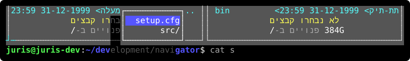
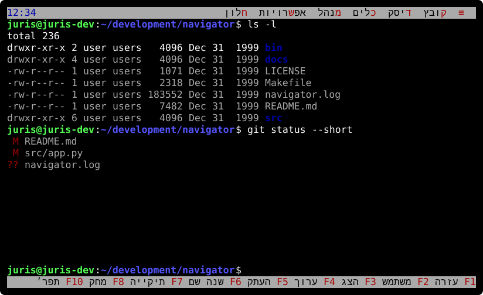
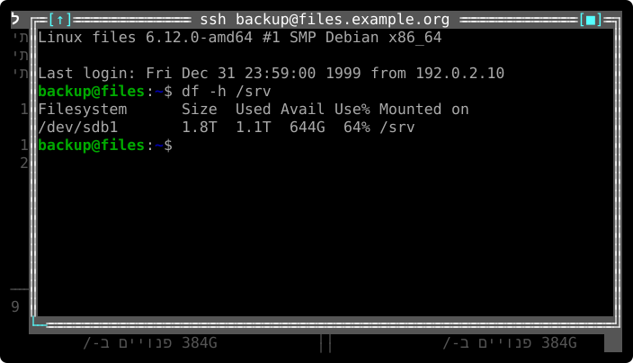
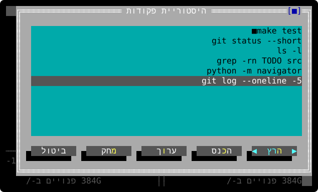

# שורת הפקודה והמסוף

מתחת ללוחות יש שורת פקודה, ומאחורי החלונות יש מסוף: טרמינל שבו רצה המעטפת שלכם.

## שורת הפקודה

כל מה שאתם מקלידים כשללוח יש המקלדת הולך לשורת הפקודה. `Enter` מריץ אותו במעטפת, בתיקייה של הלוח הפעיל,
והפלט מופיע במסוף.

| מקש | מה הוא עושה |
|---|---|
| `Enter` | הרצת הפקודה |
| `Ctrl+Enter` | הכנסת שם הקובץ שתחת הסמן לשורה |
| `Ctrl+E`, `Ctrl+X` | החזרת הפקודה הקודמת והבאה |
| `Tab` | השלמת המילה שמוקלדת, כשיש טקסט בשורה |
| `Esc` | ניקוי השורה |

כשיש טקסט בשורה, `Left`, `Right`, `Home` ו-`End` עורכים אותה. `Enter` על תוכנית בלוח מריץ אותה.

אחרי פקודה הלוחות קוראים מחדש את התיקיות שלהם, והלוח הפעיל עוקב אחרי המעטפת אם הפקודה החליפה תיקייה.

## המסוף

`Ctrl+O` מסתיר את החלונות ומציג את המסוף; `Ctrl+O` נוסף מחזיר אותם. כל עוד החלונות מוסתרים, המקשים הולכים
למעטפת, או לתוכנית שרצה בה.

`Shift+PgUp` ו-`Shift+PgDn` גוללים אחורה במה שהמסוף הציג, ו-`Shift+Up` ו-`Shift+Down` גוללים בשורה.

כל עוד תוכנית רצה במסוף היא מקבלת כל מקש, כולל `F1` ו-`F10`; צאו קודם מהתוכנית בדרך שלה.

## פקודה בחלון

פקודה יכולה לרוץ בחלון משלה, לצד הלוחות, במקום במסוף. התחילו את שורת הפקודה ב-`&`, או לחצו `Shift+Enter`
במקום `Enter`.

התוכנית שבחלון מקבלת כל מקש, חוץ מאלה שמביאים חלון אחר לחזית. כשהיא מסתיימת, החלון שומר את הפלט שלה והכותרת
שלו אומרת איך היא הסתיימה; `Esc` או `Enter` סוגרים אותו. סגירת החלון בזמן שהתוכנית רצה מסיימת את התוכנית.

*כלים > מעטפת מרוחקת* פותח מעטפת על שרת, במכולה או במכשיר בחלון כזה.

## הרצת פקודה

*קובץ > הרצת פקודת מערכת* מבקש פקודה בשורה שחולקת את ההיסטוריה של שורת הפקודה.

- *בחלון* מריץ אותה בחלון משלה, ולא במסוף.
- *בגודל מלא* פותח את החלון הזה על כל שולחן העבודה.
- *מודאלי* משאיר את המקלדת בחלון הזה עד שהוא נסגר.

## היסטוריית פקודות

`Alt+F8`, או *כלים > היסטוריית פקודות*, מציג את הפקודות שהקלדתם, החדשה ביותר אחרונה.

- *הרץ*, או `Enter`, מריץ את הפקודה שתחת הסמן.
- *הכנס* מכניס אותה לשורת הפקודה בלי להריץ אותה.
- *ערוך* משנה אותה בתיבה; הפקודה ששונתה הופכת לחדשה ביותר.
- *מחק*, או `Del`, מסיר אותה מההיסטוריה.

*כלים > חיפוש עמום בהיסטוריה*, `Alt+Shift+F8`, מחפש ב-`fzf` את הפקודות שהוקלדו כאן ובמעטפת.

## היסטוריות קבצים

`Alt+PgDn` מציג את הקבצים שהוצגו קודם ו-`Alt+PgUp` את הקבצים שנערכו קודם; הם *היסטוריית צפייה בקבצים*
ו-*היסטוריית עריכת קבצים* בתפריט *כלים*. *פתח* פותח שוב את הקובץ שתחת הסמן, ו-*מחק רשומה* מסיר אותו מהרשימה.
