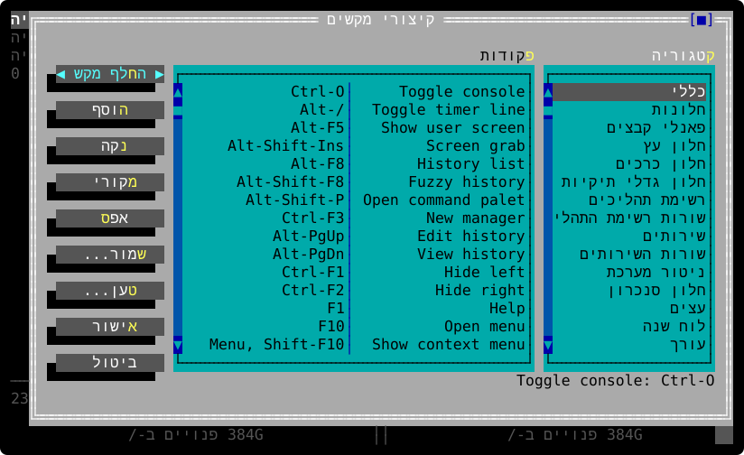
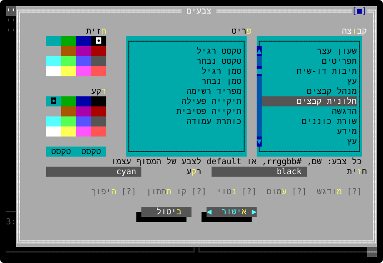

# מקשים וצבעים

## קיצורי מקשים

*אפשרויות > תצורה > קיצורי מקשים* משנה איזה מקש עושה מה. המקשים מסודרים במקטעים, אחד לכל מקום שבו הם פועלים:
בכל מקום, מנהל הקבצים, העורך, המציג, תיבות הדו-שיח וכן הלאה.

בחרו פקודה ולחצו על המקש שאתם רוצים עבורה.

*שמור* כותב את כל הערכה לקובץ, ו*טען* קורא ערכה מקובץ. Navigator מגיע עם ארבע ערכות: ברירת המחדל שלו, וערכות
בסגנון WordStar, ‏DOS Navigator 1.51 ו-Emacs.

הקיצורים נשמרים בקובץ `keybindings.ini` בתיקיית התצורה. המקשים שמזיזים את הסמן ברשימות ובטקסט קבועים.

## צבעים

*אפשרויות > צבעים* משנה את הצבעים של ערכת הנושא שבשימוש.

- *קבוצה* ו*פריט* בוחרים מה לצבוע.
- *חזית* ו*רקע* בוחרים מתוך שישה-עשר הצבעים; השורות שלידם מקבלות כל צבע, כשם או כ-`#rrggbb`.
- חמש התיבות קובעות מודגש, עמום, נטוי, קו תחתון והיפוך. תיבה שמציגה `?` משאירה את התכונה כפי שהפריט יורש אותה.

המסך מתעדכן תוך כדי השינויים. *אישור* שומר את השינויים לערכת הנושא הזו; *ביטול* מחזיר הכול למצבו הקודם.

*שמור ערכת צבעים* שומר את הצבעים כערכת נושא משלכם, ש-`--theme` ו*טען ערכת צבעים* ימצאו אחר כך. *טען ערכת צבעים*
לוקח את הצבעים של ערכת נושא אחרת.

כדי להשתמש בערכת נושא אחרת, הפעילו את Navigator עם `--theme NAME`; ‏`--list-themes` מציג את שמותיהן.
