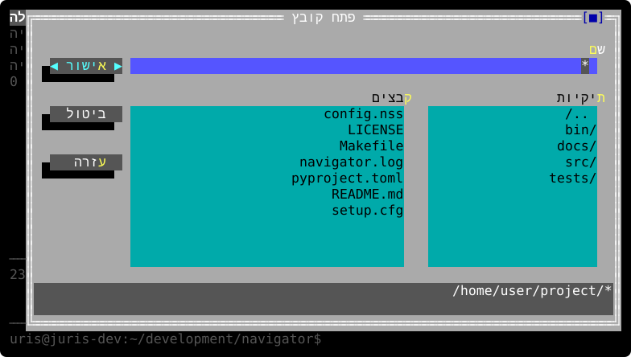

# תיבות דו-שיח

תיבת דו-שיח מחזיקה את המקלדת עד שסוגרים אותה.

## מקשים בתיבת דו-שיח

| מקש | מה הוא עושה |
|---|---|
| `Tab`, `Shift+Tab` | מעבר לפקד הבא או הקודם |
| `Alt` ואות מודגשת | מעבר לפקד עם האות הזו |
| `Enter` | לחיצה על כפתור ברירת המחדל, זה שמסומן בחצים |
| `Esc` | סגירת התיבה בלי לעשות דבר |
| `Space` | סימון תיבת סימון, או בחירת כפתור רדיו |
| `Down` בשורה שלידה `↓` | פתיחת ההיסטוריה של השורה |
| `F1` | הצגת העזרה לתיבה הזו |

ברשימת היסטוריה, `Enter` לוקח רשומה ו-`Del` שוכח אותה.

## בחירת קובץ

כמה פקודות מבקשות קובץ באותה תיבה: השם בשורה, ומתחתיו הקבצים והתיקיות של המקום שמוצג.

- *שם* הוא שם הקובץ. אפשר להקליד נתיב שלם. שם עם `*` או `?`, או שם של תיקייה, מציג את הקבצים האלה במקום לבחור
  אחד.
- *קבצים* מציג את הקבצים שמתאימים. הקלדת אותיות שם מוצאת שם שמתחיל בהן.
- *תיקיות* מציג את התיקיות; `Enter` על אחת נכנס אליה.
- החלונית בתחתית מציגה את הנתיב, ואת הגודל והתאריך של הקובץ שתחת הסמן.
- *אישור*, או `Enter` על קובץ, בוחר אותו.

`Left` ו-`Right` עוברים בין הרשימות והכפתורים.
