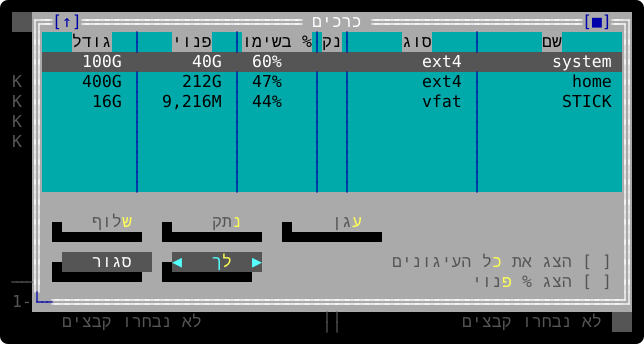
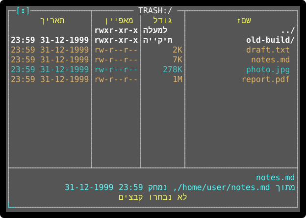

# מקומות שאינם הדיסק

לוח יכול להציג יותר מהתיקיות של הדיסק שלכם. בכל מקום שבו הוא נמצא, מציגים, עורכים, מעתיקים ומוחקים קבצים
באותו אופן.

## ארכיונים

`Enter` על ארכיון, כמו קובץ zip או tar, נכנס לתוכו כאילו היה תיקייה. העתיקו ממנו קבצים, או אליו, ב-`F5`.
[ארכיונים](archives.md) מסביר יצירה וחילוץ.

## שרתים, מכולות ומכשירים

*כלים > קישורים* פותח לוח על מחשב או שירות אחר. כל פריט שומר רשימה של החיבורים שיצרתם, כדי להתחבר שוב;
[חיבורים](connections.md) מתאר את התיבה שלו.

| פריט | למה הוא מגיע |
|---|---|
| *SSH (SFTP)*, `Alt+F11` | שרת דרך SSH |
| *FTP* | שרת FTP או FTPS |
| *SMB* | שיתוף Windows |
| *S3* | דלי (bucket) ב-S3 או בשירות תואם |
| *מכולת Docker*, *מכולת Podman* | הקבצים שבתוך מכולה שרצה |
| *מכשיר Android (adb)* | טלפון או טאבלט, דרך `adb` |
| *מאגר rclone* | כל מאגר מרוחק שהוגדר ב-`rclone`, כמו Google Drive או Dropbox |
| *קישור GVfs/KIO* | כל מה ששולחן העבודה יכול להגיע אליו, כמו טלפון דרך MTP או שרת WebDAV |

פריט מוצג באפור כשהתוכנית שהוא צריך אינה מותקנת; תיאור הכלי שלו מציין את התוכנית.

אפשר גם להקליד כתובת במקום שבו מתבקשת תיקייה, כמו `sftp://user@host/dir` או `smb://host/share`.

*כלים > מעטפת מרוחקת* פותח מעטפת על השרת, במכולה או במכשיר. *כלים > נתק*, `Alt+H`, סוגר חיבור; לוח שהציג אותו
חוזר לדיסק.

## כרכים

*דיסק > כרכים* מציג את הדיסקים ואת המדיה הנשלפת, ומעגן אותם, מבטל את העיגון שלהם ומוציא אותם.

### תמונות דיסק

`Enter` על תמונת דיסק, קובץ `.iso` או `.img`, או *דיסק > עגן תמונה* כשהסמן עליה, מעגן אותה לקריאה בלבד ופותח
אותה בלוח. *דיסק > בטל עיגון תמונה*, בתוך התמונה או עליה, מבטל שוב את העיגון ומחזיר את הלוחות שהיו בתוכה אל
קובץ התמונה. זה דורש udisks2, שרוב שולחנות העבודה מריצים; *ENTER מעגן תמונות דיסק* בעמוד
[פאנלי קבצים](settings.md#פאנלי-קבצים) של ההגדרות מכבה את החלק של `Enter`.

## האשפה

`F8` מעביר קבצים בדיסק לאשפה במקום למחוק אותם כש-*F8 זורק לאשפה* מסומן בעמוד
[פאנלי קבצים](settings.md#פאנלי-קבצים) של ההגדרות. בתיבה [מחיקה](file-operations.md#מחיקה) מסומן אז
*העבר לאשפה*; בטלו את הסימון כדי למחוק את הקבצים לצמיתות. [ביטול](file-operations.md#ביטול), `Ctrl+Z`, מחזיר את
ההעברה האחרונה לאשפה.

*דיסק > אשפה*, או לחיצה כפולה על פח האשפה, מציג בלוח הפעיל את הקבצים שבאשפה. השורה שמתחת ללוח אומרת מאיפה בא
הקובץ שתחת הסמן ומתי הוא נמחק.

- *קובץ > שחזר מהאשפה* מחזיר את הקבצים הנבחרים למקום שממנו באו.
- `F8` שם מוחק אותם לצמיתות.
- `F5` מעתיק אותם החוצה, כמו מכל תיקייה.

*דיסק > רוקן אשפה* מוחק לצמיתות את כל מה שבאשפה, אחרי שאלה.

## סימניות

`Alt+F1` ו-`Alt+F2` פותחים רשימה של תיקיות מסומנות עבור הלוח השמאלי והימני, ו-`Alt+C` עבור הלוח הפעיל.
ב[סימניות](bookmarks.md) נמצאים המקשים של הרשימה.
