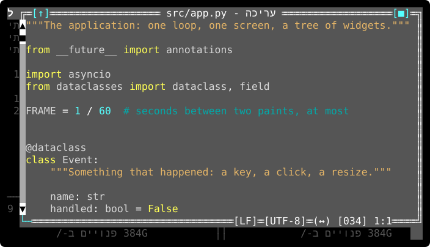
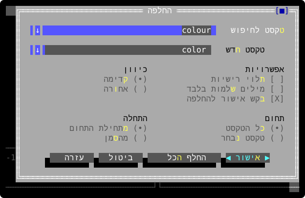
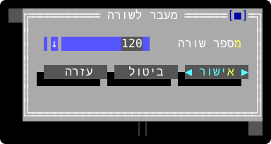
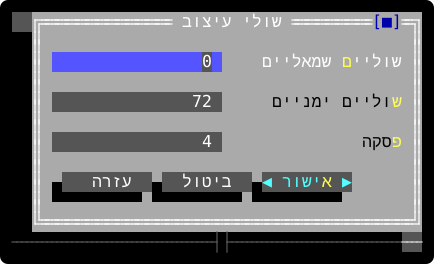

# העורך

`F4` פותח בעורך את הקובץ שתחת הסמן. כל פקודה נמצאת גם בתפריט *עורך*, שמופיע בשורת התפריט כל עוד עורך פתוח.



## מקשים

| מקש | מה הוא עושה |
|---|---|
| `F2` | שמירה |
| `Shift+F2` | שמירה בשם אחר |
| `Ctrl+F4` | סגירת העורך; הוא שואל קודם אם הטקסט שונה |
| `Alt+Backspace` | ביטול |
| `Alt+Shift+Backspace` | ביצוע מחדש |
| `Ctrl+Y` | מחיקת השורה |
| `Ctrl+Backspace` | מחיקת המילה שמשמאל |
| `Ctrl+N` | הוספת שורה |
| `F7`, `Ctrl+F7` | [חיפוש והחלפה](#חיפוש-והחלפה) |
| `Alt+G` | [מעבר לשורה](#מעבר-לשורה) |
| `Alt+PgUp` | רשימת הקבצים שנערכו קודם |

## פתיחת קובץ

| מקש או פריט | מה הוא פותח |
|---|---|
| `F4` | את הקובץ שתחת הסמן |
| `Alt+F4`, `Ctrl+K`, *קובץ > ערוך > עריכה חלופית* | את הקובץ שתחת הסמן בעורך האחר: ראו להלן |
| `Shift+F4`, *קובץ > ערוך > ערוך קובץ חדש* | קובץ שאתם נותנים לו שם ב[תיבת קבצים](dialogs.md#בחירת-קובץ). שם שעדיין אינו קיים נוצר כשאתם שומרים |
| *קובץ > ערוך > פתח...* | קובץ שאתם בוחרים בתיבת קבצים, בלי צורך במנהל קבצים. שם שעדיין אינו קיים נוצר כשאתם שומרים |
| `Alt+PgUp` | קובץ מרשימת הקבצים שנערכו קודם |

`F4` משתמש בעורך של Navigator, ו-*עריכה חלופית* בתוכנית אחרת: זו ש-`editors.ini` מציין עבור הקובץ
([שיוכי קבצים](user-menu.md#שיוכי-קבצים)), ואחרת רשימה של העורכים שמותקנים למסוף, כמו `vim` או `nano`,
וזה שתבחרו רץ בחלון משלו. כש-*עורך פנימי* אינו מסומן בעמוד [מערכת](settings.md#מערכת) של ההגדרות, שני המקשים
מתחלפים: `F4` מריץ את התוכנית של `editors.ini`, ואחרת את `$EDITOR`, ו-*עריכה חלופית* משתמש בעורך של Navigator.
`Ctrl+K` קיים משום שמנהלי חלונות רבים סוגרים את המסוף ב-`Alt+F4`.

`F4` על תיקייה פותח את [מאפייני הקבצים](file-operations.md#מאפייני-קבצים) שלה.

קובץ שנערך קודם נפתח במקום שבו עזבתם אותו.

## בלוקים ולוח הגזירים

כדי לסמן בלוק, החזיקו `Shift` בזמן הזזת הסמן, או גררו בעכבר.

| מקש | מה הוא עושה |
|---|---|
| `Ctrl+Ins`, `Ctrl+C` | העתקת הבלוק |
| `Shift+Del`, `Ctrl+X` | גזירת הבלוק |
| `Shift+Ins`, `Ctrl+V` | הדבקה |
| `Ctrl+Del` | מחיקת הבלוק |
| `Alt+Shift+I`, `Alt+Shift+O` | הזחת הבלוק וביטול ההזחה |
| `Alt+Shift+U`, `Alt+Shift+L` | המרת הבלוק לאותיות גדולות, לאותיות קטנות |
| `Alt+T` | מיון שורות הבלוק |
| `Alt+H` | הסתרת הבלוק או הצגתו |

[העתקה והדבקה](clipboard.md) מסביר אילו ממקשי ההעתקה וההדבקה פועלים באיזה מסוף.

תת-התפריט *אפשרויות* מחליף את התנהגות החלון הזה, כמו הזחה אוטומטית, מספרי שורות והדגשת תחביר. מה שעורך חדש
מתחיל איתו נקבע בעמוד [עורך/מציג](settings.md#עורךמציג) של ההגדרות.

## חיפוש והחלפה

`F7` מוצא טקסט ו-`Ctrl+F7` מחליף אותו. `Shift+F7` חוזר על החיפוש האחרון, כולל ההחלפה.

התיבה נפתחת עם ניחוש של מה שאתם מחפשים: הטקסט המסומן אם הוא בשורה אחת, ואחרת המילה שתחת הסמן.



- *טקסט לחיפוש* הוא הטקסט לחפש. `Down` בשורה פותח את ההיסטוריה של חיפושים קודמים.
- *טקסט חדש*, בהחלפה, הוא מה לשים במקומו.

### אפשרויות

- *תלוי רישיות* מבחין בין אותיות גדולות לקטנות.
- *מילים שלמות בלבד* מדלג על התאמה שהיא חלק ממילה ארוכה יותר.
- *בקש אישור להחלפה* שואל לפני כל החלפה: *כן*, *לא*, *הכל* לזו ולכל מה שאחריה, או *ביטול*.

### היכן לחפש

- *כיוון*: *קדימה* לעבר סוף הטקסט, או *אחורה* לעבר תחילתו.
- *תחום*: *כל הטקסט* מחפש בכל הטקסט, *טקסט נבחר* רק בבלוק המסומן.
- *התחלה*: *מתחילת התחום* מתחיל בתחילת התחום, *מהסמן* בסמן.

### החלפה

*אישור* מחליף את ההתאמה הראשונה. *החלף הכל* מחליף כל אחת, ומציין כמה הוחלפו. אפשר לבטל כל החלפה בנפרד.

### סרגל החיפוש

`Ctrl+F` ו-`Ctrl+R` פותחים סרגל בתוך חלון העורך במקום תיבה. הוא מחפש תוך כדי הקלדה, מאיר כל התאמה שעל המסך,
ויכול לחפש לפי ביטוי רגולרי.

## מעבר לשורה



`Alt+G` מבקש מספר שורה ומציב את הסמן בשורה הזו. השורות נספרות מ-1. התיבה נפתחת עם המספר שהקלדתם לאחרונה.

## שוליים



*עורך > פסקה > שוליים* קובע את שלושת המספרים שעיצוב הפסקאות פועל ביניהם. הם חלים על חלון העורך הזה בלבד; ערכי
ההתחלה באים מהגדרות העורך.

- *שוליים שמאליים* הוא העמודה שבה מתחילה כל שורה.
- *שוליים ימניים* הוא העמודה האחרונה ששורה יכולה להגיע אליה.
- *פסקה* היא העמודה שבה מתחילה השורה הראשונה של פסקה.

כדי לעצב פסקה, סמנו אותה כבלוק ולחצו `Alt+J` כדי ליישר אותה לשני הצדדים, `Alt+L` כדי ליישר אותה לשוליים
השמאליים, `Alt+R` לימניים, או `Alt+C` כדי למרכז אותה. כל הבלוק נחשב פסקה אחת.

## הדגשת תחביר

העורך והמציג צובעים את הטקסט של תוכנית, דף אינטרנט, קובץ תצורה ורבים אחרים לפי מה שכל חלק הוא. הצביעה שקובץ
מקבל נקבעת לפי שמו, ב-`highlight.ini`, ועבור סקריפט בלי סיומת מוכרת לפי השורה הראשונה שלו, כמו `#!/bin/sh`:
*אפשרויות > עריכת קובץ הדגשה* פותח את הקובץ הזה בעורך.

```ini
[*.conf]
lexer = ini

[*.txt]
lexer = none
autowrap = on
right_margin = 72
```

- כל סעיף הוא [מסכת קבצים](panels.md#מסכות-קבצים). הסעיף הראשון שתואם את הקובץ ומציין `lexer` בוחר את השפה;
  קובץ שאף סעיף אינו לוקח נשאר לניחוש של Pygments.
- `lexer` מציין את השפה, כפי ש-Pygments קורא לה (`python3 -m pygments -L lexers` מציג אותן). `none` אינו צובע
  דבר; `auto` נותן ל-Pygments לנחש לפי השם והתוכן.
- סעיף יכול גם לקבוע את אפשרויות העורך לקבצים האלה, בשמות שיש להן בסעיף `[editor]` של `navigator.ini`:
  `auto_indent`, `insert_tabs`, `line_numbers`, `soft_wrap`, `autowrap`, `right_margin`, `line_ending` ואחרות.
  כל אחת באה מהסעיף התואם הראשון שקובע אותה. ההערות שבקובץ עצמו מפרטות את כולן. קובץ שנערך קודם שומר על
  האפשרויות שהיו לו כשעזבתם אותו.

לחלון אחד, *עורך > סוג קובץ* (`Ctrl+Shift+H`) בוחר שפה אחרת, ו-*עורך > אפשרויות > הדגשת תחביר* מכבה ומדליק את
הצביעה. הצבעים הם של ערכת הנושא.
