# פעולות על קבצים

העתקה, העברה, קישור, פיצול וקידוד פועלים על הבחירה: הקבצים המתויגים של הלוח הפעיל, או הקובץ שתחת הסמן כשדבר אינו
מתויג. רובן נפתחות עם התיקייה של הלוח השני כמקום לשים בו את התוצאה.

## העתקה והעברה

`F5` מעתיק את הבחירה ו-`F6` משנה את שמה או מעביר אותה. שניהם פותחים את אותה תיבה: שורה שאומרת לאן, מצבי ההעתקה,
וארבע אפשרויות.

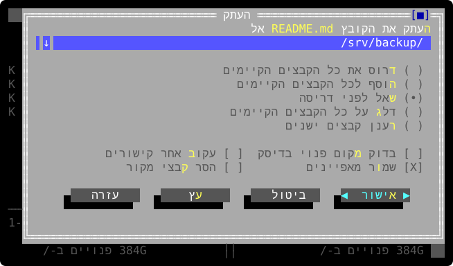

### לאן

מה שמקלידים בשורה קובע מה קורה:

| מקלידים | מה זה אומר |
|---|---|
| תיקייה שקיימת, או שם שמסתיים ב-`/` | הקבצים נכנסים לתיקייה הזו |
| שם עם `*` או `?` | כל קובץ מקבל שם חדש לפי המסכה הזו, במקום שאליו הוא הולך |
| כל שם אחר, כשנבחר קובץ אחד | השם החדש של הקובץ |
| כל שם אחר, כשנבחרו כמה קבצים | תיקייה ליצור ולהעתיק לתוכה |

מסכה מוחלת על השם ועל הסיומת בנפרד: `*.bak` נותן לכל קובץ את הסיומת `bak`. מסכה בלי נקודה מכסה את השם כולו, ולכן
`*` משאיר כל שם כפי שהוא.

`F10`, או הכפתור *עץ*, בוחר את התיקייה מתוך עץ. `Down` בשורה פותח את ההיסטוריה של המקומות שהעתקתם אליהם קודם.

### מה לעשות בקבצים שכבר נמצאים שם

| מצב | מה הוא עושה |
|---|---|
| *דרוס את כל הקבצים הקיימים* | מחליף אותם בלי לשאול |
| *הוסף לכל הקבצים הקיימים* | מוסיף כל קובץ לסופו של הקובץ שכבר נמצא שם |
| *שאל לפני דריסה* | שואל על כל אחד. אפשר להחיל את התשובה על כל השאר |
| *דלג על כל הקבצים הקיימים* | משאיר אותם בשקט ומעתיק את האחרים |
| *רענן קבצים ישנים* | מחליף קובץ רק כשזה שמועתק חדש יותר |

כשהוא שואל, *שנה שם* מאפשר לתת לעותק שם אחר במקום.

### אפשרויות

- *בדוק מקום פנוי בדיסק* עוצר לפני ההעתקה כשביעד אין מספיק מקום.
- *שמור מאפיינים* שומר הרשאות, בעלים וזמנים בעותקים. מה שלא היה אפשר לשמור מדווח; ההעתקה עצמה עדיין מצליחה.
- *עקוב אחר קישורים* מעתיק את מה שקישור מצביע עליו, לא את הקישור עצמו.
- *הסר קבצי מקור* מוחק את המקוריים אחרי שהועתקו, מה שהופך את ההעתקה להעברה.

המצב והאפשרויות נזכרים עד שיוצאים מ-Navigator.

### בזמן הריצה

תיבת ההתקדמות מציגה את המהירות ואת הזמן שנותר. *רקע* שולח את ההעתקה הצידה כדי שתוכלו להמשיך לעבוד: אחוז מופיע
בשורת התפריטים, ולחיצה עליו מחזירה את התיבה. אם להעתקה יש שאלה בזמן שהיא ברקע, האחוז מציג `?` ומחכה לכם. *עצור*
שואל לפני שהוא נוטש את ההעתקה.

קבצים שהועתקו מאבדים את התיוג שלהם; קבצים שדולגו שומרים עליו.

`Ctrl+Z` מבטל את ההעתקה; ראו [ביטול](#ביטול).

## יצירת תיקייה

`F7` יוצר תיקייה בלוח הפעיל. הקלידו נתיב כמו `a/b/c` כדי ליצור כל תיקייה בדרך, או כמה שמות מופרדים ב-`;` כדי ליצור
כמה.

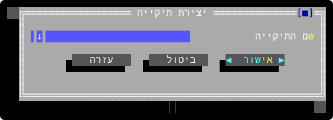

## שינוי שם מהיר

`Shift+F6`, או *קובץ > כלי שינוי שם > שינוי שם מהיר*, מבקש בתיבה קטנה את השם החדש של הקובץ שתחת הסמן. הוא משנה את
שמו של קובץ אחד במקומו; כדי להעביר קובץ, או לשנות שמות של כמה לפי מסכה, השתמשו ב-`F6`.

## שינוי שמות מרובה

`Alt+A`, או *קובץ > כלי שינוי שם > שינוי שמות מרובה*, משנה את שמות הקבצים המתויגים לפי תבנית אחת. הרשימה בחצי
התחתון מציגה כל שם חדש לפני שנעשה דבר, והשורה שמתחתיה אומרת מה לא בסדר כשאי אפשר להשתמש בשם: שם ריק, שם שיש בו
`/`, שני קבצים שקיבלו שם אחד, או שם שכבר תפוס.

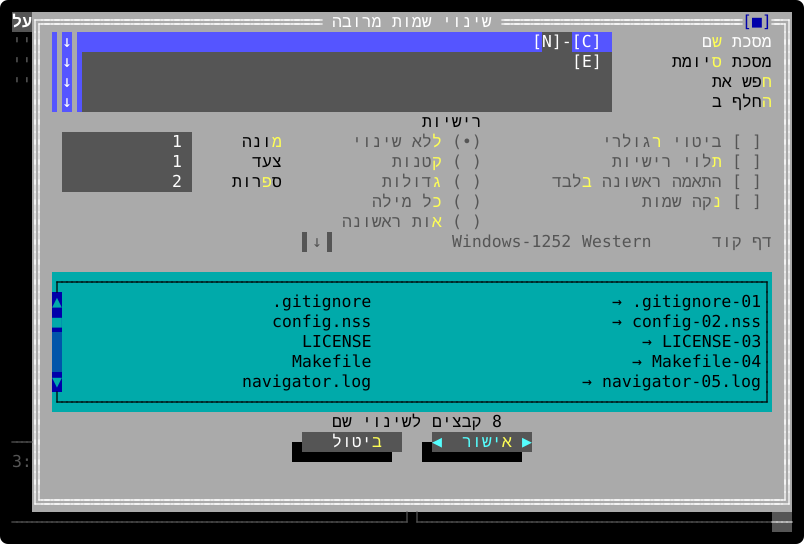

שם חדש נבנה בשלושה שלבים.

**המסכות.** *מסכת שם* בונה את השם ו*מסכת סיומת* את הסיומת. טקסט נלקח כמו שהוא, וממלא מקום בסוגריים מרובעים
מוחלף:

| ממלא מקום | מייצג |
|---|---|
| `[N]` | השם הישן בלי הסיומת שלו |
| `[N3]` | התו השלישי שלו |
| `[N2-5]` | התווים השני עד החמישי שלו |
| `[N2-]` | מהתו השני והלאה |
| `[N2,4]` | ארבעה תווים מהשני |
| `[N-3-]` | שלושת התווים האחרונים |
| `[E]` | הסיומת הישנה, שנחתכת באותן דרכים |
| `[P]` | שם התיקייה שבה נמצא הקובץ, שנחתך באותן דרכים |
| `[C]` | מונה, לפי *מונה*, *צעד* ו*ספרות* |
| `[C10+5:3]` | מונה שמתחיל ב-10, מתקדם ב-5 ויש לו שלוש ספרות: 010, 015, 020 |
| `[Y]` `[M]` `[D]` `[h]` `[m]` `[s]` | תאריך ושעת השינוי של הקובץ |
| `[[]` `[]]` | `[` ו-`]` |

מסכת סיומת ריקה משאירה את השם בלי נקודה.

**חיפוש והחלפה.** *חפש את* ו*החלף ב* פועלים על השם המלא שהמסכות בנו.

- *ביטוי רגולרי* מתייחס לחיפוש כביטוי רגולרי; ההחלפה יכולה אז להשתמש ב-`\1` עבור קבוצה.
- *תלוי רישיות* מבחין בין אותיות גדולות לקטנות.
- *התאמה ראשונה בלבד* מחליף התאמה אחת בכל שם, לא את כולן.

**רישיות.** *ללא שינוי*, *קטנות*, *גדולות*, *כל מילה* או *אות ראשונה*.

*נקה שמות* מתקן שמות לפני שלושת השלבים: בתים שאינם UTF-8 נקראים ב*דף קוד* שבוחרים, תווי בקרה הופכים ל-`_`, ושמות
באותה תיקייה שנבדלים רק ברישיות ממוספרים.

קובץ שהשם שלו יוצא זהה נשאר בשקט. שמות שמתחלפים בין הקבצים, `a` ל-`b` ו-`b` ל-`a`, משתנים כראוי.

### שמות שצריך לנקות

*קובץ > כלי שינוי שם > סמן שמות פגומים* מתייג כל קובץ בלוח ש*נקה שמות* היה משנה את שמו: שם שאינו UTF-8 תקין, שם
שנכתב בצורת Unicode מפורקת, שם שיש בו תו בקרה, ושמות שנבדלים משם אחר רק באותיות גדולות. `Alt+A` כש*נקה שמות* מסומן
משנה אז את שמותיהם.

## מחיקה

`F8`, או `Del` כששורת הפקודה ריקה, מוחק את הבחירה אחרי שאלה. `Shift+F8`, ‏`Shift+Del` או *קובץ > מחק קובץ יחיד*
מוחק את הקובץ שתחת הסמן, לא משנה מה מתויג.

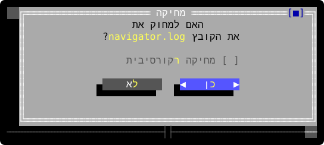

- *מחיקה רקורסיבית* מוחקת תיקיות עם כל מה שבתוכן בלי לשאול על כל אחת.
- *העבר לאשפה* מוצג כש[האשפה](drives.md#האשפה) בשימוש. כשהיא אינה מסומנת, הקבצים נמחקים לצמיתות.

בלי *מחיקה רקורסיבית* נשאלים על תיקייה שאינה ריקה, ועל קבצים שאין לכם הרשאת כתיבה אליהם; על כל שאלה אפשר לענות
עבור כל השאר. אילו שאלות נשאלות בכלל נקבע בעמוד [אישורים](settings.md#אישורים) של ההגדרות.

מחיקה ארוכה אפשר לשלוח לרקע, כמו העתקה.

## ביטול

`Ctrl+Z`, או *קובץ > בטל פעולה*, מבטל את פעולת הקבצים האחרונה, ולחיצה נוספת את זו שלפניה, עד חמישים. הוא אומר מה
הוא עומד לעשות ושואל קודם.

| פעולה | מה הביטול עושה |
|---|---|
| העתקה, `F5` או הדבקה | מסיר את מה שההעתקה יצרה, אבל רק את הקבצים ששום דבר לא שינה מאז: לאשפה בדיסק, לצמיתות במקומות אחרים |
| העברה, `F6` או גזירה והדבקה | מחזיר את הקבצים |
| שינוי שם, `F6`, `Alt+F6`, `Shift+F6` או `Alt+A` | מחזיר את השמות הישנים |
| מחיקה ל[אשפה](drives.md#האשפה) | משחזר את הקבצים מהאשפה |
| התיקייה החדשה של `F7` | מסיר אותה, אם היא עדיין ריקה |

קובץ שהעתקה או העברה החליפו נעלם לצמיתות, והשאלה אומרת כמה כאלה היו. מחיקה לצמיתות, מאפיינים וקישורים אי אפשר
לבטל, וגם לא העתקה או העברה לתוך ארכיון או ממנו. רשימת הפעולות נשמרת עד ש-Navigator יוצא ומשותפת לכל חלונות מנהל
הקבצים. כל עוד יש טקסט בשורת הפקודה, `Ctrl+Z` נשאר לשורת הפקודה.

## מאפייני קבצים

`Alt+E` משנה את המאפיינים של הבחירה. רק מה שמשנים מוחל, כך שקבצים שנבדלים בדרכים אחרות שומרים על ההבדלים שלהם.
*רקורסיבי* מחיל את השינוי גם על כל מה שבתוך התיקיות.

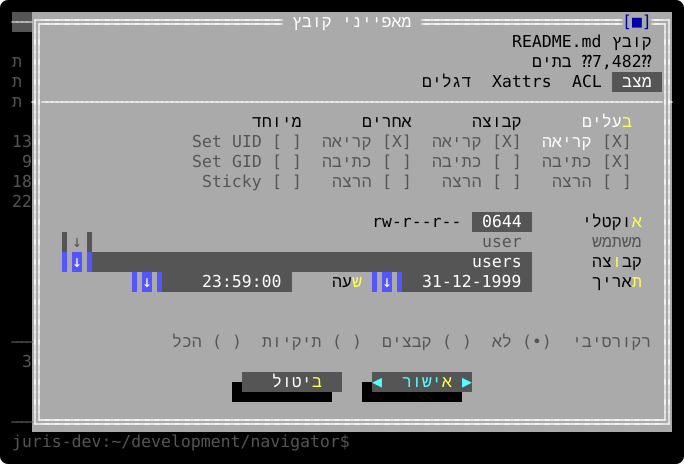

- *מצב* מכיל את ההרשאות: רשת של קריאה, כתיבה והרצה עבור הבעלים, הקבוצה ואחרים, אותו דבר כמספר אוקטלי, הבעלים
  והקבוצה, והתאריך והשעה. ברשת, `R`, `W` ו-`X` מסמנים שורה שלמה.
- *ACL* מציג את רשומות בקרת הגישה שמעבר למצב, ומוסיף, עורך ומסיר אותן.
- *Xattrs* מציג את המאפיינים המורחבים.
- *דגלים* מכיל את הדגלים של מערכת הקבצים, כמו immutable ו-append-only.

תיבה שמציגה `?` פירושה שהקבצים שונים שם; השאירו אותה כמו שהיא כדי לשמור כל קובץ כמו שהוא.

### רשומות ACL

*הוסף* ו*ערוך* בעמוד *ACL* פותחים רשומה אחת. *סוג* אומר אם היא נוקבת במשתמש או בקבוצה, *שם* בוחר באיזה, ו*הרשאות*
הן *קריאה*, *כתיבה* ו*הרצה*. *ברירת מחדל, עוברת בירושה לקבצים חדשים* הופך אותה לרשומת ברירת מחדל של תיקייה: מה
שנוצר בתוך התיקייה יורש אותה.

### מאפיינים מורחבים

*הוסף* ו*ערוך* בעמוד *Xattrs* פותחים מאפיין אחד, ה*שם* שלו וה*ערך* שלו. ערך הוא טקסט, או `0x` ואחריו ספרות הקס,
או `0s` ואחריו base64. מירכאות סביב ערך משאירות אותו טקסט.

## קישורים

`Shift+F5` יוצר קישורים לבחירה בתיקייה שנוקבים בה.

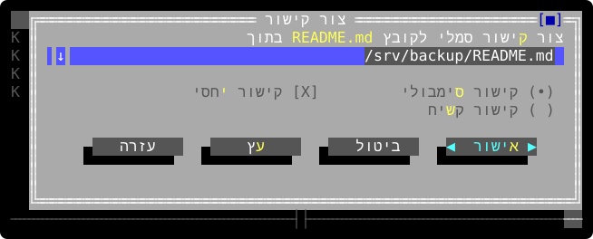

- *קישור סימבולי* יוצר קובץ קטן שמחזיק את הנתיב של המקור. הוא יכול להצביע על תיקייה, ועל דיסק אחר.
- *קישור קשיח* נותן לקובץ שם שני. הוא עובד רק לקבצים, ורק באותה מערכת קבצים.
- *קישור יחסי* כותב את הנתיב ביחס לקישור, כך שאפשר להעביר את הקישור ואת המקור יחד. הוא חל רק על קישורים סמליים.

ב*קובץ > קישורים* יש עוד: עריכה של לאן קישור מצביע, הפיכת קישורים ליחסיים או למוחלטים, תיוג קישורים שבורים,
והצגת כל השמות שיש לקובץ עם קישורים קשיחים.

### שינוי היעד של קישורים

*קובץ > קישורים > ערוך יעד קישור* משנה את הקישורים הסמליים שנבחרו.

- כשנבחר קישור אחד, שורה מחזיקה את היעד שלו לעריכה. *קישור יחסי* כותב את היעד החדש ביחס לקישור.
- כשנבחרו כמה, *חפש את* ו*החלף ב* משנים את אותו חלק בכל יעד, וזה מה שעץ שהועבר צריך.

*הפוך ליחסי* ו*הפוך למוחלט* כותבים מחדש את היעד של כל קישור שנבחר בדרך השנייה, כך שהוא מגיע לאותו קובץ. *סמן
קישורים שבורים* מתייג כל קישור בלוח שמצביע לשום מקום: אלה שמסומנים `!` ברשימה כשהיא מוצגת בלי סמלים.

### כל השמות של קובץ

לקובץ עם קישורים קשיחים יש כמה שמות, אולי בתיקיות שונות. *קובץ > קישורים > הצג קישורים קשיחים* מוצא כל שם שיש
לקובץ שתחת הסמן במערכת הקבצים שלו ומציג אותם בלוח, כמו ש[חיפוש קובץ](panels.md#חיפוש-קובץ) מציג את מה שמצא;
`Enter` על `..` חוזר. תיקיות שאסור לכם לקרוא מדולגות, כך שאולי יימצאו פחות שמות ממה שיש לקובץ. העמודה *קישורים*
של התצוגה המפורטת מציגה כמה שמות יש לקובץ.

## פיצול ואיחוד

*קובץ > פיצול/איחוד קטעים* פועל על הקובץ שתחת הסמן, והשם של הקובץ קובע איזו משתי הפעולות הוא עושה.

### פיצול

כל קובץ רגיל מפוצל לחלקים בשמות `NAME.001`, ‏`NAME.002` וכן הלאה, בתיקייה שנוקבים בה.

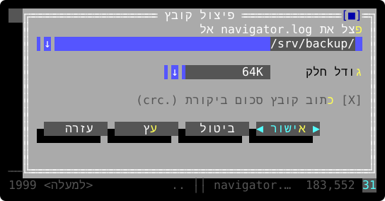

- *גודל חלק* הוא הגודל של כל חלק: מספר בתים, או מספר ואחריו `K`, `M` או `G`, כמו `100M` או `1.44M`.
- *כתוב קובץ סכום ביקורת (.crc)* כותב גם את `NAME.crc`, שמחזיק את השם, הגודל וסכום הביקורת של הקובץ. בעזרתו אפשר
  לבדוק את הקובץ המאוחד.

קובץ שאינו גדול מחלק אחד אינו מפוצל. Total Commander, ‏Double Commander ו-7-Zip יודעים לאחד את החלקים האלה.

### איחוד

על חלק (`NAME.001`) או על ה-`NAME.crc` של סדרה, הפקודה מרכיבה את הקובץ בחזרה בתיקייה שנוקבים בה. היא קוראת את
החלקים לפי הסדר עד שאחד חסר. עם קובץ `.crc` היא גם בודקת את התוצאה; אם סכום הביקורת אינו תואם, הקובץ נשמר ומודיעים
לכם.

## קידוד ופענוח UU

קידוד UU הופך כל קובץ לטקסט פשוט שאפשר לשלוח למקומות שבהם מותר רק טקסט.

### קידוד

`Ctrl+F7` מקודד את הקובץ שתחת הסמן לתוך `NAME.uue`. קובץ גדול נכתב במקטעים, קובץ לכל אחד.

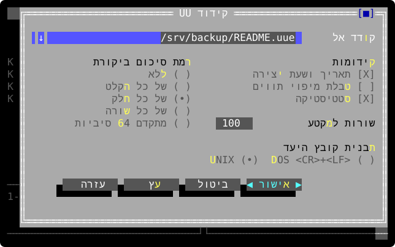

- *קידומות* מוסיפות שורות לפני הנתונים: התאריך והשעה של הקובץ, טבלת התווים שבשימוש, וסטטיסטיקה.
- *רמת סיכום ביקורת* מוסיפה סכומי ביקורת כדי שאפשר יהיה למצוא נזק בפענוח: בלי, של הקובץ כולו, של כל מקטע, של כל
  שורה, או זה של 64 סיביות.
- *שורות למקטע* הוא כמה שורות נתונים נכנסות למקטע אחד.
- *תבנית קובץ היעד* בוחרת איך שורות מסתיימות: כמו ב-DOS, או כמו ב-UNIX.

### פענוח

`Ctrl+F8` מפענח את הקובץ שתחת הסמן לתוך התיקייה שנוקבים בה. קובץ אחד יכול להחזיק כמה קבצים מקודדים ואת המקטעים
שלהם בכל סדר.

- *בדוק קבצים קיימים* שואל לפני החלפת קובץ שכבר נמצא שם.
- *הצג הודעות שגיאה* מציג כל שגיאה שנמצאה בנתונים.
- *שמור קבצים פגומים* כותב קובץ גם כשהנתונים שלו נפגמו.

## סיכומי ביקורת

רשימת סיכומי ביקורת מחזיקה תקציר (digest) של כל קובץ, כדי שאפשר יהיה לבדוק את הקבצים מאוחר יותר לנזק או לשינוי.

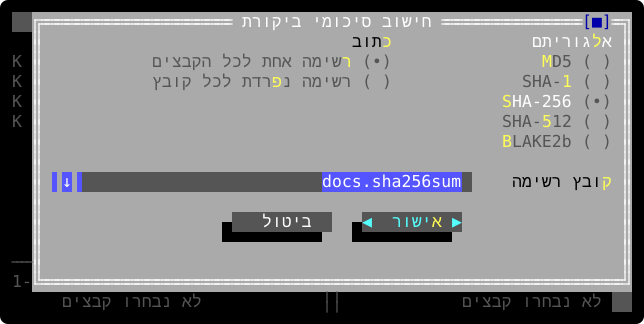

*קובץ > קידוד > סיכומי ביקורת > חשב* מחשב גיבוב לקבצים המתויגים, ולכל מה שבתוך תיקייה מתויגת.

- *אלגוריתם* הוא *MD5*, *SHA-1*, *SHA-256*, *SHA-512* או *BLAKE2b*.
- *רשימה אחת לכל הקבצים* כותב רשימה אחת, בשם שבשורה *קובץ רשימה*. *רשימה נפרדת לכל קובץ* כותב רשימה ליד כל קובץ.

*אמת* קורא את הרשימות המתויגות, או את הרשימה שתחת הסמן, מחשב שוב את הגיבוב של הקבצים שהן נוקבות בהם ומדווח כמה
תאמו. קבצים שלא תאמו, או שחסרים, מוצגים תחת *בעיות*.

הרשימות הן אלה ש-`md5sum`, ‏`sha256sum` וקרוביהן כותבים ובודקים, כך שכל צד יכול לאמת את של השני. האלגוריתם של
רשימה נקבע לפי השם שלה, כמו `.sha256sum`, ‏`.sha256` או `SHA256SUMS`, ואחרת לפי האורך של התקצירים שבה.

## הצפנה

*קובץ > קידוד > כלי הצפנה* מצפין ומפענח קבצים עם GnuPG (`gpg`) או `age`. תוכנה שאינה מותקנת מוצגת באפור.

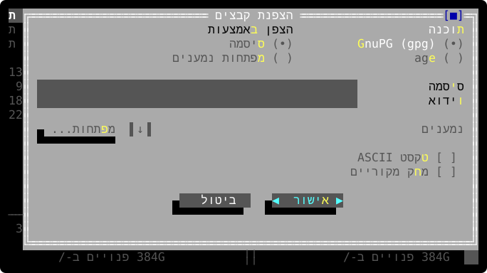

*הצפן* פועל על הקבצים המתויגים, ועל כל מה שבתוך תיקייה מתויגת. כל קובץ נכתב לידו בשם `NAME.gpg` או `NAME.age`.

- *תוכנה* היא *GnuPG (gpg)* או *age*.
- *הצפן באמצעות* *סיסמה*, שמוקלדת פעמיים, או *מפתחות נמענים*. הנמענים מופרדים ברווחים: מזהי מפתח או טביעות אצבע
  עבור gpg, מפתחות או קובצי מפתחות עבור age. *מפתחות...* בוחר מתוך המפתחות של gpg.
- *טקסט ASCII* כותב את הקבצים המוצפנים כטקסט; gpg קורא להם `NAME.asc`.
- *מחק מקוריים* מסיר כל קובץ אחרי שהעותק המוצפן שלו נכתב.

*פענח* פועל על הקבצים המוצפנים המתויגים, או על זה שתחת הסמן, וכותב כל אחד בחזרה לידו בשמו בלי הסיומת. סיסמה
מתבקשת רק כשקובץ צריך אחת, ופעם אחת לכולם.

## המרת טקסט

*קובץ > קידוד > המר טקסט* כותב מחדש את קובצי הטקסט המתויגים, או את זה שתחת הסמן, בקידוד אחר או עם סיומי שורות
אחרים. כל קובץ משתנה במקומו.

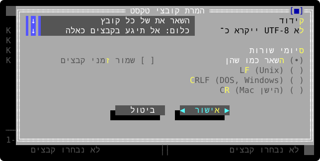

- *קידוד* הוא הקידוד שבו הקבצים נכתבים.
- *לא UTF-8 ייקרא כ־* הוא הקידוד שמניחים עבור קובץ שאינו UTF-8 ואין לו סימן סדר בתים. כשלא נבחר אחד, קובץ כזה
  נשאר בשקט.
- *סיומי שורות*: *השאר כמו שהן*, *LF (Unix)*, *CRLF (DOS, Windows)* או *CR (Mac הישן)*.
- *שמור זמני קבצים* נותן לכל קובץ שנכתב מחדש את הזמן שהיה לו.

קובץ שנראה בינארי, קובץ שהקידוד שנבחר אינו יכול לכתוב את הטקסט שלו, וקובץ גדול מאוד נשארים בשקט, ומודיעים לכם
למה. קובץ שהיה יוצא ללא שינוי אינו נכתב.

## פתיחה באמצעות

*קובץ > פתח באמצעות* פותח את הקובץ שתחת הסמן באחד מהיישומים של שולחן העבודה, שנבחר מרשימה של אלה שמטפלים בסוג
שלו, הרגיל ראשון.

- *יישומים אחרים* מציג כל יישום אחר שמותקן.
- *קבע ברירת מחדל* בוחר את היישום שבו הסוג ייפתח מעכשיו, ואינו פותח דבר.
- *פקודה...* מבקש שורת פקודה משלכם. `!.!` בתוכה מייצג את הקובץ; בלעדיו שם הקובץ נכנס בסוף. הפקודה רצה במסוף,
  ולכל סיומת נשמרת היסטוריה של הפקודות שהיו בשימוש.

הוא צריך את `gio` של שולחן העבודה או את הכלים של KDE; ראו *שילוב עם שולחן העבודה* בעמוד
[תקשורת](settings.md#תקשורת) של ההגדרות. קובץ בשרת מורד קודם. מה שיישום משנה אינו נשלח בחזרה; מה ש*פקודה...*
משנה כן, ברגע שהפקודה מסתיימת.

`Enter` על קובץ ששום רשומה ב-`extensions.ini` אינה לוקחת פותח אותו גם כן ביישום של שולחן העבודה, כל עוד *העבר
קבצים אחרים לשולחן* מסומן בעמוד [פאנלי קבצים](settings.md#פאנלי-קבצים).

## הדפסה

`Ctrl+F9`, או *קובץ > הדפס*, מדפיס את הקבצים שנבחרו אחרי שאלה. הם הולכים למדפסת של המערכת דרך `lp`, או `lpr` היכן
שאין `lp`, שמדפיסים ב-`$PRINTER` או במדפסת ברירת המחדל. תיקיות מדולגות, והתיוג של כל קובץ מוסר ברגע שהוא נשלח
למדפסת. העורך מדפיס את הטקסט שלו עם `F8`.
