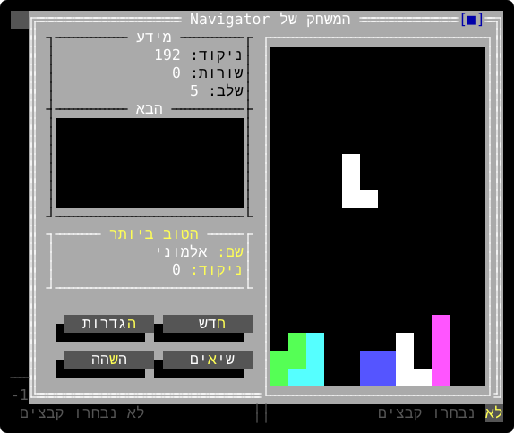

# המשחק

`Alt+F9`, או *משחק* בתפריט `≡`, פותח את המשחק: צורות נופלות לתוך כוס, ושורה שמתמלאת נעלמת. יש לו שני סגנונות:
טטריס עם שבע צורות ופנטיקס עם עשרים ושבע.

## מקשים

| מקש | מה הוא עושה |
|---|---|
| `Left` או `Home` | הזזת הצורה שמאלה |
| `Right` או `PgUp` | הזזת הצורה ימינה |
| `Up` | סיבוב הצורה |
| `Down` או `Space` | הפלת הצורה |
| `F2` | התחלת משחק חדש |
| `F3` | השהיה, והמשך |
| `F4` | הצגת 10 הטובים |
| `F5` | הגדרת המשחק: רמת הפתיחה, הסגנון והתצוגה המקדימה |
| `Gray +` | העלאת הרמה |
| `Gray *` | הצגה או הסתרה של הצורה הבאה |
| `Esc` | סגירת המשחק |

המשחק נעצר מעצמו כשעוברים לחלון אחר.

## עשרת הטובים

כשמשחק מסתיים בניקוד שמספיק לעשרת הטובים, תתבקשו להזין שם שתחתיו הוא יירשם. בלי שם, או עם *ביטול*, הוא נרשם
בשם *אלמוני*. יש רשימה אחת לכל סגנון.

## הגדרות

`F5`, או הכפתור *הגדרות*, מגדיר את המשחק.

- *רמה* היא הרמה שבה משחק מתחיל, מ-*1 - תינוק* עד *10 - בית משוגעים*. בכל רמה הצורות נופלות מהר יותר.
- *סגנון משחק* הוא *טטריס קלאסי* או *פנטיקס*.
- *תצוגת הצורה הבאה* מציגה את הצורה הבאה ליד הכוס.
