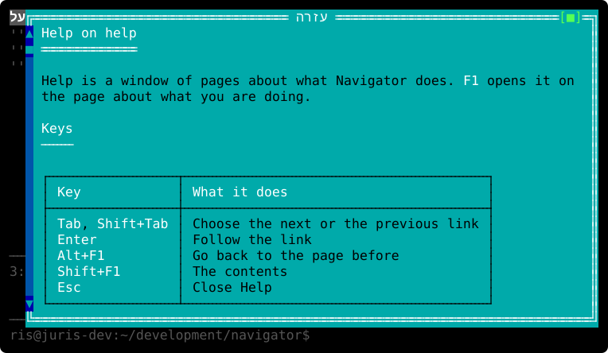

# עזרה על העזרה

`F1` פותח את המדריך הזה בדף שעוסק במה שאתם עושים. הדפים מקושרים זה לזה: קישור מוצג בצבע משלו, ותמיד אחד
מהקישורים הוא הנבחר.

## עזרה במקום שבו אתם נמצאים

`F1` פועל בכל מקום, ופותח את הדף על מה שמקבל את המקלדת:

- בתיבת דו-שיח, את הסעיף על אותה תיבה. בתיבות רבות יש גם כפתור *עזרה* שעושה אותו דבר;
- בתפריט פתוח, את הדף על הפריט המודגש, או על התפריט שלו;
- בחלון, כמו המציג, העורך או המחשבון, את הדף של אותו חלון;
- בלוחות, את הדף על הלוחות.

כשאין דף שעוסק במה שאתם עושים, נפתח [תוכן העניינים](README.md). `Esc` סוגר את העזרה ומשאיר אתכם במקום שבו
הייתם, ותפריט שהיה פתוח נשאר פתוח. בזמן שתוכנית רצה במסוף, `F1` שייך לתוכנית.

## מקשים

| מקש | מה הוא עושה |
|---|---|
| `Tab` | בחירת הקישור הבא |
| `Shift+Tab` | בחירת הקישור הקודם |
| `Enter` | מעבר לקישור הנבחר |
| `Alt+F1` | חזרה למקום שממנו באתם |
| `Shift+F1` | פתיחת [תוכן העניינים](README.md) |
| `F1` | פתיחת הדף הזה |
| `Up`, `Down`, `PgUp`, `PgDn`, `Home`, `End` | גלילת הדף |
| `Left`, `Right` | גלילה לצדדים, כששורת קוד רחבה מהחלון |
| `Alt+Z` | הגדלת החלון לכל המסך, וחזרה |
| `Ctrl+F5` | הזזת החלון ושינוי גודלו: החיצים מזיזים אותו, `Shift` והחיצים משנים את גודלו, `Enter` משאיר אותו שם, `Esc` מחזיר אותו |
| `Esc` | סגירת העזרה |

אפשר לשנות את המקשים האלה: אפשרויות > תצורה > קיצורי מקשים, תחת *חלון עזרה*.

## העכבר

לחיצה על קישור עוברת אליו. הגלגלת גוללת את הדף, וכך גם הפס שבקצה הימני של החלון כשהדף ארוך מהחלון. בדף שיש בו
שורת קוד רחבה מהחלון יש גם פס לאורך הקצה התחתון; `Shift` והגלגלת גוללים אותו לצדדים.

## קישורים לאתרים אחרים

Navigator אינו עוקב אחר קישור שמוביל אל מחוץ למדריך הזה, לאתר אינטרנט. ייתכן שהמסוף שלכם יפתח אותו: ברוב
המסופים החזיקו `Ctrl` ולחצו עליו.
