# לוחות

מנהל הקבצים מציג שני לוחות זה לצד זה, וכל אחד מהם מציג את הקבצים של תיקייה אחת. אחד מהם פעיל: יש בו פס הסמן,
הפקודות פועלות על הקבצים שלו, ובדרך כלל מציעות את התיקייה של הלוח השני כמקום לשים בו את התוצאה.

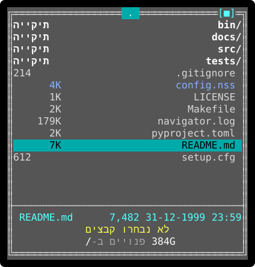

## תנועה בלוח

| מקש | מה הוא עושה |
|---|---|
| `Tab` | מעבר ללוח השני |
| `Up`, `Down`, `PgUp`, `PgDn`, `Home`, `End` | הזזת הסמן |
| `Enter` | כניסה לתיקייה או לארכיון, הרצת תוכנית, או פתיחת קובץ |
| `Backspace`, `Ctrl+PgUp` | מעבר לתיקיית האב |
| `Ctrl+\` | מעבר לתיקיית השורש |
| `Ctrl+R` | קריאה חוזרת של התיקייה |
| `Alt+Backspace` | רשימת התיקיות שבהן הייתם |
| `Alt+=` | הצגת אותה תיקייה בלוח השני |
| `Ctrl+U` | החלפת שני הלוחות זה בזה |

הקלדת אותיות כותבת בשורת הפקודה שמתחת ללוחות; ראו [שורת הפקודה](console.md).

לוח קורא מחדש את התיקייה שלו מעצמו כשמשהו בה משתנה.

## תצוגות

`Ctrl+Y` עובר בין שלוש תצוגות של לוח:

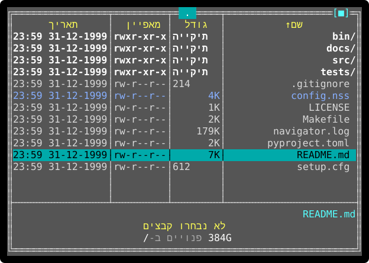

- *פשוט*: שמות וגדלים.
- *מפורט*: שמות עם גודל, מאפיינים, בעלים ותאריך בעמודות. `Alt+K` בוחר את העמודות.
- *רשימה*: שמות בלבד, בכמה עמודות.

בתצוגה הפשוטה ובמפורטת `Left` ו-`Right` גוללים שמות ארוכים. בתצוגה המפורטת לחיצה על כותרת עמודה ממיינת לפי
אותה עמודה, ולחיצה שנייה הופכת את הסדר.

`Ctrl+H` מציג או מסתיר קבצים מוסתרים, ו-`Alt+I` מציג או מסתיר את השורות שמתחת לרשימה.

## מיון

`Alt+B` בוחר את סדר הלוח: לפי שם, סיומת, גודל, זמן, מאפיינים, בעלים או סוג, בכל אחד משני הכיוונים, או ללא
מיון. התיקיות מוצגות לפני הקבצים.

## תיוג קבצים

הפקודות פועלות על הקבצים המתויגים, או על הקובץ שתחת הסמן כשאף קובץ אינו מתויג.

| מקש | מה הוא עושה |
|---|---|
| `Ins`, או `Space` כששורת הפקודה ריקה | תיוג הקובץ או ביטול התיוג, וירידה שורה |
| `Gray +` | תיוג הקבצים שתואמים מסכה |
| `Gray -` | ביטול התיוג של הקבצים שתואמים מסכה |
| `Gray *` | היפוך התיוגים |
| `Ctrl+A` | תיוג של הכול |

בעכבר, הכפתור האמצעי מתייג קובץ, וגרירה איתו מתייגת כל קובץ שעוברים עליו. `Shift` או `Ctrl` עם לחיצה שמאלית
מתייגים מהסמן ועד הקובץ שנלחץ.

השורות שמתחת לרשימה מציינות כמה קבצים מתויגים ומה הגודל הכולל שלהם.

## חיפוש מהיר

`Ctrl+S` מתחיל חיפוש לפי שם: הקלידו את האותיות הראשונות והסמן עובר לשם הראשון שמתחיל בהן. `Ctrl+S` נוסף עובר
לשם הבא. `Esc` מסיים את החיפוש; כל מקש אחר מסיים אותו ועושה את מה שהוא עושה בדרך כלל, כך ש-`Enter` נכנס ישר
לתיקייה שנמצאה.

## העתקה דרך לוח הגזירים

`Ctrl+C` מעתיק את הבחירה ו-`Ctrl+X` גוזר אותה; `Ctrl+V` בתיקייה אחרת מדביק בה את הקבצים, ושואל כמו ש[העתקה
והעברה](file-operations.md#העתקה-והעברה) שואלות. `Esc` שוכח את הקבצים. המקשים האלה פועלים על הלוח כל עוד שורת
הפקודה ריקה.

## הצד השני

הצד שאינו פעיל יכול להציג משהו אחר במקום הלוח:

| מקש | מה הוא מציג |
|---|---|
| `Ctrl+T` | עץ של תיקיות |
| `Ctrl+Q` | תצוגה מהירה של הקובץ שתחת הסמן |
| `Ctrl+L` | [מידע](#לוח-המידע) על התיקייה, הדיסק והקובץ שתחת הסמן |

אותו מקש מחזיר את הלוח. `Ctrl+F1` ו-`Ctrl+F2` מסתירים את הצד השמאלי ואת הימני, `Ctrl+P` מסתיר את הצד שאינו
פעיל, ו-`Alt+Left` ו-`Alt+Right` מזיזים את המחיצה שבין הצדדים.

`Alt+F12` עובר לעמודות מילר: שורה של עמודות צרות, אחת לכל תיקייה בדרך, עם תצוגה מקדימה של מה שתחת הסמן.

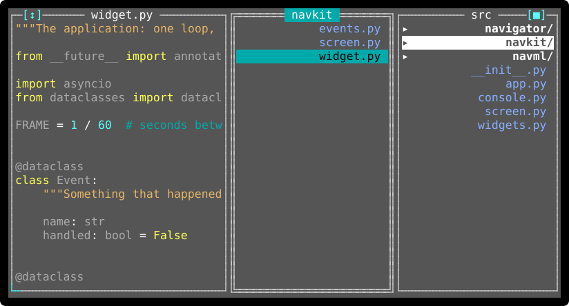

## לוח המידע

`Ctrl+L` מציג מידע על הלוח הפעיל במקומו של הלוח השני, ו-`Ctrl+L` נוסף מחזיר את הלוח. הוא עוקב אחרי הלוח הפעיל
בזמן שאתם נעים:

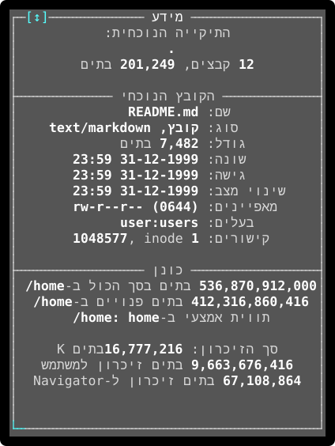

- שם התיקייה, וכמה קבצים יש בה ומה גודלם;
- הקובץ שתחת הסמן: הסוג, הגודל, הזמנים, המאפיינים, הבעלים, מספר הקישורים וה-inode שלו. תמונה, צליל, וידאו,
  PDF ותוכנית מקבלים יותר: הגודל בפיקסלים, האורך, הזרמים, העמודים או הספריות שהתוכנית צריכה. מה שצליל או וידאו
  מקבלים דורש את `ffprobe` של FFmpeg;
- מערכת הקבצים שהתיקייה נמצאת בה: הגודל שלה, המקום הפנוי, וההתקן או התווית שלה. בשרת, השרת ואופן החיבור;
  בארכיון, הארכיון;
- הזיכרון של המחשב, כמה תוכניות עוד יכולות להשתמש בו, וכמה Navigator עצמו תופס;
- קובץ המידע של התיקייה, `DirInfo` או `File_ID.DIZ`, כשיש כזה.

כשיש יותר ממה שנכנס, `Tab` מעביר אליו את המקלדת כדי לגלול אותו בחיצים, ב-`PgUp` וב-`PgDn`; גם גלגלת העכבר
גוללת אותו. העמוד [פאנל מידע](settings.md#פאנל-מידע) שבהגדרות בוחר אילו שורות מוצגות.

## יותר ממנהל קבצים אחד

`Ctrl+F3` פותח חלון נוסף של מנהל קבצים. ראו [חלונות](windows.md) על מעבר בין חלונות.

## מסכות קבצים

כמה תיבות מקבלות מסכת קבצים. מסכה היא תבנית אחת או יותר מופרדות ב-`;`, שבהן `*` מייצג כל טקסט ו-`?` כל תו
בודד. תבנית שמתחילה ב-`-` מוציאה את מה שהיא תואמת, והתבנית האחרונה שתואמת שם היא שמכריעה: `*;-*.bak` הוא כל
קובץ חוץ מעותקי גיבוי.

## אפשרויות לוח

`Alt+S`, או *לוח > הגדרות לוח*, קובע איך הלוח הפעיל מציג את הקבצים שלו. אותן בחירות לכל לוח חדש נמצאות בעמוד
*ברירות מחדל לפאנל* של [ההגדרות](settings.md#ברירות-מחדל-לפאנל).

- *מיין לפי* בוחר את הסדר: לפי שם, סיומת, גודל, זמן, מאפיינים, בעלים או סוג, או ללא מיון. *סדר הפוך* הופך
  אותו.
- *גודל תיקיות* סופר את הגודל של כל תיקייה ומציג אותו.
- *קובץ נוכחי*, *קבצים מסומנים*, *סיכומים* ו-*מקום חופשי* בוחרים את השורות שמוצגות מתחת לרשימה.
- *הדגשת קבצים* צובע קבצים לפי הסוג שלהם.
- *קבצי הפעלה תחילה* ו-*ארכיונים תחילה* מציגים את הקבצים האלה לפני האחרים.
- *מסכת קבצים* מגביל את הלוח לקבצים שתואמים [מסכה](#מסכות-קבצים).

## מסנן

`Alt+Del`, או *לוח > בחירה > מסנן מתקדם*, בוחר אילו קבצים הלוח מציג לפי הסיומות שלהם. התיבה מציגה את `*`
ומסכה אחת לכל סיומת שנמצאה בתיקייה.

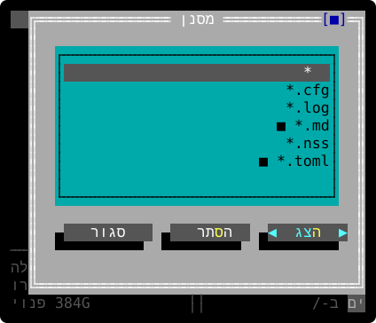

- `Space` או `Ins` מסמנים מסכה ועוברים לבאה. `+` מסמן את כולן, `-` אף אחת, ו-`*` הופך את הסימונים.
- *הצג* גורם ללוח להציג את המסכות המסומנות, או את זו שתחת הסמן כשאף אחת אינה מסומנת.
- *הסתר* גורם ללוח להשמיט אותן.
- *סגור* סוגר את התיבה. היא נשארת פתוחה אחרי *הצג* ו-*הסתר*, כדי שתוכלו להמשיך לבחור.

בחירה ב-`*` מציגה שוב את הכול.

## חיפוש קובץ

`Alt+F7`, או *קובץ > חפש*, מחפש קבצים לפי שם ולפי מה שהם מכילים.

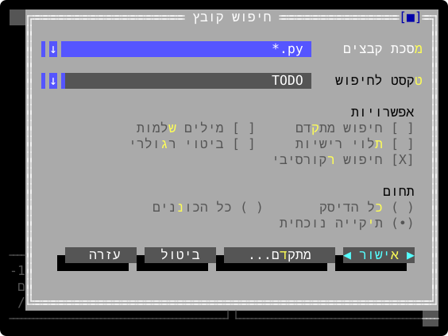

- *מסכת קבצים* היא השמות לחפש. מילה פשוטה בלי `*` ובלי נקודה מוצאת כל שם שמתחיל בה.
- *טקסט לחיפוש* מגביל את החיפוש לקבצים שמכילים את הטקסט. השאירו אותו ריק כדי לחפש לפי שם בלבד.

### אפשרויות

- *חיפוש מתקדם* מחיל גם את ההגבלות שנקבעו בכפתור *מתקדם*.
- *תלוי רישיות* מבחין בין אותיות גדולות לקטנות בטקסט.
- *חיפוש רקורסיבי* מחפש גם בתתי-התיקיות.
- *מילים שלמות* מדלג על טקסט שהוא חלק ממילה ארוכה יותר.
- *ביטוי רגולרי* קורא את הטקסט כביטוי רגולרי, שמותאם על פני שורות.

### היקף

- *כל הדיסק* מחפש בכל הדיסק שהלוח נמצא בו.
- *תיקייה נוכחית* מחפש בתיקייה של הלוח.
- *כל הכוננים* מחפש בכל הדיסקים.

### התוצאות

הקבצים שנמצאו מוצגים בלוח, שכותרתו *חיפוש:* והמסכה. אפשר להציג, לערוך, להעתיק ולמחוק אותם שם כמו כל קובץ אחר;
השורה שמתחת ללוח מציינת באיזו תיקייה נמצא כל אחד מהם. `Enter` על `..` חוזר לתיקייה שממנה חיפשתם.

### חיפוש מתקדם

הכפתור *מתקדם* קובע הגבלות שחלות כל עוד *חיפוש מתקדם* מסומן:

- *תאריך אחרי* ו-*תאריך לפני* מגבילים את הקבצים לפי מועד השינוי שלהם. תאריכים נכתבים שנה-חודש-יום, למשל
  `2026-01-31`.
- *גודל גדול מ* ו-*גודל קטן מ* מגבילים אותם לפי גודל.
- *סוג* מגביל אותם לקבצי הפעלה, קישורים סמליים, קבצים מוסתרים, קבצים לקריאה בלבד, או קישורים שבורים.

*נקה הכל* מסיר כל הגבלה.

### החלפה בקבצים

`Alt+Shift+F7` פותח את אותה תיבה עם שורה נוספת, *החלף ב*. הוא מוצא את הקבצים באותו אופן ומחליף את הטקסט בכל
אחד מהם.

## יצירת קובץ רשימה

`Alt+L`, או *לוח > יצירת קובץ רשימה*, כותב את שמות הקבצים המתויגים לקובץ טקסט.

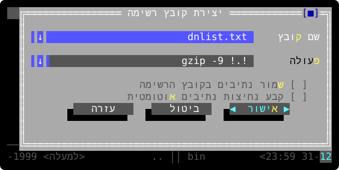

- *שם קובץ* הוא הקובץ לכתוב. אם הוא כבר קיים, תישאלו אם להחליף אותו או להוסיף לסופו.
- *פעולה*, כשהיא ממולאת, הופכת את הרשימה לסקריפט: שורה אחת לכל קובץ, ושם הקובץ משובץ בטקסט שנתתם. כמה שורות
  לכל קובץ מופרדות ב-`;`.
- *שמור נתיבים בקובץ הרשימה* כותב את הנתיב המלא של כל קובץ, ולא רק את שמו.
- *קבע נחיצות נתיבים אוטומטית* כותב נתיב רק עבור קובץ שאינו בתיקייה של קובץ הרשימה עצמו.

בפעולה, אלה מייצגים חלקים משם כל קובץ:

| כותבים | זה הופך ל |
|---|---|
| `!` | השם בלי הסיומת |
| `.!` | הסיומת, עם הנקודה שלה |
| `!\` | התיקייה של הקובץ, מסתיימת ב-`/` |
| `!/` | התיקייה של הקובץ, בלי ה-`/` שבסוף |
| `!!` | `!` |

לפעולה שאין בה אף אחד מאלה מתווסף שם הקובץ בסופה: `cp` הופך ל-`cp name`.

## סימון קבוצה

`Gray +` מתייג את הקבצים בלוח שתואמים [מסכת קבצים](#מסכות-קבצים), ו-`Gray -` מבטל את התיוג שלהם. אלה גם *סמן
קבוצה* ו-*בטל סימון קבוצה* בתפריט *לוח*.

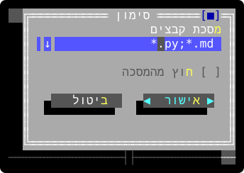

*חוץ מהמסכה* הופך את המסכה: הקבצים שהיא אינה תואמת הם שמתויגים או שהתיוג שלהם מבוטל.

## הגדרת עמודות

`Alt+K`, או *לוח > הגדרות עמודות*, בוחר מה התצוגה המפורטת מציגה לצד כל שם: *גודל*, *מאפיינים*, *קישורים*,
*בעלים* ו-*תאריך*.

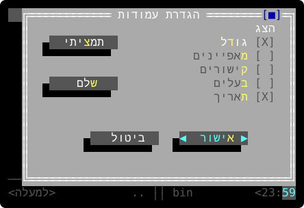

- *אישור* מציג את העמודות המסומנות.
- *תמציתי* מציג שמות בלבד.
- *שלם* מציג כל עמודה חוץ מ-*קישורים*.

העמודות שלוח חדש מתחיל איתן נמצאות בעמוד [עמודות](settings.md#עמודות) של ההגדרות.

## חיפוש כפילויות

*לוח > חיפוש כפילויות* מחפש מתחת לתיקייה של הלוח קבצים בעלי אותו תוכן ומציג אותם בלוח, כמו חיפוש.

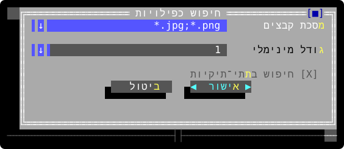

- *מסכת קבצים* בוחרת אילו קבצים מושווים.
- *גודל מינימלי* משמיט קבצים קטנים יותר.
- *חיפוש בתתי־תיקיות* מחפש גם בתיקיות שמתחת.

הקבוצות שמבזבזות הכי הרבה מקום באות ראשונות, והקבצים של קבוצה נשארים יחד בכל מיון של הלוח. שום דבר אינו
מתויג: תייגו את העותקים שאינכם רוצים ומחקו אותם ב-`F8`. המערכת מדלגת על קישורים סמליים, ושני שמות של אותו קובץ
שמקושרים בקישור קשיח אינם נחשבים כפילויות.

## פלט פקודה ללוח

`Alt+Y`, או *לוח > פלט פקודה ללוח*, מריץ פקודת מעטפת בתיקייה של הלוח ומציג את הקבצים שהיא מדפיסה, שם קובץ אחד
בשורה, כרשימה של הלוח. זה מיועד לפקודות שעונות על השאלה "אילו קבצים?":

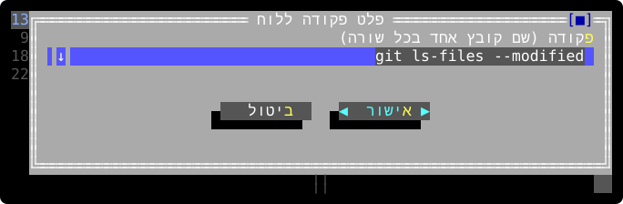

```sh
git ls-files -m
grep -l TODO *.py
```

שורת פקודה שמתחילה ב-`|` עושה אותו דבר בלי התיבה.

## היסטוריית תיקיות

`Alt+BkSp`, או *לוח > היסטוריית תיקיות*, מציג את התיקיות שהלוחות היו בהן, האחרונה ראשונה. *עבור אל* פותח את זו
שתחת הסמן בלוח הפעיל, ו-*מחק רשומה* מסיר אותה מהרשימה.

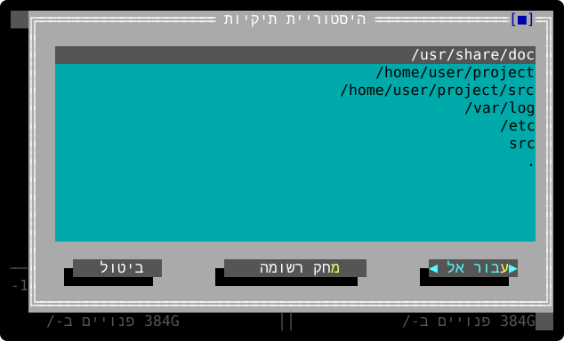

## זכירת תיקייה

*לוח > זכור עבור תיקייה זו* שומר את סדר המיון, התצוגה ומסכת הקבצים שהלוח מציג עכשיו, ומשתמש בהם בכל פעם שלוח
נמצא בתיקייה הזו. *גם עבור תיקיות המשנה שלה* מציג באותו אופן כל תיקייה שמתחתיה, אלא אם אחת מהן נזכרת בפני עצמה.

*רשימת תיקיות שמורות* מציג את התיקיות שנזכרו. `Enter` עובר לאחת מהן, ו-`Del` שוכח אותה.
