# הגדרות

*אפשרויות > הגדרות* מכיל את כל ההגדרות בחמישה-עשר עמודים. `Ctrl+PgUp` ו-`Ctrl+PgDn` מחליפים עמוד; הפריטים
שתחת *אפשרויות > תצורה* ו*אפשרויות > מנהל קבצים* פותחים את התיבה בעמוד שלהם. השהיית העכבר על אפשרות מציגה מה היא
עושה.

*אישור* מחיל את השינויים מיד וכותב אותם ל-`navigator.ini`. *ביטול* מוותר עליהם.

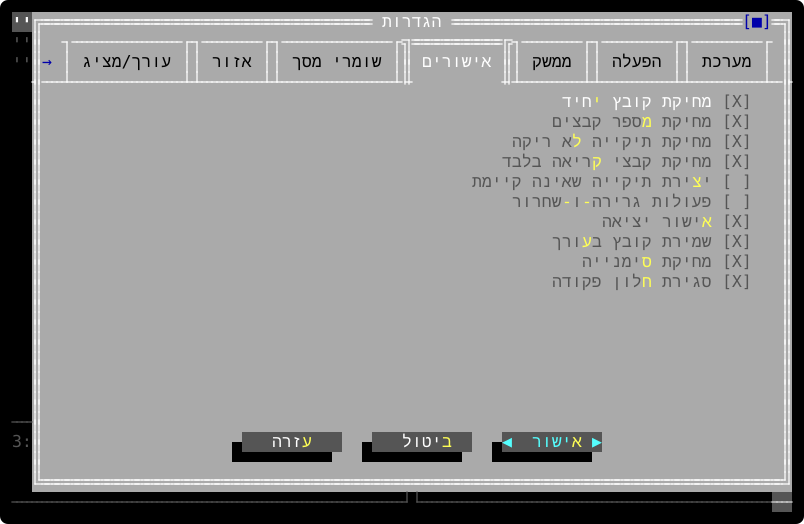

## מערכת

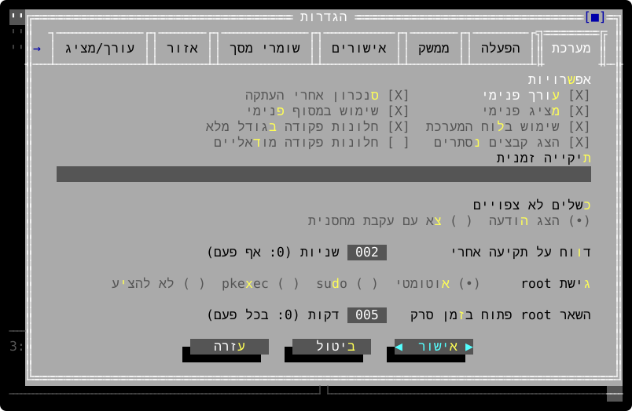

- *עורך פנימי* ו*מציג פנימי*: `F4` ו-`F3` משתמשים בעורך ובמציג של Navigator עצמו. כשהם כבויים, הם מריצים את
  התוכנה שב-`$EDITOR` וב-`$PAGER`.
- *שימוש בלוח המערכת*: העתקה ללוח הגזירים של שולחן העבודה והדבקה ממנו. כשהאפשרות כבויה, Navigator מחזיק לוח גזירים
  משלו.
- *הצג קבצים נסתרים*: לוח חדש מציג קבצים נסתרים. `Ctrl+H` מחליף זאת בלוח אחד.
- *סנכרון אחרי העתקה*: כל קובץ שהועתק נכתב עד הדיסק לפני שהוא נחשב גמור.
- *שימוש במסוף פנימי*: `Ctrl+O` מציג את המסוף בתוך Navigator. כשהאפשרות כבויה, הוא מוסר את כל המסוף למעטפת.
- *חלונות פקודה בגודל מלא* ו*חלונות פקודה מודאליים*: איך נפתחת פקודה שרצה בחלון משלה.
- *תיקייה זמנית*: לאן הולכים קבצים זמניים. ריק פירושו `$TMPDIR`.
- *כשלים לא צפויים*: שגיאה לא צפויה מציגה הודעה עם הפרטים שלה, או יוצאת מ-Navigator ומדפיסה אותם.
- *דווח על תקיעה אחרי*: כמה שניות Navigator רשאי להפסיק להגיב לפני שהסיבה נכתבת ל-`errors.log`.
- *גישת root*: איך אפשר לבצע שוב כ-root צעד שנדחה מחוסר הרשאה: דרך `sudo`, דרך `pkexec`, או אף פעם.
- *השאר root פתוח בזמן סרק*: כמה דקות גישת root נשארת פתוחה אחרי השימוש האחרון בה. ראו
  [עבודה כ-root](as-root.md).

## הפעלה

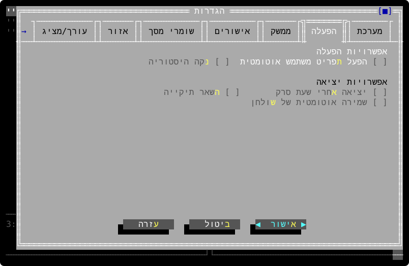

- *הפעל תפריט משתמש אוטומטית*: תפריט המשתמש (`F2`) נפתח כש-Navigator מתחיל.
- *נקה היסטוריה*: רשומות היסטוריה שאינן מוצמדות מוסרות בכל הפעלה.
- *יציאה אחרי שעת סרק*: Navigator יוצא אחרי שעה בלי מקש או לחיצה.
- *שמירה אוטומטית של שולחן*: החלונות נשמרים כשיוצאים ומוחזרים בהפעלה הבאה.
- *השאר תיקייה*: הלוח הפעיל שומר על התיקייה שלו אחרי פקודה, ובשולחן עבודה משוחזר.

## ממשק

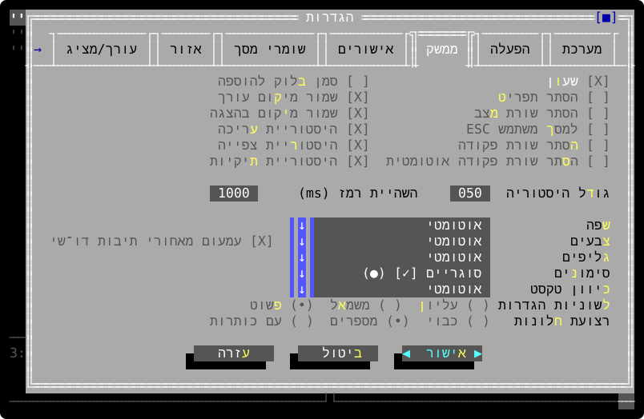

- *שעון*, *הסתר תפריט*, *הסתר שורת מצב*: השעון בשורת התפריטים, שורת התפריטים עצמה עד `F10`, ושורת המקשים בשורה
  התחתונה.
- *ESC למסך משתמש*: `Esc` בשורת פקודה ריקה מציג את המסוף עד המקש הבא.
- *הסתר שורת פקודה* ו*הסתר שורת פקודה אוטומטית*: הסתרת שורת הפקודה תמיד, או כל עוד היא ריקה.
- *סמן בלוק להוספה*: סמן בצורת בלוק בשורת הפקודה.
- *שמור מיקום עורך* ו*שמור מיקום בהצגה*: קובץ נפתח שוב בחלון, ובמקום, שבו הושאר.
- *היסטוריית עריכה*, *היסטוריית צפייה*, *היסטוריית תיקיות*: שמירת הרשימות ש-`Alt+PgUp`, ‏`Alt+PgDn`
  ו-`Alt+Backspace` מציגים.
- *גודל היסטוריה*: כמה רשומות שומרת כל רשימת היסטוריה.
- *השהיית רמז (ms)*: כמה זמן העכבר צריך לנוח לפני שרמז מופיע; 0 לביטול.
- *שפה*: השפה של הכיתובים וההודעות.
- *צבעים*: כמה צבעים לשלוח למסוף.
- *גליפים*: אילו תווים מניחים שיש בגופן של המסוף: ASCII פשוט, Unicode, או הסמלים של Nerd Font.
- *עמעום מאחורי דו־שיח*: מה שמאחורי תיבת דו-שיח מצויר דהוי.
- *סימונים*: איך מצוירים תיבות סימון וכפתורי רדיו.
- *כיוון טקסט*: משמאל לימין, מימין לשמאל, או כפי שהשפה נקראת.
- *לשוניות הגדרות*: היכן התיבה הזו מציגה את הלשוניות שלה.
- *רצועת חלונות*: האם החלונות הפתוחים מוצגים בשורת התפריטים, לפי מספר או עם הכותרות שלהם.

## אישורים

כל תיבה גורמת ל-Navigator לשאול לפני הפעולה: מחיקת קובץ אחד, מחיקת כמה, מחיקת תיקייה שאינה ריקה, מחיקת קבצים לקריאה
בלבד, יצירת תיקייה שהעתקה נוקבת בשמה, גרירה ושחרור, יציאה, שמירה בעורך, מחיקת סימנייה, וסגירת חלון פקודה שהפקודה
שלו עדיין רצה.

## שומרי מסך

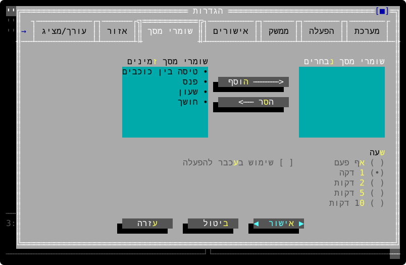

שומר מסך משתלט על המסך אחרי זמן בלי מקש או לחיצה.

- *שומרי מסך נבחרים* מתחלפים בתורם. *הוסף* מעביר אחד מתוך *שומרי מסך זמינים*, ו*הסר* מוציא אותו.
- *שעה* היא כמה זמן לחכות, או *אף פעם*.
- *שימוש בעכבר להפעלה*: הזזת המצביע לפינה הימנית העליונה מפעילה שומר מסך מיד; כל עוד הוא בפינה הימנית התחתונה, אף
  אחד לא מתחיל.

## אזור

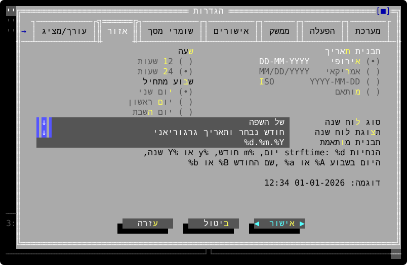

- *תבנית תאריך*: הסדר שבו נכתבים תאריכים, או *מותאם* עם התבנית שנכתבת במלואה בשורה *תבנית מותאמת*.
- *שעה*: שעון של 12 שעות או של 24 שעות.
- *שבוע מתחיל*: היום הראשון בשבוע בלוחות שנה.
- *סוג לוח שנה* ו*תצוגת לוח שנה*: איזה לוח שנה מציג חלון לוח השנה, והאם הוא עומד לצד הלוח הגרגוריאני.

*דוגמה* מציגה תאריך ושעה שנכתבו כפי שנבחר.

## עורך/מציג

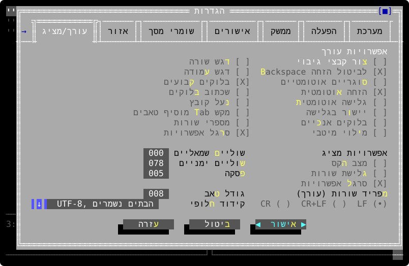

עם מה מתחיל חלון עורך או מציג חדש. את רוב האפשרויות של העורך אפשר להחליף לחלון אחד מתפריט *אפשרויות* שלו.

אפשרויות עורך:

- *צור קבצי גיבוי*: שמירה עם `F2` שומרת את הקובץ הישן בשם `NAME.bak`.
- *Backspace לביטול הזחה*: `Backspace` ברווחים שבתחילת השורה חוזר להזחה של שורה שמעל.
- *סוגריים אוטומטיים*: הקלדת `(`, `{` או `[` מקלידה גם את בן הזוג שלו.
- *הזחה אוטומטית*: `Enter` מזיח את השורה החדשה כמו את זו שמעליה.
- *גלישה אוטומטית* ו*יישור בגלישה*: שורה שמוקלדת מעבר לשוליים הימניים נגלשת, והשורה שנשארה מאחור מורחבת עד
  השוליים.
- *בלוקים אנכיים*: בלוקים מסומנים כעמודות.
- *מילוי מיטבי*: רווחים שמגיעים לעצירת טאב נכתבים כטאב.
- *דגש שורה* ו*דגש עמודה*: השורה והעמודה של הסמן מודגשות.
- *בלוקים קבועים*: הבלוק נשאר מסומן כשהסמן זז. *שכתוב בלוקים*, כשזו כבויה: הקלדה והדבקה מחליפות את הבלוק.
- *נעל קובץ*: העורך מחזיק נעילה על הקובץ שלו שתוכנות אחרות יכולות לראות.
- *מקש Tab מוסיף טאבים*: `Tab` מוסיף תו טאב, לא רווחים.
- *מספרי שורות*: השורות ממוספרות לאורך הצד השמאלי.
- *סרגל אפשרויות*: המסגרת התחתונה מציגה את האפשרויות של החלון, ולחיצה מחליפה אחת מהן.

אפשרויות מציג: *מצב הקס* פותח קבצים בהקס, *גלישת שורות* גולש שורות ארוכות, ו*סרגל אפשרויות* כמו של העורך.

- *שוליים שמאליים*, *שוליים ימניים*, *פסקה*: השוליים ל[עיצוב פסקאות](editor.md#שוליים).
- *גודל טאב*: הרוחב של טאב.
- *מפריד שורות (עורך)*: סוף השורה שניתן לקובץ חדש.
- *קידוד חלופי*: כיצד העורך קורא קובץ שאינו UTF-8.

## סוגי מציג

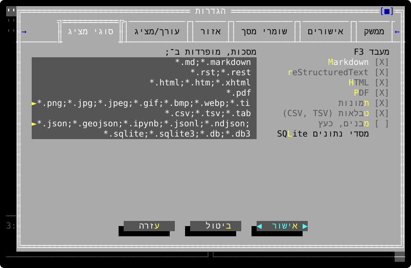

אילו קבצים `F3` מציג כמשהו אחר מהטקסט שלהם: Markdown, ‏reStructuredText ו-HTML כעמוד, PDF כטקסט שלו, תמונות
כתמונות, CSV ו-TSV כטבלה, וקבצים מובנים (JSON, ‏YAML, ‏TOML, ‏XML) כעץ. לכל אחד יש תיבה להפעלתו ושורה של
[מסכות קבצים](panels.md#מסכות-קבצים) שאומרת על אילו קבצים הוא חל. *מסדי נתונים SQLite* היא המסכה של קבצים שייפתחו
כמסד נתונים.

## פאנלי קבצים

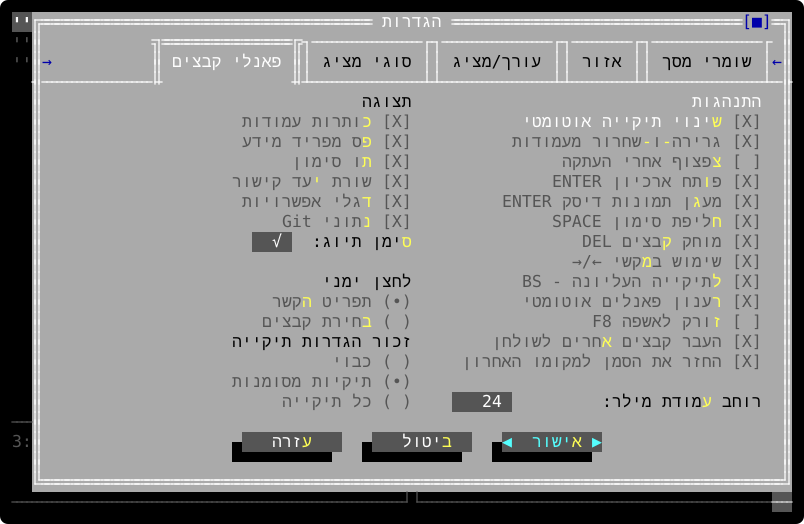

התנהגות:

- *שינוי תיקייה אוטומטי*: הלוח עוקב אחר הסמן בעץ שלידו.
- *גרירה-ו-שחרור מעמודות*: אפשר לגרור קבצים אל מחוץ ללוח בעזרת העכבר.
- *צפצוף אחרי העתקה*: הפעמון של המסוף מצלצל כשהעתקה מסתיימת.
- *ENTER פותח ארכיון*: `Enter` על ארכיון נכנס לתוכו כמו לתיקייה.
- *ENTER מעגן תמונות דיסק*: `Enter` על קובץ `.iso` או `.img` מעגן אותו ופותח אותו.
- *SPACE חליפת סימון*, *DEL מוחק קבצים*, *BS - לתיקייה העליונה*: המקשים האלה פועלים על הלוח כל עוד שורת הפקודה
  ריקה.
- *שימוש במקשי ←/→*: החצים, `Home` ו-`End` עורכים שורת פקודה שיש בה טקסט. כשהאפשרות כבויה, הם עושים זאת עם
  `Shift`.
- *רענון פאנלים אוטומטי*: לוח קורא שוב את התיקייה שלו כשהיא משתנה בדיסק.
- *F8 זורק לאשפה*: `F8` מעביר קבצים לאשפה במקום למחוק אותם.
- *העבר קבצים אחרים לשולחן*: `Enter` על קובץ שלא הוגדרה עבורו תוכנה פותח אותו ביישום של שולחן העבודה.
- *החזר את הסמן למקומו האחרון*: חזרה לתיקייה מציבה את הסמן היכן שהושאר.
- *רוחב עמודת מילר*: הרוחב של עמודה בתצוגת מילר.

תצוגה:

- *כותרות עמודות*: שורת כותרת מעל העמודות.
- *פס מפריד מידע*: קו מעל הסיכומים שמתחת לרשימה.
- *תו סימון* ו*סימן תיוג*: קובץ מתויג מסומן בסימן, ואיזה סימן.
- *שורת יעד קישור*: שורה מתחת ללוח מציגה לאן מצביע קישור סמלי.
- *דגלי אפשרויות*: המסגרת התחתונה מציגה את האפשרויות של הלוח, ולחיצה מחליפה אחת מהן.
- *נתוני Git*: בעץ עבודה של git, המצב של כל קובץ, והענף בכותרת.

*לחצן ימני* בוחר מה עושה לחצן העכבר הימני בלוח: פתיחת תפריט ההקשר, או תיוג קבצים. *זכור הגדרות תיקייה* בוחר אילו
תיקיות שומרות על סדר המיון, התצוגה, העמודות ומסכת הקבצים שלהן.

## פאנל מידע

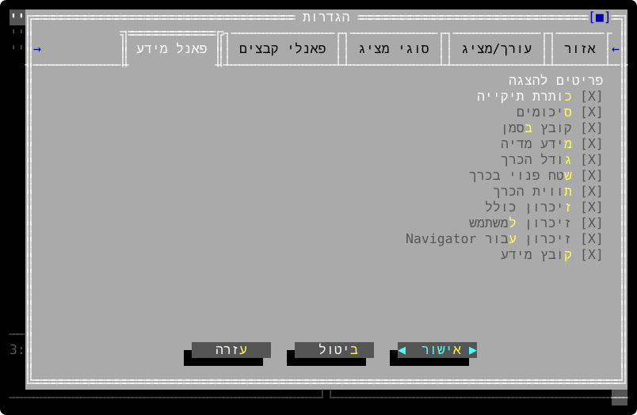

אילו שורות מציג לוח המידע (`Ctrl+L`): שם התיקייה, הסיכומים שלה, הקובץ שתחת הסמן, פרטי מדיה, גודל אמצעי האחסון,
המקום הפנוי והתווית שלו, הזיכרון של המחשב, וקובץ המידע של התיקייה.

## ברירות מחדל לפאנל

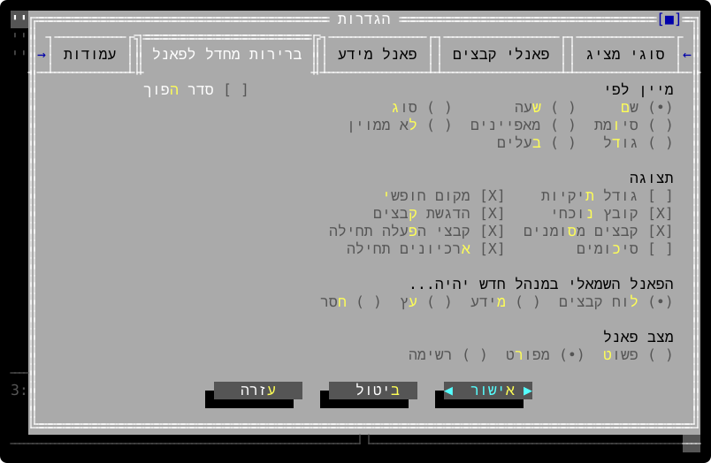

איך מתחילים הלוחות של מנהל קבצים חדש.

- *מיין לפי* ו*סדר הפוך*: הסדר שבו הקבצים מוצגים.
- *גודל תיקיות*: הגודל של כל תיקייה נספר ומוצג.
- *קובץ נוכחי*, *קבצים מסומנים*, *סיכומים*, *מקום חופשי*: השורות שמתחת לרשימה.
- *הדגשת קבצים*: הקבצים נצבעים לפי הסוג שלהם.
- *קבצי הפעלה תחילה* ו*ארכיונים תחילה*: הקבצים האלה מוצגים לפני האחרים.
- *הפאנל השמאלי במנהל חדש יהיה*: לוח קבצים, לוח המידע, עץ, או כלום.
- *מצב פאנל*: התצוגה הפשוטה, המפורטת או תצוגת הרשימה.

## עמודות

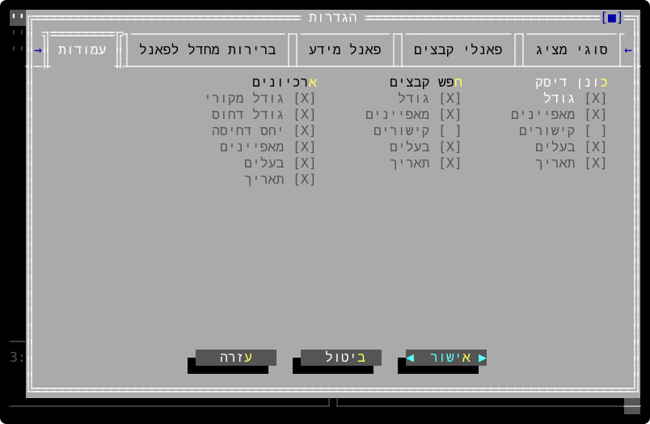

אילו עמודות לוח מציג בתצוגה המפורטת שלו, בנפרד לשלושה סוגי רשימות. `Alt+K` משנה אותן ללוח אחד; ראו
[הגדרת עמודות](panels.md#הגדרת-עמודות).

- *כונן דיסק*: תיקייה בדיסק או בשרת. העמודות הן *גודל*, *מאפיינים*, *קישורים* (כמה שמות יש לקובץ), *בעלים*
  ו*תאריך*.
- *חפש קבצים*: הרשימה שבה [חיפוש קובץ](panels.md#חיפוש-קובץ) ממלא לוח. אותן עמודות.
- *ארכיונים*: בתוך ארכיון. *גודל מקורי*, *גודל דחוס*, *יחס דחיסה* (כמה הוא נדחס), *מאפיינים*, *בעלים* ו*תאריך*.

## הדגשה

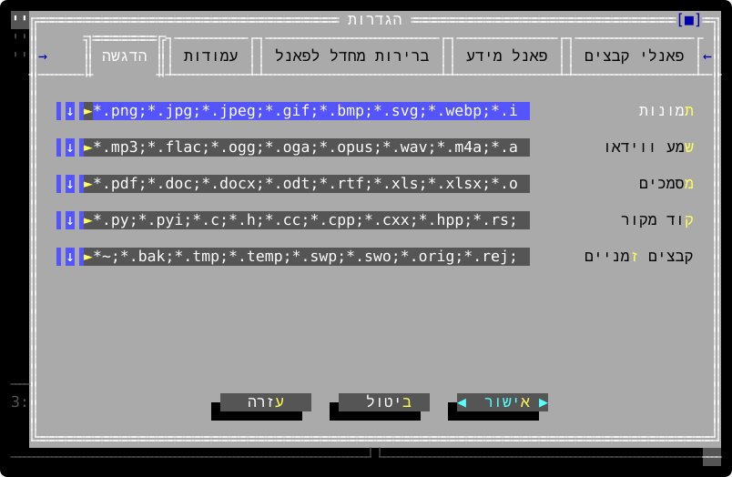

[מסכות הקבצים](panels.md#מסכות-קבצים) של חמש הקבוצות שהלוחות צובעים: *תמונות*, *שמע ווידאו*, *מסמכים*, *קוד מקור*
ו*קבצים זמניים*. קובץ שתואם את המסכה של קבוצה מוצג בצבע של הקבוצה כל עוד *הדגשת קבצים* מסומן עבור הלוח. הצבעים
עצמם שייכים לערכת הנושא, ומשנים אותם תחת *אפשרויות > צבעים* ([צבעים](customizing.md#צבעים)).

הקבוצות האלה צובעות שמות בלוחות; אילו צבעים מקבל הטקסט שבתוך קובץ במציג ובעורך נקבע ב-`highlight.ini`
([הדגשת תחביר](editor.md#הדגשת-תחביר)).

## תקשורת

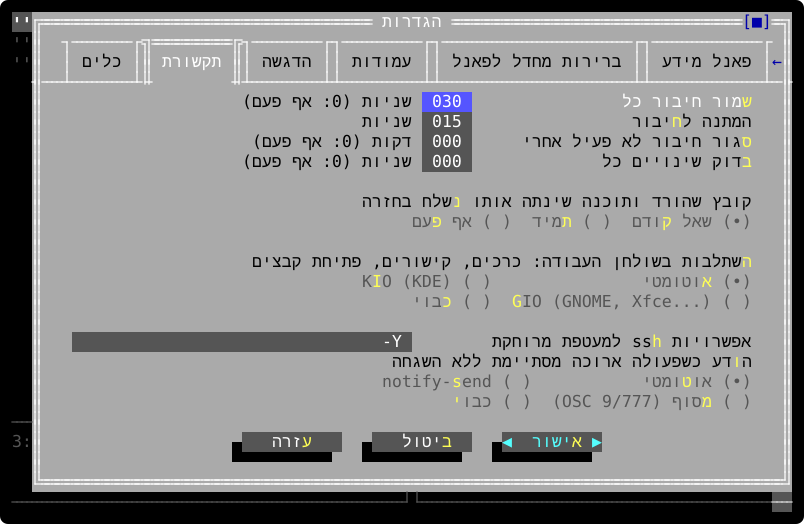

- *שמור חיבור כל*: באיזו תדירות נשלחת הודעה כדי להשאיר חיבור לשרת פתוח.
- *המתנה לחיבור*: כמה זמן לחכות לתשובה משרת.
- *סגור חיבור לא פעיל אחרי*: כמה זמן חיבור שאינו בשימוש נשאר פתוח.
- *בדוק שינויים כל*: באיזו תדירות נבדקת תיקייה בשרת לשינויים.
- *קובץ שהורד ותוכנה שינתה אותו נשלח בחזרה*: האם קובץ כזה מועלה שוב: אחרי שאלה, תמיד, או אף פעם.
- *שילוב עם שולחן העבודה*: השירותים של איזה שולחן עבודה משמשים לאמצעי אחסון, לקישורים ולפתיחת קבצים.
- *אפשרויות ssh למעטפת מרוחקת*: מילים שמתווספות לפקודת `ssh` של כל מעטפת מרוחקת.
- *הודע כשפעולה ארוכה מסתיימת ללא השגחה*: איך מודיעים לשולחן העבודה שפעולה ארוכה הסתיימה בזמן שהמסוף היה ברקע.

## כלים

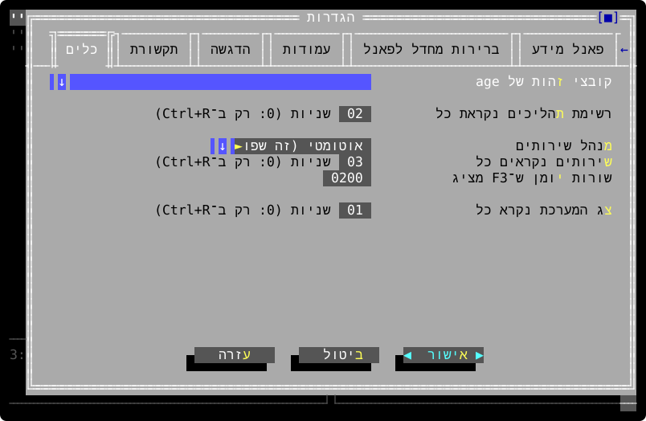

- *קובצי זהות של age*: קובצי המפתח ש-`age` מפענח בעזרתם.
- *רשימת תהליכים נקראת כל*, *שירותים נקראים כל*, *צג המערכת נקרא כל*: באיזו תדירות החלונות האלה מתרעננים.
- *מנהל שירותים*: עם איזה מנהל שירותים מדבר חלון השירותים.
- *שורות יומן ש־F3 מציג*: כמה מהיומן של שירות `F3` פותח.
