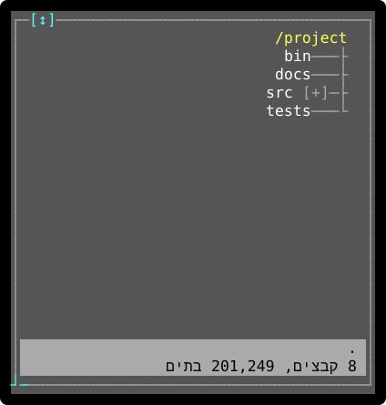
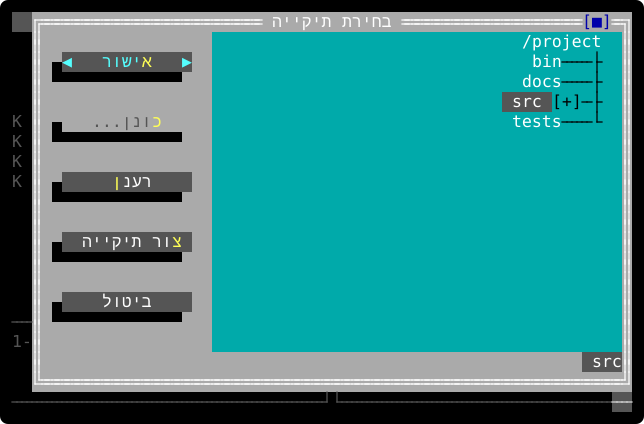
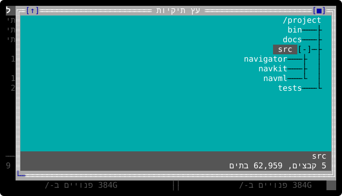
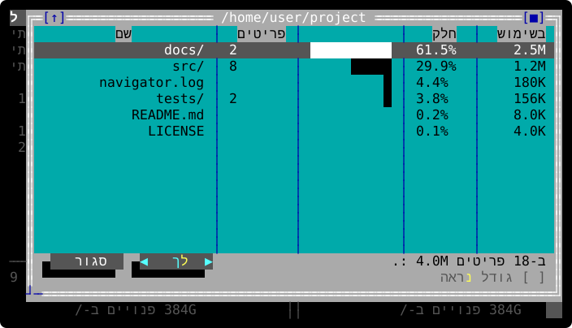

# עצי תיקיות

עץ מציג תיקיות, ומתחת לכל אחת, בהזחה, את התיקיות שבתוכה.

| מקש | מה הוא עושה |
|---|---|
| `Up`, `Down` | הזזת הסמן |
| `Right` | פתיחת התיקייה וכניסה אליה |
| `Left` | מעבר לתיקייה שהיא נמצאת בה |
| `+`, `-` או `Space` | פתיחת התיקייה או סגירתה |
| `*` | פתיחת כל התיקיות |
| `Enter` | בחירת התיקייה |
| `Ctrl+S` | חיפוש: הקלידו את תחילת השם; `/` ממשיך בתוך התיקייה שנמצאה |

עץ מציג תיקיות מוסתרות כשהלוח מציג אותן (`Ctrl+H`).

## העץ שליד לוח

`Ctrl+T` מציב עץ במקום הלוח שאינו פעיל. הוא עוקב אחרי הלוח הפעיל, והלוח עוקב אחריו: כשהסמן נח על תיקייה בעץ,
התיקייה הזו מוצגת בלוח. כש-*שינוי תיקייה אוטומטי* אינו מסומן בעמוד [פאנלי קבצים](settings.md#פאנלי-קבצים) של
ההגדרות, רק `Enter` עושה זאת.

## החלפת תיקייה

`Alt+T` פותח עץ בתיבה, שממנה בוחרים את התיקייה של הלוח הפעיל. *צור תיקייה* יוצר תיקייה מתחת לסמן, ו-*רענן*
קורא את העץ מחדש.

## חלון העץ

*דיסק > עץ תיקיות* פותח את העץ בחלון משלו על שולחן העבודה, שנשאר פתוח בזמן שאתם עובדים במקום אחר. `Enter` על
תיקייה שולח לשם את הלוח הפעיל של מנהל הקבצים הפעיל. לחלון יש תפריט *עץ* משלו, עם *רענן* (`Ctrl+R`), *חיפוש
מהיר* (`Ctrl+S`) ו-*סגור*; גם `Esc` סוגר אותו.

## גדלי תיקיות

*דיסק > גדלי תיקיות* מודד את התיקייה של הלוח הפעיל ומציג את מה שבתוכה לפי גודל, כדי שתראו מה תופס את המקום.

| מקש | מה הוא עושה |
|---|---|
| `Enter`, `Right` | כניסה לתיקייה |
| `Backspace`, `Left` | יציאה חזרה |
| `Ctrl+N`, `Ctrl+S`, `Ctrl+E` | מיון לפי שם, גודל, מספר פריטים; לחיצה נוספת הופכת את הסדר |
| `Ctrl+A` | החלפה בין גודל התוכן לבין המקום שהוא תופס בדיסק |
| `F8`, `Del` | מחיקה, כמו בלוח |
| `Ctrl+R` | מדידה מחדש |
